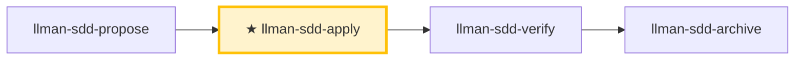

# LLMAN SDD Apply

按顺序在一轮内完成 `llmanspec/changes/<id>/tasks.md` 的所有任务：实现 → 补测试/验收 → 跑门禁 → 失败自修复重跑 → 全过后报告。除非明确 blocker，不得中途问“要不得继续”**。

## Pipeline 位置

## Git 分支生命周期（摘要）

**Skill 导航** ≠ **分支生命周期**。全图见根 `AGENTS.md` 或 `llman-sdd-propose` 内嵌图。

硬规则：
1. **先**绑定分支（`change start` / `attach`）→ full；**再**提交 specs（绑定分支上编辑并 commit `llmanspec/specs/**`）。
2. 无合约编辑 → `needs_specs_change: false`。`stage=full` 且 specs-landed 门通过即可进 apply；`readyToImplement=true`（全门绿）是 verify/finalize 前的完成信号。
3. 收口用 `change finalize`（自动提交 `archive(sdd): <id>`；`--no-commit` 跳过）。
4. **不得**在默认分支 commit specs；已 attach 不得重复 `start`。
5. worktree（可选）：`change start --worktree` 在独立 worktree 建分支、不动当前检出（`--base <branch>` 仅本地分支）记录分叉源；attach 缺省按运行时信号推导分叉源、偏离默认分支时输出 WARNING；finalize 目标即绑定分支时跳过合并就地收口，目标被其他 worktree 持有时自动在该 worktree 内执行（输出标注位置）。



> 📍 进入前须 specs-landed 门通过（或 `needs_specs_change: false`）；`readyToImplement=true`（全门绿）是本轮的完成信号 → 下一步 `llman-sdd-verify`。

## 硬约束

- **唯一事实来源驱动**：`proposal.md` / `design.md` / `tasks.md` 与分支上的 `llmanspec/specs/**`；specs 的行为合约条款逐条落实。
- **范围锁定**：只做当前 change 范围，不得顺手修无关问题；改动保持最小。
- **管辖范围**：SDD 流程（change 分支、proposal、specs 编辑门）只约束行为合约面——`llmanspec/**` 及其产物对齐（如 `.agents/skills` 渲染新鲜度）。仓库其余文件（构建脚本、CI、一般文档、测试实现）按项目常规工程流程直改直提交，不经 change 包装；改动触及行为合约语义时，回到对应 skill 流程。
- **不得猜测**：需求不明或 specs 与现实矛盾 → STOP 报告，不自行假定。
- **不留旧兼容层**：change 要求改行为就全量升级到新写法，除非 tasks/proposal 明确要兼容。
- **收尾**：该轮以宜接 `llman-sdd-verify` 收束；finalize/archive 归 `llman-sdd-archive`（不得在自修复循环里 finalize）。

## Commit 策略

- **change 分支上提交自由**（`change finalize` 不得求干净树）：按 task/里程碑分段提交，或留脏交给 finalize 一次收尾——均为一等公民。
- **默认收尾**：全部 task 过门禁且 verify 全绿后，`llman-sdd change finalize <id>` 自动提交 `archive(sdd): <change-id>`（未提交 diff + frontmatter + 改名一笔）。不得在 apply 循环内 finalize。`--no-commit` 跳过自动提交（手动/CI 历史、pre-commit hook 冲突）。
- **blocker 中断**：因 blocker STOP 前先做**一次** WIP commit（如 `wip(sdd): <change-id> <摘要>`）保全现场再报告。

## 步骤

### 0) Preflight（必须）
- 读取并遵守 `llmanspec/config.yaml`、`AGENTS.md`（若存在）。
- `git status --porcelain`：工作区不干净且改动不属于本 change → 先 `git stash push -u -m "llman-sdd-apply autopilot backup"`。
- `llman-sdd validate --all --strict`：失败且与本 change 无关 → 停下报告（工件不一致则无法以事实来源驱动实现）。
- **specs 清单可读**：`llman-sdd list --specs` 返回清单且无错误；异常 → 停下报告。

### 1) 选定 change id 并查前置
- 已提供则直接用；否则从上下文推断，不明确就跑 `llman-sdd list --json` 让用户选。始终说明“使用变更：<id>”并告知如何覆盖。
- 确认在经 `llman-sdd change start <id>` 或 `change attach <id>` 绑定的非默认分支上（仅重绑用 `--force`）。分支上的 specs 即唯一事实来源——不得在 `changes/<id>/specs/` 下编写。
## 阶段守卫（`stage` / `readyToImplement`）

阶段必须以权威 JSON 判定，不得凭工件表面推断：

```bash
llman-sdd show <id> --output json --type change
```

读字段：`stage`、`specsLanded`、`needsSpecsChange`、`readyToImplement`、`gateChecks`（逐项 `pass` + 未过时的 `hint`）。

| 状态 | 动作 |
|------|------|
| `stage=draft`（仅 proposal.md） | STOP。补 design.md → designed，补 tasks.md → planned，再绑定分支、在绑定分支提交 specs。draft 不能 apply/verify。若已有 proposal+tasks 而仍是 `draft`（缺 design.md——它是 stage 门槛）：先补 design.md。不得建 `changes/<id>/specs/`，不得在默认分支改 specs。 |
| `stage=designed`（proposal + design） | 补 tasks.md → `planned`；规划文档齐全后再 `change start` / `attach`（绑定分支）。 |
| `stage=planned`（proposal + design + tasks） | STOP 直到绑定：`change start` / `attach` → `full`。 |
| `stage=full` 且 `readyToImplement=false` | 读未过的 `gateChecks` 分项。specs-landed 门未过 → 在**绑定分支**提交 specs（编辑 `llmanspec/specs/**` 并 commit），或设 `needs_specs_change: false`；不得重跑 `change start`（绑定分支上的 specs 丢失 → checkout/重建 + 绑定分支偏离时 `attach --force`）。specs-landed 门已绿而 tasks-done/validate/clean-tree 未过 → 实施中期的正常状态：继续 apply 勾 tasks，不得当作 specs 未提交。 |
| `readyToImplement=true` | 完成信号：gateChecks 全绿（tasks 全勾 + validate 通过）——verify/finalize 前置已满足。`changes/<id>/specs/` 预期**不存在**，不得当作缺失。 |
- 用 `llman-sdd context --task "<proposal 目标>" --paths "<specs scope>"` 获取匹配 `<paths>` 的 specs。
  - context 不可用 → 先 `llman-sdd index check`：stale/缺失则 `llman-sdd index rebuild` 后重试；fresh 仍不可用（`LLMAN_SDD_INDEX_CHAT_MODEL` 未设）→ 改用 `llman-sdd list --specs` + 直读 `.feature`——勿循环 rebuild。

### 2) 通读事实来源工件
- `llmanspec/changes/<id>/proposal.md`、`design.md`（如有）、`tasks.md`
- 分支上的 `llmanspec/specs/**`（`<capability>.feature`）

把 proposal/design 的决策整理为不可违反的硬约束清单；把 tasks.md 转成最小可执行步骤序列（保持原顺序）。

### 3) 展示状态
- 进度“N/M tasks complete”+ 接下来 1–3 个未完成任务的简短概览。

### 4) 逐任务实施（循环）
对每个未完成 task：
1. **实现**：严格按 task 描述 + specs 要求，改动最小。
2. **完成后立刻勾 checkbox**：`- [ ]` → `- [x]`。**收口不是 task**：`change finalize` / `change archive` 是流水线步骤，不得 出现在 tasks.md——若已列（如“收口——finalize”），删掉（收口的任务门要求全部任务已勾）。
3. **编辑与验证串行**：验证 必须 在编辑落盘后执行；不得 把编辑与测试/校验放进同一批并行工具调用（可能读到旧文件，产生假失败/假通过）。
4. task 不明、遇 blocker、或 specs/design 与现实不一致 → STOP 报告，不自行假定。

### 5) 验证与自修复循环（每个 task 或每批 task 后跑一次）
- 测试与静态门禁：执行本仓已声明的验证手段——以仓库文档与配置记载为准；已配置 `specs.check_command` 的项目，以 `llman-sdd config` 读得的命令为准。仓库未声明时，询问用户；不假定任何具体任务工具存在。
- 分支上按需编辑 `llmanspec/specs/<capability>.feature`（扁平或目录主文件；统一原生分层：`@req:<id>` 挂 `规则:` 块头、嵌套 `场景:` 为可执行示例），spec 改动后跑 `llman-sdd validate --specs`；分支上可自由提交。
- SDD 校验：`llman-sdd validate <id> --strict`

**验证阶梯（opt-in 纪律，按成本逐级扩大）**：
- L1 最小单元：已声明验证手段中能直接加载被改模块的最快一层，仅覆盖当前改动点。
- L2 定向行为：定向执行已声明验证手段中匹配当前场景的子集（已配置 `specs.check_command` 时优先），只复现目标行为。
- L3 显式全量：`llman-sdd validate --check`（配置 `specs.check_command` 时执行全量 harness；缺省 validate 不再执行 harness）。
- L4 收口兜底：`change finalize` 预合并强制真实 harness——每次收口至少 1 次全量。
- 自修复循环默认用 L1/L2 快速复现；只有需要全量验收时才 L3；避免无谓白付全量成本。

**门禁证据**：
- 缺省 `validate` 只做结构/状态门，不声明 harness 证据；harness 证据 必须 经显式 `--check` 或收口验收取得。
- 门禁结论 必须 来自真实 harness：声称 harness 合格时 必须 已用 `--check`（或收口）；缺省结构门的通过不是通过；harness 失败 必须 先查根因（环境变量泄漏、嵌套调用守卫、工作目录错误等），不得 以“固有/自指属性”定性后绕过。
- 前后对比类判据（计数、基线）必须 在 change 分支上测量（相对现算 merge-base）；默认分支测得的值通常恒为基线，不构成证据。
- 重构或批量替换类 task：必须 对比改动前后测试用例数；门禁全绿但用例数下降视为失败。

**失败 → 自修复（不得问要不得继续）：**
1. 解析失败原因（测试 / lint / 格式 / 校验）。
2. 判定是否难定位 bug（原因不明 / 间歇 flake / 回归看不穿）：
   - **不是**（明确的 lint/格式/编译/校验错误）：最小修复（不扩范围），先重跑最小失败复现命令，再重跑全部门禁。
   - **是 → 升级诊断子流程**：
     1. **先建一个能复现失败的命令**（快、确定、agent 可跑、能在此 bug 上变红）——驱动真实 bug 路径并断言用户症状。**不得 在没有它之前猜原因**（盯着代码空想正是要防止的失败）。
     2. 运行确认变红 → 最小化复现（逐个剔除输入/调用/配置/数据，只留可复现的最小输入与调用）。
     3. 生成 **3–5 个排序假设**，每个可证伪（“若 X 是因，改 Y 会让 bug 消失”）。
     4. 单变量验证（一次只改一个），找到根因后修复。
     5. 没有合适 seam 写回归测试时，记录该架构缺口（交 `llman-sdd-arch-review`；未启用时写入本 change 的 `proposal.md` Further Notes 段或 `design.md`，不得 因此中断循环）。
3. 先重跑最小失败复现命令，再重跑全部门禁。
4. 记为一轮自修复：`Round N：失败点 → 修复 → 重跑 → 通过/失败`。

**自修复上限 8 轮**；超过仍不过视为 blocker：停止并输出 blocker 报告（最后一次失败命令与输出摘要、已尝试的修复）。

**人审关卡（每批 task 门禁通过后）**：进入下一批次或输出完成报告前跑 `llman-sdd review`：退出码零 → 继续；非零 = CRITICAL → STOP 修复后重跑；不得 带 CRITICAL 进入下一批次或输出完成报告。

### 6) 完成报告
所有 task 完成 + 全部门禁通过后输出结构化报告（见 Output Contract），然后宜跑 `llman-sdd-verify`。

> 命令细节用 `llman-sdd <cmd> --help` 查看；命令参考以 CLI 为准，skill 不内嵌命令表。
> 文中“规约”= 本项目 `llmanspec/specs/` 下的 `.feature` 文件；用 `llman-sdd list --specs` / `llman-sdd show <capability>` 查全文。

## 版本漂移提示（`[NOTE] ... scaffolded with llman-sdd X; installed CLI is Y`）

见到该 stderr 提示时：向用户**转述**此提示并宜跑 `llman-sdd init --update`（刷新 managed blocks 与 skills 至当前 CLI 版本）；更新完成前**继续按现有 skill 执行**，不因版本差异中断流程。每进程至多提示一次，属参考信息而非错误。

校验修复（单轨 feature-as-spec）：

1）缺 `# purpose:` 头注释：每个 capability `.feature` 必须含非空 `# purpose:`；`功能:` 标题必须等于 discover 分配后的 spec id（`llman-sdd list --specs` 查看 id）。
```
# language: zh-CN
# purpose: 一句话概述

功能: <spec-id>
```

2）原生分层格式（`rule must carry an @req:<req_id> tag on the rule header`）：
- 规范样式只有一种：`@req:<id>` 挂在 `规则:` 块头标签,块内嵌套 `场景:`(假如/当/那么)是可执行示例——默认首选。
- 仅当需求无法程序化表达或暂不转写时才保留无嵌套场景的 `规则:`(裸规则):描述自由文本,不强制情态词;validate 以聚合计数提示,review `pending` 信号计量,specs-compact 负责压降。
- 历史标签 `@executable`/`@rule`/`@human`/`@manual` 不再使用、解析惰性;旧文件报结构问题时运行 `llman-sdd spec migrate-native` 迁移。
- 不在任何 `规则:` 内的顶层 `场景:` 是功能级示例:无规则句柄、不告警、不参与规则统计(Gherkin 原生语义)。

分支护栏：
- 先 `change start` / `attach` 绑定分支，再在绑定的非默认分支编辑 `.feature` 并 commit（提交 specs）。
- 锁定规则（报告制）：改/删既有 `规则:` 块只出 WARNING，不阻断 validate / finalize / `change diff`；报告按 `@req:<id>` 指明被改规则。控制点：git 分支对比 + `llman-sdd review` / `change diff`。旧锁定确认元数据（frontmatter `rules_touched` / `agent_acked`、`@agent` tag、`--yes` 确认语义）已全部删除，无别名无兼容层。
- `stage=full` 且 specs-landed 门通过（specsLanded ∨ `needs_specs_change: false`）即可进 apply；verify/finalize 须 `readyToImplement=true`（完成信号）。收口优先 `change finalize`。

## Context
- 先查状态再动手：change/spec 状态以 `llman-sdd show/list/validate` 输出为准；读 spec 全文前先用 `llman-sdd context --task --paths` 定位。

## Goal
- 达成一个可验证结果；报告附结果路径与校验状态。

## Constraints
- 遵守正文硬约束（不复读）。先判断规模选路径：合约变更走完整 SDD，实现层走 quick；不确定选完整 SDD。改动最小；已知校验错误不得强行继续。

## Workflow
- 每步以 `llman-sdd` 命令结果为事实来源；改动工件后必跑 `llman-sdd validate`；命令细节见 `llman-sdd <cmd> --help`。

## Decision Policy
- 高影响歧义先澄清再继续；事实自己查证，只有决策问用户。

## Output Contract
- 先给人读摘要（结论 / 风险 / 待决策），机器细节随后。

## Ethics Governance
- `ethics.risk_level`：low——仅读写本仓库与 `llmanspec/`，无外发动作；正文另有声明时从其声明。
- `ethics.prohibited_actions`：违反正文“硬约束”的动作；未经用户明确要求的 push / PR / 外部上传。
- `ethics.required_evidence`：结论须有命令输出或文件路径佐证；门禁状态以 `llman-sdd validate` 为准。
- `ethics.refusal_contract`：门禁 CRITICAL 未清零 → 拒绝进入下一阶段；自修复达上限 → 报告 blocker。
- `ethics.escalation_policy`：改动 SDD 合约/模板或执行不可逆动作前，暂停并请用户确认。
