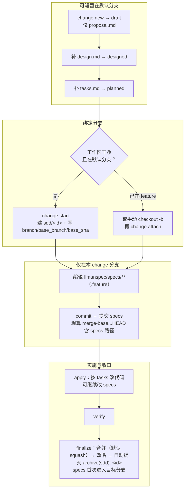

# LLMAN SDD Explore

在开始实现前理清思路、调查问题、澄清需求时用此 skill。

**探索模式只思考，不实现：**
- 可以读文件、搜代码、调查代码库。
- 可以建/改规划文档（proposal/design/tasks）。
- `llmanspec/specs/**` **只读**——除非 change 已绑定分支且你在该分支上；否则 STOP 并宜转 `llman-sdd-propose` / `change start`。
- 不得写应用代码。

## Pipeline 位置

## Git 分支生命周期

两层别混：**分支生命周期**（绑定分支 → 提交 specs → `readyToImplement`）与 **skill 导航**（explore→propose→apply→verify→archive）。提交 specs **不是**独立 skill。

### 速览

1. **先**绑定分支（`change start` / `attach`）→ `stage=full`；**再**在绑定的非默认分支编辑 `llmanspec/specs/**` 并 commit（提交 specs）。
2. 无合约编辑的 change 设 frontmatter `needs_specs_change: false`。`stage=full` 且 specs-landed 门通过（`specsLanded ∨ needs_specs_change=false`）即可进 apply；`readyToImplement=true`（gateChecks 全过，含 tasks-done）是 verify/finalize 前的完成信号。diff 范围一律现算 merge-base；存储的 `base_sha` 仅审计。
3. 收口一律 `llman-sdd change finalize <id>`：自动提交 `archive(sdd): <id>`（实现 diff + 改名一笔）；`--no-commit` 跳过自动提交。change 分支上提交自由（分段或 finalize 一次收尾均可）。
4. **不得**为过干净树门禁把 specs commit 到默认分支；已 attach 不得重复 `start`。
5. worktree（可选）：`change start --worktree` 在独立 worktree 建分支、不动当前检出（`--base <branch>` 仅本地分支）记录分叉源；attach 缺省按运行时信号推导分叉源、偏离默认分支时输出 WARNING；finalize 目标即绑定分支时跳过合并就地收口，目标被其他 worktree 持有时自动在该 worktree 内执行（输出标注位置）。

### 权威全图

上图为权威全图，本单元即其唯一来源（无需另寻根 `AGENTS.md`）。

Worktree 决策表：

| 工作形态 | 命令 | 判据 |
|---|---|---|
| 单检出 | `llman-sdd change start <id>` | 在默认分支且树干净；直接切到新分支 |
| 保留当前检出 / 并行 change | `llman-sdd change start <id> --worktree` | 分支建于独立 worktree（`sdd.worktree_root` / `sdd.worktree_naming` 可调，缺省仓库根兄弟目录），当前检出不动，输出含 worktree 路径；配 `--base <branch>`（仅本地分支）记录非默认分叉源 |
| 已在 feature 分支（含手工 wt/git-worktree） | `llman-sdd change attach <id>` | 分支已存在；分叉源按 `--base` > `branch.<name>.base` / 本地 upstream 推导 > 默认分支，偏离默认分支时输出 WARNING；`--base` 仅接受本地分支 |

finalize 目标定位：目标即绑定分支时跳过合并就地收口（输出含 in-place close-out 提示）；目标分支被其他 worktree 持有时，`llman-sdd change finalize <id>` / `llman-sdd change archive <id>` 自动在该 worktree 内完成合并、改名与提交（输出含 `executed in target worktree <path>`）；持有 worktree 脏时中止报错并列出处置选项（零写入）。

> 📍 你在探索阶段 → 下一步通常 `llman-sdd-propose`；小改动（不改合约）走 `llman-sdd-quick`。

## 姿态
- 好奇而不教条，以真实代码为依据。
- 需要时用 ASCII 图可视化；同时保留多个选项与权衡。

## 动作清单
1. 用 `llman-sdd context --task "<任务>" --paths "<文件>"` 定位匹配 `<paths>` 的 specs，通读其 `direct` 列出的 spec 全文（这些是必须理解的合约）。
   - context 不可用(含 `quality: "unavailable"`)→ 先 `llman-sdd index check`:stale/缺失则 `llman-sdd index rebuild`(默认 pageindex,免模型)后重试;fresh 仍不可用(`LLMAN_SDD_INDEX_CHAT_MODEL` 未设)→ 改用 `llman-sdd list --specs` + 直读 `.feature`——勿循环 rebuild。
2. 澄清目标与约束（问 1–3 个问题）。
3. **逐问深挖分支（可选，用户显式触发才进入）**：触发词“深挖”“grill”“逐个问”“彻底理清”。进入后一问一答走清决策：
   - 一次只问一个问题，附你的推荐答案，等反馈再问下一个。
   - 事实 vs 决策分离：能读 `.feature`/代码/跑命令查证的事实自行查证，**不问**用户；只有决策（取舍、偏好、范围边界）才问。
   - 术语校准：术语冲突或模糊立即指出（“spec 定义 'X' 为 A，你刚说成 B——哪个对？”）；解决后：已绑定分支且当前在绑定分支上 → 更新 `.feature`；否则只记入 `proposal.md`，不得在默认分支改 specs。不得 另建 `CONTEXT.md` 词表当第二权威。
   - 决策回写：已解决的决策写进该 change 的 `proposal.md`“Open Questions”段。
   - 完成判据：每个待定决策都已解决或显式推迟。未触发时保持默认（问 1–3 个问题）。
4. 涉及某个 change id 时，读 `llmanspec/changes/<id>/` 下的工件。
   - 诊断校验错误先跑 `llman-sdd validate <spec> --strict` 过结构门禁（Gherkin / `@req` 链接 / 双写 / req_id 唯一性）；配置了 `specs.check_command` 时 validate 仅经显式 `--check` 执行该 harness（缺省跳过）。失败项在缺省 TOON 输出的 `items[].issues[]` 逐条指明；`--output human` 输出人读 `FAIL <item_type>/<id>` 行。
5. 探索 2–3 个选项与权衡。
6. 判断变更规模，确定是否走完整 SDD。
7. 结论清晰时宜请用户确认记录（勿自动写）：
   - 范围/设计/工作项 → 规划文档（`proposal.md` / `design.md` / `tasks.md`）
   - 约束/可执行 harness → 仅宜写入 `llmanspec/specs/**`；实际编辑须先绑定分支。未绑定时只记 proposal。

## 退出探索模式
- 行为合约变更 → `llman-sdd-propose`
- 小改动 / 不改合约 → `llman-sdd-quick`
- change 已提交 specs（`stage=full`、specs-landed 门绿）→ `llman-sdd-apply`
若用户在探索中要求开始实现，STOP 并提醒先退出探索模式。

> 命令细节用 `llman-sdd <cmd> --help` 查看；命令参考以 CLI 为准，skill 不内嵌命令表。
> 文中“规约”= 本项目 `llmanspec/specs/` 下的 `.feature` 文件；用 `llman-sdd list --specs` / `llman-sdd show <capability>` 查全文。

## Context
- 先查状态再动手：change/spec 状态以 `llman-sdd show/list/validate` 输出为准；读 spec 全文前先用 `llman-sdd context --task --paths` 定位。

## Goal
- 达成一个可验证结果；报告附结果路径与校验状态。

## Constraints
- 遵守正文硬约束（不复读）。先判断规模选路径：合约变更走完整 SDD，实现层走 quick；不确定选完整 SDD。改动最小；已知校验错误不得强行继续。

## Workflow
- 每步以 `llman-sdd` 命令结果为事实来源；改动工件后必跑 `llman-sdd validate`；命令细节见 `llman-sdd <cmd> --help`。

## Decision Policy
- 高影响歧义先澄清再继续；事实自己查证，只有决策问用户。

## Output Contract
- 先给人读摘要（结论 / 风险 / 待决策），机器细节随后。

## Ethics Governance
- `ethics.risk_level`：low——只读写本仓库与 `llmanspec/`，无外发动作；正文另有声明时按正文执行。
- `ethics.prohibited_actions`：违反正文硬约束的动作；用户未明确要求时，不得 push、发 PR 或向外部上传。
- `ethics.required_evidence`：结论必须给出命令输出或文件路径；门禁状态以 `llman-sdd validate` 输出为准。
- `ethics.refusal_contract`：门禁 CRITICAL 未清零时，不得进入下一阶段；自修复达到上限时，报告 blocker。
- `ethics.escalation_policy`：改动 SDD 合约、模板，或执行不可逆动作前，必须先取得用户确认。
