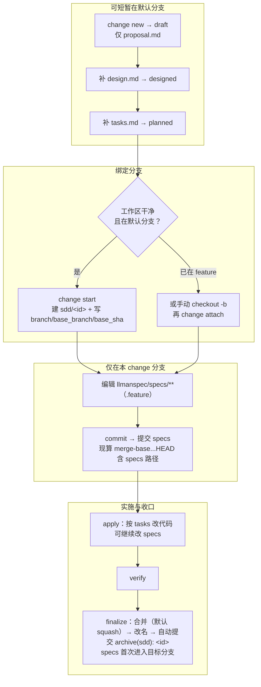

# LLMAN SDD Fast-Forward (FF)

快速走完 propose 等价路径：规划文档 → 绑定分支 → 提交 specs（至 specs-landed 门通过）。**不是**旧的 `changes/<id>/specs/` delta 模型。

## 硬约束

- 规划文档只写在 `llmanspec/changes/<id>/`（proposal/design/tasks）；specs 只写在绑定分支的 `llmanspec/specs/**`。
- **不得**创建 `llmanspec/changes/<id>/specs/`。
- `stage=full` 且 specs-landed 门通过（或 `needs_specs_change: false`）即可进 apply；verify/finalize 须 `readyToImplement=true`。

## 步骤

1. 取得一句话描述；change id 未给则推导并宣布（非阻塞，同 propose 规则）；确定受影响 capability。
2. 确保已 `llman-sdd init`（存在 `llmanspec/`）。
3. `llmanspec/changes/<id>/` 已存在：询问补齐或换 id；勿未确认就覆盖。
4. 建规划文档（可短暂在默认分支）：`llman-sdd change new <id>`（或手写）→ 充实 `proposal.md` → `design.md`（按需）→ `tasks.md`。
5. **绑定分支**：`llman-sdd change start <id>`（干净树 + 默认分支）或手动建分支后 `change attach <id>`。
6. **提交 specs**：在绑定分支编辑 `llmanspec/specs/<capability>.feature`（扁平，或目录主文件）并 commit；无合约变更设 `needs_specs_change: false`。
7. 校验：`llman-sdd validate <id> --strict`。
8. 用 `llman-sdd show <id> --output json` 确认 specs-landed 门绿（`specsLanded`/`needsSpecsChange`）后宜接 `llman-sdd-apply`（未提交前不得提示）。

## Git 分支生命周期

两层别混：**分支生命周期**（绑定分支 → 提交 specs → `readyToImplement`）与 **skill 导航**（explore→propose→apply→verify→archive）。提交 specs **不是**独立 skill。

### 速览

1. **先**绑定分支（`change start` / `attach`）→ `stage=full`；**再**在绑定的非默认分支编辑 `llmanspec/specs/**` 并 commit（提交 specs）。
2. 无合约编辑的 change 设 frontmatter `needs_specs_change: false`。`stage=full` 且 specs-landed 门通过（`specsLanded ∨ needs_specs_change=false`）即可进 apply；`readyToImplement=true`（gateChecks 全过，含 tasks-done）是 verify/finalize 前的完成信号。diff 范围一律现算 merge-base；存储的 `base_sha` 仅审计。
3. 收口一律 `llman-sdd change finalize <id>`：自动提交 `archive(sdd): <id>`（实现 diff + 改名一笔）；`--no-commit` 跳过自动提交。change 分支上提交自由（分段或 finalize 一次收尾均可）。
4. **不得**为过干净树门禁把 specs commit 到默认分支；已 attach 不得重复 `start`。
5. worktree（可选）：`change start --worktree` 在独立 worktree 建分支、不动当前检出（`--base <branch>` 仅本地分支）记录分叉源；attach 缺省按运行时信号推导分叉源、偏离默认分支时输出 WARNING；finalize 目标即绑定分支时跳过合并就地收口，目标被其他 worktree 持有时自动在该 worktree 内执行（输出标注位置）。

### 权威全图



上图为权威全图，本单元即其唯一来源（无需另寻根 `AGENTS.md`）。

Worktree 决策表：

| 工作形态 | 命令 | 判据 |
|---|---|---|
| 单检出 | `llman-sdd change start <id>` | 在默认分支且树干净；直接切到新分支 |
| 保留当前检出 / 并行 change | `llman-sdd change start <id> --worktree` | 分支建于独立 worktree（`sdd.worktree_root` / `sdd.worktree_naming` 可调，缺省仓库根兄弟目录），当前检出不动，输出含 worktree 路径；配 `--base <branch>`（仅本地分支）记录非默认分叉源 |
| 已在 feature 分支（含手工 wt/git-worktree） | `llman-sdd change attach <id>` | 分支已存在；分叉源按 `--base` > `branch.<name>.base` / 本地 upstream 推导 > 默认分支，偏离默认分支时输出 WARNING；`--base` 仅接受本地分支 |

finalize 目标定位：目标即绑定分支时跳过合并就地收口（输出含 in-place close-out 提示）；目标分支被其他 worktree 持有时，`llman-sdd change finalize <id>` / `llman-sdd change archive <id>` 自动在该 worktree 内完成合并、改名与提交（输出含 `executed in target worktree <path>`）；持有 worktree 脏时中止报错并列出处置选项（零写入）。
> 命令细节用 `llman-sdd <cmd> --help` 查看；命令参考以 CLI 为准，skill 不内嵌命令表。
> 文中“规约”= 本项目 `llmanspec/specs/` 下的 `.feature` 文件；用 `llman-sdd list --specs` / `llman-sdd show <capability>` 查全文。
校验修复（单轨 feature-as-spec）：

1）缺 `# purpose:` 头注释：每个 capability `.feature` 必须含非空 `# purpose:`；`功能:` 标题必须等于 discover 分配后的 spec id（`llman-sdd list --specs` 查看 id）。
```
# language: zh-CN
# purpose: 一句话概述

功能: <spec-id>
```

2）原生分层格式（`rule must carry an @req:<req_id> tag on the rule header`）：
- 规范样式只有一种：`@req:<id>` 挂在 `规则:` 块头标签,块内嵌套 `场景:`(假如/当/那么)是可执行示例——默认首选。
- 仅当需求无法程序化表达或暂不转写时才保留无嵌套场景的 `规则:`(裸规则):描述自由文本,不强制情态词;validate 以聚合计数提示,review `pending` 信号计量,specs-compact 负责压降。
- 历史标签 `@executable`/`@rule`/`@human`/`@manual` 不再使用、解析惰性;旧文件报结构问题时运行 `llman-sdd spec migrate-native` 迁移。
- 不在任何 `规则:` 内的顶层 `场景:` 是功能级示例:无规则句柄、不告警、不参与规则统计(Gherkin 原生语义)。

分支护栏：
- 先 `change start` / `attach` 绑定分支，再在绑定的非默认分支编辑 `.feature` 并 commit（提交 specs）。
- 锁定规则（报告制）：改/删既有 `规则:` 块只出 WARNING，不阻断 validate / finalize / `change diff`；报告按 `@req:<id>` 指明被改规则。控制点：git 分支对比 + `llman-sdd review` / `change diff`。旧锁定确认元数据（frontmatter `rules_touched` / `agent_acked`、`@agent` tag、`--yes` 确认语义）已全部删除，无别名无兼容层。
- `stage=full` 且 specs-landed 门通过（specsLanded ∨ `needs_specs_change: false`）即可进 apply；verify/finalize 须 `readyToImplement=true`（完成信号）。收口优先 `change finalize`。

## Ethics Governance
- `ethics.risk_level`：low——只读写本仓库与 `llmanspec/`，无外发动作；正文另有声明时按正文执行。
- `ethics.prohibited_actions`：违反正文硬约束的动作；用户未明确要求时，不得 push、发 PR 或向外部上传。
- `ethics.required_evidence`：结论必须给出命令输出或文件路径；门禁状态以 `llman-sdd validate` 输出为准。
- `ethics.refusal_contract`：门禁 CRITICAL 未清零时，不得进入下一阶段；自修复达到上限时，报告 blocker。
- `ethics.escalation_policy`：改动 SDD 合约、模板，或执行不可逆动作前，必须先取得用户确认。
