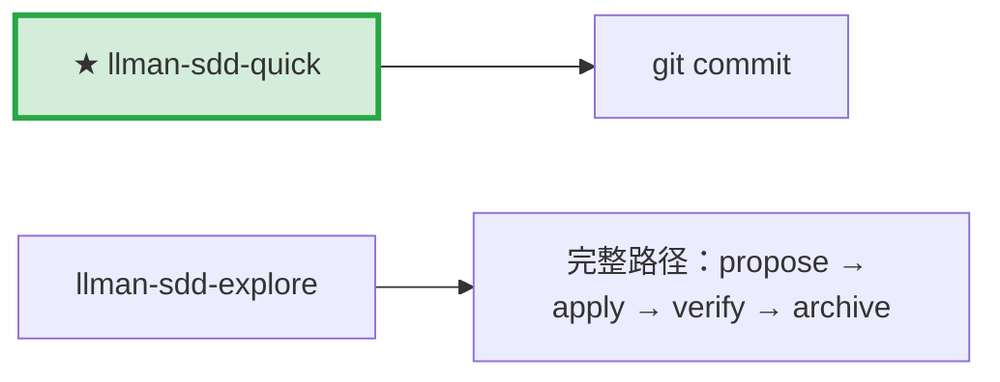

# LLMAN SDD Quick Path

不改行为合约的小改动用此路径。

## Pipeline 位置

> 📍 快速路径：直接改代码 commit。发现要改合约 → STOP，转 `llman-sdd-propose`。

## 使用条件（全部满足）
- 不改变任何 spec 中需求语义定义的外部可观测行为
- 不跨 capability；不涉及迁移/兼容性；不是 SDD 元规范变更

## 步骤
1. 用 `llman-sdd list --specs` 列出规格，再直读相关 `.feature`，确认没有要改的行为合约。
2. 直接改代码。
3. 若要动 `llmanspec/specs/**`，STOP——除非已在绑定的非默认 change 分支上（迷你 change：`change start` → 编辑 → commit）。不得在默认分支 commit specs，即使 typo 或仅收紧 scope 也不行。优先把 specs 维护路由到 `llman-sdd-propose`。
4. git commit（message 写明 why）。无需 change 目录，无需 archive。

## 边界处理
- 修改中发现要改行为合约 → STOP，转 `llman-sdd-propose`。
- 涉及多文件且 scope 不明 → 先用 `llman-sdd list --specs` 确认，再直读 `.feature`。

> 命令细节用 `llman-sdd <cmd> --help` 查看；命令参考以 CLI 为准，skill 不内嵌命令表。
> 文中“规约”= 本项目 `llmanspec/specs/` 下的 `.feature` 文件；用 `llman-sdd list --specs` / `llman-sdd show <capability>` 查全文。

## Ethics Governance
- `ethics.risk_level`：low——只读写本仓库与 `llmanspec/`，无外发动作；正文另有声明时按正文执行。
- `ethics.prohibited_actions`：违反正文硬约束的动作；用户未明确要求时，不得 push、发 PR 或向外部上传。
- `ethics.required_evidence`：结论必须给出命令输出或文件路径；门禁状态以 `llman-sdd validate` 输出为准。
- `ethics.refusal_contract`：门禁 CRITICAL 未清零时，不得进入下一阶段；自修复达到上限时，报告 blocker。
- `ethics.escalation_policy`：改动 SDD 合约、模板，或执行不可逆动作前，必须先取得用户确认。
