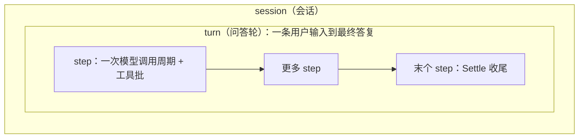

<!-- LLMANSPEC:START -->

# LLMAN 规范驱动开发

本项目使用 llman SDD。阅读 `llmanspec/config.yaml` 了解 SDD 命令行为配置，以及 `llmanspec/AGENTS.md` 获取项目附加规则。

## SDD 流水线

使用 `/llman-sdd-explore` 开始，然后按照 pipeline：`/llman-sdd-propose` → `/llman-sdd-apply` → `/llman-sdd-verify` → `/llman-sdd-archive`。

保留此托管块，便于 `llman-sdd init --update` 刷新。
<!-- LLMANSPEC:END -->

# 仓库级 Agent 指南

XYlitol（命令 / crate：`xylitol`）是一个 coding agent 实现：Rust workspace，开发由 llman SDD 驱动。crate 图与依赖方向见 `src/AGENTS.md`；现行成员以根 `Cargo.toml` 为准。

术语与写作：黑话首现时附标准词或英文；`规则:` 标题用标准词（细则 `llmanspec/AGENTS.md`「语言」）；内部编号（`c####` / `ath##`）单独引用时带 12 字以内语义尾。

## 术语：三层词汇

文档叙事主语分三层：

事件 / 字段载体：`StepStart` / `StepEnd` / `step_index`；Settle 是 turn 的收尾动作，发生在末个 step。提交边界一律写 turn（= 一次提交 = 一对 `AgentStart` / `AgentEnd`）或「每次提交」。

## 产品定调

个人开箱即用的 coding harness。第三方外进程插件最小切片已交付（配置驱动、trust 门禁、JSON-RPC stdio 工具桥）；插件市场、签名、dylib、同进程静态链入未交付，不得写成现行必须。现行扩展入口 = 官方插件 + 配置 + MCP / shell hook + `external_plugins`。`xylitol-tui` 是源自 pi-tui 的独立 fork，不追平上游。

| 关注点 | 现行规则 | 真源 |
|---|---|---|
| Trust / 配置后置 | Trust 门禁项目本地资源是否加载，工具开箱 allow-all；外进程插件须显式 `trusted: true`；集成件装配策略见下「开箱与配置后置」 | `llmanspec/specs/domain-security/` 等；实现边界 `src/AGENTS.md` |
| Loop 参与 | 官方插件经 rutis 生命周期注册 loop 中间件参与 ReAct 决策；core 持 turn 边界、取消、权限终裁；插件不得整段替换 loop；外进程插件只贡献工具 | `llmanspec/specs/agent-runtime/`；`src/AGENTS.md`「Loop 中间件」 |
| 产品端 | Print 与 TUI（TTY 默认）已开放；TUI 默认确保并 attach 本机 Host；Print 与库嵌入可同进程 | `crates/xylitol-app-tui/src/AGENTS.md`；`llmanspec/specs/protocol-app/`、`server-core/` |
| CS 角色 | 端是 client（键、画、TTY）；模型 / 会话 / MCP / trust 是 host；跨进程走四象限 JSON-RPC 2.0 文本信封 | `src/AGENTS.md` |
| 跨端公共体验 | 已开放端动作语义一套；未开放端见 GitHub FR，不得写成现行必须 | `llmanspec/specs/protocol-app/`、`user-experience/` |
| TUI 呈现 | 信息呈现固定词；视觉色板（`just qa-check-tui-tokens` 对照 Palette） | `llmanspec/specs/app-tui-fixed-zone/`；`crates/xylitol-app-tui/src/DESIGN.md` |

未兑现方向跟踪 GitHub Issues（roadmap [#28](https://github.com/StrayDragon/xylitol/issues/28)、插件生态 [#29](https://github.com/StrayDragon/xylitol/issues/29)）；文档落点 `xylitol-dev` skill `references/docs-loop.md`。

## 工作原则

| 做 | 不做 |
|---|---|
| 目标不清先确认范围；改动聚焦 | 边界未清就动手；顺手改无关代码 |
| 黑话首现附标准词或英文；内部编号单独引用带 12 字以内语义尾 | 黑话不加对照直接用；裸编号造成检索死端 |
| 代码是真值源；架构规则读 `src/AGENTS.md`；设计史查 `llmanspec/changes/archive/` | 凭记忆改架构；向 archive 要现行规则 |
| 动代码前读相关代码，沿目录树遵循最近的 `AGENTS.md` | 跳过上下文直接改 |

## 目标 crate（摘要）

Host 侧 crate 边界按替换、开关、生命周期划，不按 `app / agent / infra` 各拆一 crate。依赖与 seam 纪律只在 `src/AGENTS.md`，此处仅一行角色：

| crate | 角色 |
|---|---|
| `xylitol-plugin-sdk` | 词表 + 端口 + 错误 + `rt` 再导出（插件作者只依赖这一包） |
| `xylitol-protocol` | 四象限信封（JSON-RPC 2.0 文本）+ `PROTOCOL_VERSION`。不认识端口，不认识 `XyEvent` |
| `xylitol-runtime` | 执行权威：`XyDriver` + trust + 会话槽 + ReAct 内环 + 唤醒准入。不依赖信封 |
| `xylitol-kernel` | 进程内核：`Kernel::boot`、核心插件、Builtins、admit。`rutis-loader` 只在这里 |
| `xylitol-serve` | 载体：监听 + JSON-RPC 分派；Host profile 插件 |
| `xylitol-wire` | `XyEvent` 与 wire `Event` 的唯一映射（依赖 protocol + sdk） |
| `xylitol-official-plugin-*` | 官方可替换插件，一能力一包（成员见 `src/AGENTS.md` crate 图）。不是市场，不是 dylib |
| `xylitol-app-tui` / `xylitol-app-print` | 产品端。TUI 只认线协议（经 `xylitol-wire` 映射）；Print 同进程直调，不编线协议 |
| `xylitol-tui` | 通用 TUI 引擎（零引用产品） |
| 根包 `xylitol` | argv + profile。默认接线经 kernel |

## 开箱与配置后置

| 能力 | 开箱默认 | 配置后置 |
|---|---|---|
| 本机 Host | TUI 默认确保并 attach 本机监听（`server` feature 可关） | 显式 `xylitol serve` 常驻，默认回环 Basic 凭据门禁 |
| MCP / LSP / DAP / subagent / 外进程插件 | 未配置零装配，不 spawn 子进程 | 有配置才装配 |
| otel 与 fff 检索 | 默认开，可关 | — |

能力目录前缀对照见 `llmanspec/AGENTS.md`「capability 命名」，行为细则见 `llmanspec/specs/` 对应目录。

## 编码规则

| 必须 | 不得 |
|---|---|
| 遵循 `rustfmt.toml` / `.editorconfig`；排版交给 `just fmt` / `just lint` | 在 AGENTS 里重复排版细则 |
| 命名：snake_case 模块与函数，PascalCase 类型 | 自创命名风格 |
| 模块边界贴合目标 crate 与 crate 内分层；能内联不套 wrapper | 为对称性加 wrapper；加无要求的兼容 shim |
| 优先穷举类型 / 注册表；公共形状让 rust-analyzer 能跳转 | 字符串 magics；跳转不到的公共形状 |
| 线协议标识符按语义命名；协议版本只经 `PROTOCOL_VERSION` 与 `host.describe` 协商 | 标识符带版本段（`new_v3`、`V4`、`*_v3`）；为旧名保留别名或双解析路径（版本命名闸卡住） |
| `Xy*` 库契约与外部库包装准则见 `src/AGENTS.md`「三层契约与 `Xy*`」 | 凭感觉决定包不包一层 |

## Provider 交付范围

交付 OpenAI 兼容与 Anthropic Messages 两族（OAuth 等纳入是显式决策，不默认承诺）；网关 courtesy（如 Zen 会话归因）允许。产品细则 `llmanspec/specs/infra-provider/`；开闭规则（业务只依赖 `XyModel`，新兼容端 = 方言插件 / 配置）见 `src/AGENTS.md`「Provider 与消息」。

模型配置面是跨仓契约：`models.entries` 与 thinking 档位（`thinking_level_map`）形状同时被 `StrayDragon/x-magpie` 的 `packages/xylitol` 连接器消费，它渲染 `conf.d/magpie-models.yaml` 供本仓加载。改模型条目 schema 或生成形状时 **必须** 同步适配该连接器并跑其 `just check`，不得只改本仓使生成文件失效。

## 命令与验证

- 日常：`just setup` / `fmt` / `lint` / `test` / `test-tui`；全量门禁 `just qa`（或 `ci`）；需要真终端（PTY / tmux）再加 `just qa-e2e`。新机器先 `just setup`；缺工具在第一次触发 recipe 时安装或失败。
- 非变更门禁脚本 `scripts/check_*.py` 必须经 wiring 进 `qa`；维护脚本不进门禁。
- prek 与 `just qa` 正交：prek hook 只承担文本 / 元数据卫生与 commit-msg 规约；cargo 级门禁（fmt / clippy / test / doc-test）不得拆成独立 hook 进 prek；push 一致性由 CI 兜底。
- 探查：`cargo run -- --help`；文档构建与检查：`just doc` / `just qa-doc-check`。
- 一次性探针只落 `scripts/lab_*.py`（或包 examples `lab_*`）并直接 python 调用，不新增 just recipe；重复使用或需流程化才升 skill / 门禁。引擎 demo 入口在 `crates/xylitol-tui/justfile`。
- 门禁组成细则见 `xylitol-dev` skill `references/qa-gates.md`。
- Python 解释器：门禁脚本需 Python 3.11 以上（`tomllib`），只依赖标准库；`justfile` 与 BDD step 自动挑选可用解释器。
- 注释闸（uncomment，只读）：策略见根 `.uncomment.toml`；`just qa` 经 `scripts/check_uncomment.py` 只跑 `uncomment --check --changed-lines`，不删注释、不 `--fix`。默认移除行内说明与 doc 注释；保留 TODO/FIXME、工具指令与 `~keep`。追溯以 specs 与提交信息为 SSOT，改动行上不得新增可移除注释。`uncomment` 须在 PATH（`uv tool install uncomment` 或 `pipx install uncomment`），未安装时闸报错而非跳过。`XYLITOL_SKIP_UNCOMMENT=1` 仅为工具确实无法安装时的应急口，不作常规跑法。

### 试验 / 真实网关验证命名（`lab_`）

试验性证据与真实网关探针统一前缀 `lab_`，不引入其他前缀。四形态与是否进 `just qa` 的矩阵及跑法见 `xylitol-dev` skill `references/test-layering.md`。

## Worktree 并行开发

- 同 crate 的不同 worktree **不得**共用 `CARGO_TARGET_DIR`（Cargo fingerprint 不区分包绝对路径，会错误复用别的树编出的产物）。
- Linux 开发链接走 mold；`-Zshare-generics` 与 mold 写在同一份 `.cargo/config.toml`（`[target]` rustflags 会覆盖 `[build]`，不得拆开）。

## 提交与测试

- Conventional Commits；开 PR 前 `just qa`。PR 合并用 rebase（保持线性历史，不 squash）；合并后本地 `main` 同步 `origin/main`，删除已合并分支。细则见 `xylitol-dev` skill `references/commit-and-collab.md`。
- 单轨 feature-as-spec、capability 命名、spec 约束层级（产品级 WHAT，不得钉代码组织）见 `llmanspec/AGENTS.md`。不得使用 `solidify` / `change delta` / 新建 `*.feature.delta.toon`。
- 测试分层：BDD 管端到端编排；单测管纯数据 / 组件边界，不重复 BDD 场景。细则见 `xylitol-dev` skill `references/test-layering.md`。
- 实现计划变更后写入 `llmanspec/`；读代码优先 `rg`。

## Skills

团队开发规范（门禁 / 测试分层 / 文档落点 / 提交协作 / 依赖候选 / 工具链 bump / TUI 验证 / 观测排障）总入口：`xylitol-dev`（正文在 `references/`）。SDD：`llman-sdd-*`（含 `llman-sdd-quick` 快速路径）。应用端：`l8ng-write-surface`、`l8ng-audit-dead-code`、`l8ng-write-tui`。TUI 参考：`l8ng-terminal-tui-differential-rendering`（`l8ng-*` 均在 `~/.config/llman/skills/` 维护，不在本仓库，避免漂移）。外部锁定：`langfuse`（经 `skills-lock.json` 管理）。构建 / 磁盘调优：按当次 rust 版本即时调研，不固化结论。

## 编写与维护 AGENTS.md

`AGENTS.md` 是稳定操作边界，不是 README / 进度板。只收硬约束、稳定原则、宽泛索引（HOW 指针）；易腐细节以代码 / skill / spec 为 SSOT，此处至多留指针。移除即改写：不留「曾 / 已退役 / 原名」墓碑。同审 `.agents/skills/` 项目 skills：事实性断言对照代码复核，漂移即修。

落点：全仓规则进根；目录边界进该目录 `AGENTS.md`；多步 how-to 进 skill（团队 how-to 进 `xylitol-dev`）；临时笔记进 `_HANDOFF` / `*.tmp.md`；change 作用域调研进 `llmanspec/changes/<id>/research/`。写什么、怎么写见 `xylitol-dev` skill `references/agents-authoring.md`。
