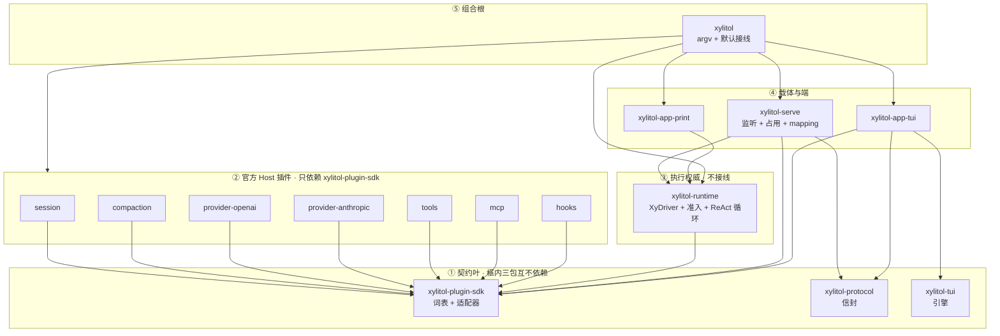

# xylitol 规划脊柱

规划真值，进 git 便于 diff。不升格为 `AGENTS.md` / spec。
进度只改本文件。稳定规则写进 `AGENTS.md`。行为合约写进 `llmanspec/`。
文风：`/home/l8ng/Projects/__straydragon__/STC-Simplified-Technical-Chinese`。

一事只在一节写全，其余用指针。沿革查 git。

<a id="now"></a>

## 现在

主线 crate 化完成。没有下一刀实现，除非另开 [§4](#MAIN) 转向或认领 GitHub [#28](https://github.com/StrayDragon/xylitol/issues/28)。

clipboard 在 `xylitol-app-tui`；resource / permission 在 `xylitol-runtime`；组合根注入 `Arc`。config 只留接线字段。观测写出与 MCP reload 留根包（见 [§3](#PRE)）。不为对称性再拆 `xylitol-host` / `xylitol-config`。

crate 图见 [§2](#TARGET)。`just qa` 与 `just qa-e2e` 已通过。

现行扩展靠 skills 与 MCP，稳定 coding agent 够用。转向（cordis 式随意插件 + 热重载）见 [§4](#MAIN)，现在不做。

rutis 接入 [S2](#S2)–[S5](#S5) **停**：理解还浅。`Ctx` 不传回合消息（见 [§4](#MAIN)）。无 `xylitol-rutis`。不得 `use rutis`。

延后项见 [§6](#DEFER)：D2 词表不加 `Xy`；D6 未开放端；D7 schedule；D8 观测后置。

禁边闸：`scripts/check_crate_graph.py`。成员名单以根 `Cargo.toml` 为准。架构规则以 `src/AGENTS.md` 为准。

回退点 tag **`v0.0.0-pre.old`**（`004a2e4d`）。命令：`git switch -d v0.0.0-pre.old`。

“不用就不付钱”分三层，不要混。

| 层 | 规则 |
|---|---|
| 编译 | 依赖写在会用该库的 crate |
| 装配 | 没挂的插件不 start |
| 热路径 | 不在每 token / 每帧上计费 |

不为编译速度拆 crate。单包 default-on 的 Cargo feature 不省默认二进制。

读法：现在 → [§2](#TARGET) 现行图 → [§4](#MAIN) 停 → [§6](#DEFER)。[§3](#PRE) 已完成。

---

## 1. 约束

1. 行为不变的组织改动可跳过 llman-sdd 生命周期。live `.feature` 主语 / 路径过期时，直接改 feature，再跑 `llman-sdd validate`。
2. 产品可观察行为变化必须走完整 SDD：explore → propose → apply → verify → archive。
3. 任何批次合并前必须 `just qa`。触及真终端时再加 `just qa-e2e`。
4. 试验脚本只许 `lab_` 前缀。
5. 提交用 Conventional Commits。未要求则不自动 commit。
6. `AGENTS.md` 只收硬约束 / 稳定原则。不得把本文件进度抄进去。移除即改写，不留墓碑。
7. 同 crate 的不同 worktree **不得**共用 `CARGO_TARGET_DIR`。
8. 改名一次性改调用点。不留兼容别名，不留 `#[deprecated]`。

| SDD | 何时 | 做什么 |
|---|---|---|
| skip-SDD | 纯组织 / 工具链 / 编译隔离，且产品行为不变 | 直接改代码 + `just qa` |
| validate-only | 组织演进导致 live `.feature` 过期 | 直接改 `.feature` + `llman-sdd validate` + `just qa` |
| must-SDD | 改了用户能看见或默认二进制含什么 | 完整 change 生命周期 |

发现“以为组织改动、实际改了行为”时立刻停，转 propose。

提交：工具链 `build:` / `chore:`；重写 `feat:` / `refactor:`；行为 `fix:`；SDD `chore(sdd):` / `archive(sdd):`。
不碰（除非该批次点名）：`docs/architecture/`、`_INTERVIEW/`、`delayed-changes/legacy/`。改行为才动 `llmanspec/`。

不得创建：`xylitol-host`、`xylitol-client`、`xylitol-kernel`、`xylitol-assemble`、`xylitol-types`、`xylitol-official-plugin-react`、`xylitol-official-plugin-tui`、`xylitol-app-voice`、空 LSP/DAP crate、dylib 加载器、`crates/xylitol/`。

---

<a id="TARGET"></a>

## 2. 现行形态

crate 按契约划分。不得 `pub use` 根 `src/` 模块凑编译。不得留兼容 shim。

三层分名：**角色**（执行权威）/ **服务提供方**（`xylitol-runtime`）/ **载体**（`xylitol-serve`）。crate 名只表达其中一层。不得叫 `xylitol-host`、`xylitol-client`、`xylitol-server-host`。**组合根不是第四个角色名**，落在根包 `xylitol`。

`XyDriver` 是 runtime 侧应用协议。客户端只通过 attach 消费。`xylitol-app-tui` 不是 rutis fiber。S2 起 rutis 仍只装配 runtime 进程内的 Host 侧插件。

<a id="TERMS"></a>

### 2.0 用语

本节名称在后文只按这里的意思用。对照总表：`docs/architecture/术语表.md`。

**词表**（vocabulary，共享类型）是 Host 侧（插件 + runtime）都要 `use` 的那一组类型和适配器 trait，几乎不含业务实现。例子：`AgentMessage`、`XyEvent`、`XyError`、`XyModel`。词表 crate 是 `xylitol-plugin-sdk`。产品 TUI 可依赖 sdk 做 `XyEvent` 投影，不得依赖官方插件，不得依赖 runtime。不得再拆 `xylitol-types`。

**词表薄留**：只把类型形状放进 `xylitol-plugin-sdk`。HTTP、假实现、观测实现不放进去。

**产品信封**（envelope）是 client/server 四象限 RPC。crate 是 `xylitol-protocol`。只描述跨端形状。不认识适配器，不认识 `XyEvent`。与 `xylitol-plugin-sdk` 互不依赖。用户可设开关名 `XYLITOL_ENVELOPE_V3`；未设默认开。content-type `application/x-fory-v3`；fbs `namespace xy.wire.v3`。改 namespace 等于删旧加新。

**官方 Host 插件**是本仓库 Host 侧静态 crate，包名 `xylitol-official-plugin-*`。不是插件市场，不是 dylib。动态加载见 [S4](#S4)。

**适配器**（adapter）：`XyModel`、`XyTool`、`XySessionStore` 这类可替换实现。调用点 `xylitol_plugin_sdk::{XyModel, …}`。不要写 seam / port / 可替换口。sdk 内私有模块名仍是 `ports`，不改名为 `adapters`。

**执行权威**是 runtime 侧角色：会话循环、trust、准入、ReAct 循环。crate 是 `xylitol-runtime`。`xylitol-runtime` 不是组合根。不认信封，不认官方插件。

**载体**（carrier）是监听 + 编解码。本仓库实现是 `xylitol-serve`。占用政策（会话槽、linger、单写者、mux）在 serve。装配与 MCP 物化由组合根注入。

**组合根**是唯一把循环 + 工具 + 模型 + 会话接在一起的地方。落在仓库根包 `xylitol`（argv + 默认接线）。把官方插件的 `Arc` 注入 runtime。`xylitol-runtime` 不接线。不得 `use rutis`。

**客户端 / 端**（client / surface）是 `xylitol-app-*`。端认信封或 `XyDriver`。端不是 Host 插件。TUI 引擎 `xylitol-tui` 零引用产品。产品 TUI attach 走 `xylitol-app-tui` 的远端 Driver。

**操作器**相对端而言：模型、会话、MCP、trust 在 Host 侧。端做键、画、TTY。

不得用这些 crate 名：`xylitol-types`；`xylitol-assemble`；`xylitol-kernel`；`xylitol-host`；`xylitol-official-plugin-react`；`xylitol-app-voice`。不得用 `xylitol-protocol` 承接 sdk。不得把信封 / 词表 / ReAct 循环做成可卸官方插件。

<a id="SETTLED"></a>

### 2.0b 定案

**P1 替换** 不同理由分开：厂商 HTTP ≠ 压缩策略 ≠ 会话落盘 ≠ 工具实现 ≠ ReAct 循环。OpenAI 兼容与 Anthropic 各一插件。DeepSeek overlay 留在 openai 插件。

**P2 开关** 没配置不 start。mcp / hooks 仍是官方插件 crate。`server` / `mcp` feature 可从二进制拿掉。未配置不得为“将来插件”堆抽象。

**P3 生命周期** 组合根注入 `Arc`。用户插入点仍是配置 / 文件，运行时承载见 [S2](#S2)。会话 instance 见 [S3](#S3)。dylib 见 [S4](#S4)，必须与否后定。不得预埋空壳。不得做 Extension Host。不得 `use rutis`。

**P4 热路径** 现行：ReAct 循环在 `xylitol-runtime`，无第二实现。测端已有 `ScriptedDriver`。这是现行边界，不是永禁；转向见 [§4](#MAIN)。

**P5 稳定方向** `plugin-sdk` ∥ `protocol` ∥ `xylitol-tui`。runtime → sdk。runtime ↛ 插件、↛ 信封。插件之间不得 `use`。mapping 只在 serve。Print 只依赖 runtime。

**P6 依赖卫生** `async-openai` 只在 openai 插件。`rmcp` 只在 mcp 插件。`salvo` 只在 serve。fory 只在 protocol。Anthropic 构建不得编 `async-openai`。第三方与 `xylitol-*` 版本真源是根 `Cargo.toml` 的 `[workspace.dependencies]`；成员 `workspace = true`。`vendor/gherkin` 走 `[patch.crates-io]`。

用户数据单元：书签 → 事实日志 + 回合/步骤。书签 ≠ 主路径 ≠ 树干前缀。KV 只追加不改前缀。切主路径 = 追加高注意力事实。压缩追加切点，不重写旧行。组稿三槽：稳定系统提示 / 高注意力（最新主路径；压缩后仍要看见）/ 易变状态栏。改注入策略走 must-SDD。

```text
我 → 会话*（书签 + 主路径）
      ├── 事实日志（只追加）
      └── 回合* → 步骤*
```

所有权：session 插件写事实；compaction 插件写摘要条；runtime 跑回合、步骤、投影组稿；端只消费事件。

官方插件七个：session、compaction、provider-openai、provider-anthropic、tools、mcp、hooks。没有 react。内置默认挂：session / compaction / provider-* / tools。配置启用：mcp / hooks。

测循环用假适配器。测端用 `ScriptedDriver`。插件依赖声明适配器，由组合根注入。

<a id="EXTEND"></a>

### 2.0c 插入点

用户/agent 扩展能力，今天**不写** rutis `Plugin`。产品心智：[扩展与开闭.md](docs/architecture/扩展与开闭.md)。

| 角色 | 怎么插 | 格式 |
|---|---|---|
| 使用 xylitol 的人 / agent | 改配置和项目文件 | YAML、MCP、hook JSON、SKILL.md |
| 嵌入库的 Rust 作者 | `embed` + `XyDriver` + 可选 `Xy*` | 词表 / Driver，不编 fory |
| Host 插件作者 | `impl` plugin-sdk 端口，改根包接线 | `XyTool` 等；不编 fory、不 `use rutis` |
| 多语言叶作者 | 无产品路径 | [S4](#S4) 才有 |
| 新端作者 | 信封客户端 | fory-v3 |

现行插入点：模型配置；MCP；脚本 hooks；skills / `$skill`；slash / bang；Trust；`/reload`；会话内换模 / thinking。TUI 靠已有 `ToolStart` / `ToolEnd` 与文本增量呈现。不必为每个新工具改 fory schema。

Host 端口真源：`xylitol-plugin-sdk`。接线优先序：配置开关 → 既有端口 → 新端口（须有第二实现）。新增第八个官方插件必须改根包 `Cargo.toml` 与组合根接线。

两条通道不互转：端 ↔ Host 走信封 fory-v3；Host 进程内装配走 `Arc` 注入。唯一产品映射是 serve 的 `XyEvent` ↔ `v3::Event`。不得做 fory ↔ rutis 转码器。

主动交互：唤醒源走准入，不换内环。schedule 见 [D7](#D7)。

<a id="LEVELS"></a>

### 2.1 组件级别

crate 边界按替换、开关、生命周期来划，不按 `app / agent / infra` 分层来划。分层纪律留在每个 crate 内部。按契约写实现，不把今日模块原样倒进目标 crate。

内核判据：别的插件都要依赖，并且不能自己被门控掉。

| 级别 | 放什么 | 例 |
|---|---|---|
| 内核 | 词表、适配器、错误、信封、trust、会话身份、ReAct 循环。不得知道压缩策略、具体厂商、TUI。不得接线 | `xylitol-plugin-sdk`、`xylitol-protocol`、`xylitol-runtime` |
| 内置插件 | 官方静态 `xylitol-official-plugin-*`。默认挂。组合根注入 `Arc`，之后直连 | session、compaction、provider-*、tools |
| 配置启用插件 | 仍是官方插件 crate；没配置不 start | mcp、hooks |
| 装配 | 根包接线 | `src/wiring/assembly.rs` |
| 客户端 | 独立 `xylitol-app-*` + 引擎 `xylitol-tui`。不是 Host 插件 | app-tui / app-print / xylitol-tui |

不得为 LSP / DAP / gpui / 语音端预埋空壳。不得把客户端放进 `xylitol-official-plugin-*`。

<a id="GRAPH"></a>

### 2.2 目录总图

```text
仓库根 xylitol/                 组合根 package（BusyBox bin + embed）。不要 crates/xylitol/
  src/                          CLI + wiring + embed，见 [§2.2.1](#ROOTSRC)
  crates/
    xylitol-plugin-sdk/         词表 + 适配器 + 错误
    xylitol-protocol/           四象限信封 + fory-v3 + PROTOCOL_VERSION
    xylitol-runtime/            执行权威：XyDriver + trust + 会话槽 + ReAct 循环 + 唤醒准入
    xylitol-serve/              载体：监听 + 占用 + XyEvent ↔ v3 Event mapping
    xylitol-tui/                TUI 引擎。零引用产品。不改名
    xylitol-app-tui/            产品 TUI 客户端
    xylitol-app-print/          Print 客户端
  plugins/                      仅 Host 侧。Cargo 依赖只出现在根包
    xylitol-official-plugin-*/
```

箭头 `A → B` = A 的 `Cargo.toml` 依赖 B。



规则：

1. 插件只依赖 `xylitol-plugin-sdk`。插件之间不得 `use`。依赖用适配器声明，由组合根注入。
2. ① 三包互不依赖。`protocol` 不认识适配器，也不认识 `XyEvent`。`plugin-sdk` 不认识信封。
3. `xylitol-runtime` 只依赖 `xylitol-plugin-sdk`。不得依赖信封，不得依赖任何 `xylitol-official-plugin-*`。
4. `xylitol-serve` 依赖 runtime + protocol。mapping 只在 serve。Print 只依赖 runtime。
5. `xylitol-app-tui` 依赖信封、`xylitol-tui`、plugin-sdk。不依赖 Host 插件，不依赖 runtime。
6. 根包是组合根：唯一列出默认官方插件的 `Cargo.toml`。新增官方插件只改根包接线，不改 runtime。不得 `use rutis`。
7. 每个 crate 内部仍守 `app → agent|infra → protocol`；`agent` 不得依赖 `infra`。不得按这三层各拆一 crate。

<a id="ROOTSRC"></a>

### 2.2.1 根 `src/`

组合根留在仓库根 package。`cargo run` 仍在仓库根。不得再做一个 `crates/xylitol/`。

```text
src/
  main.rs      tokio + run()
  lib.rs       embed + 精选 Xy* 再导出
  cli.rs       clap：无子命令 / tui / print / serve / --list-models
  wiring.rs    注入官方插件 Arc；没配置不 start mcp/hooks
  embed.rs     库用户走同一套 wiring，不经 argv
```

`cli/`、`wiring/` 是对应 `.rs` 的子模块。根包只接线：装配夹具可留在 `wiring::occupancy`；占用政策在 `xylitol-serve`；`XyInProcessDriver` 在 `xylitol-runtime`。

里面没有 TUI 画布、Print 渲染、HTTP 监听、ReAct、工具实现。那些在 `xylitol-app-*` / `xylitol-serve` / `xylitol-runtime` / `official-plugin-*`。不得把端实现嵌回 `src/app/tui`、`src/app/print`。

<a id="LLM"></a>

### 2.3 LLM 方言

两族方言各一官方插件：OpenAI 兼容、Anthropic Messages。DeepSeek overlay 留在 openai 插件。不要抽 `xylitol-llm` / `xylitol-types`。不要把 DTO 搬回主仓 `xylitol`。不要把 HTTP / 假实现 / 观测实现放进 `xylitol-plugin-sdk`。

准入：P1 两个方言；P6 Anthropic 构建不得编 `async-openai`。live-provider 路径解析在 `lab_responses_prompt_cache.rs`。

**词表薄留**（只把类型形状放进 `xylitol-plugin-sdk`，零 HTTP）：`AgentMessage::Llm` / `XyChunk`；产品 usage 形状；`HEURISTIC_BYTES_PER_TOKEN` + `heuristic_token_count`（不得用 tiktoken / RemoteCount）；`XyGenerateOptions` 字段与 `ObsSessionContext` 纯结构；`HeaderBag` 或直接 `serde_json::Map`；`tool_wire`；`Compat` 名字（`generic` / `deepseek` 配置词）。

**插件各自实现**：Responses / Completions / assembler / OpenCode attribution / DeepSeek overlay → openai 插件。Anthropic Messages → anthropic 插件。假模型直接 `impl XyModel`。工厂由根包接线时调用。

---

<a id="PRE"></a>

## 3. 已完成：组合根下沉

根 `src/*.rs` 是五文件。实现仍在 `src/wiring/`（约 6k 行），全是组合根该留的。不为对称性再拆 `xylitol-host` / `xylitol-config`。不为编译速度再拆 crate。

| 块 | 约行 | 状态 |
|---|---|---|
| `infra/clipboard` | 1.1k | 完成。实现只在 `xylitol-app-tui`。根包 Driver 不实现剪贴板 |
| `infra/resource` | 0.9k | 完成。`xylitol-runtime::resource` |
| `infra/permission` | 0.5k | 完成。后端在 runtime；根包只把 YAML 映过去 |
| `assembly.rs` + `xylitol-rutis` | — | 完成。直接注入 `Arc`。无 rutis 包 |
| `infra/config` + `settings` | — | 完成。删未接线的 `tools.*` / `session.storage` / `execution.max_retries`。装配置仍是接线，留根包 |
| `infra/observability` | 0.8k | 留根包。进程启动才知道写 `xylitol.log` / 是否装 OTLP；`otel` feature 在根包。runtime 只打 ReAct span 名，不认文件路径和网关 |
| `driver/` MCP·reload 包装 | 1.4k | 留根包。runtime 不得依赖官方 mcp 插件；`/reload` 读配置、重连、把新工具表注入 Driver，就是组合根 |

agent loop 现行在 `xylitol-runtime`。转向见 [§4](#MAIN)。

<a id="MAIN"></a>

## 4. 停：rutis 接入与架构转向

停。主线 crate 化已完成。现有产品靠 skills / MCP 扩展，稳定 coding agent 够用。理解浅时不接入、不预埋空壳。

重开条件（全满足）：自己用 rutis 跑通过；愿意改「不得 `use rutis`」；热路径延迟有基线可比。

另开时先定：**根包直接 `use rutis`**（rutis 当基础库，用到的 crate 直接依赖）。不再做进口隔离包。届时改写 `src/AGENTS.md` 的「不得 `use rutis`」。

**`Ctx` 不传回合消息。** 用户一轮、工具起止、token 增量走 `XyDriver` 队列与信封（`XyEvent` / fory-v3）。`Ctx` 是进程底板：服务注册表（`TypeKey` → `Arc`）、插件生命周期总线、fiber 表、instance。两通道不互转，见 [§2.0c](#EXTEND)。`rutis-host` 持有根 `Ctx`，本身不是 Plugin。

**现行 vs 转向。** 现行：官方库是端口实现；ReAct 在 runtime。这是当前预期，可以改。转向吸引点是 dsh 创造模式：cordis 上随意做插件并热重载。那一步等于换内核，另开。dsh 创造模式 / loop 当插件 **不等于 S2**。S2 只是 `Ctx` 当桌子常驻。loop 当 Plugin 是换内核，S2 之后另开。

读 [`/home/l8ng/Projects/__straydragon__/rutis/xylitol-x-rutis-temp`](/home/l8ng/Projects/__straydragon__/rutis/xylitol-x-rutis-temp) 时以 2026-10-20 对照为准。工作树：上游 `3d0bc0d` / rutis 0.13.0。

热路径延迟不劣化仍是若接入时的 go/no-go。契约叶与 `xylitol-app-*` 留下。

<a id="S1"></a>

### 4.1 S1 装配运行时

| 切片 | 状态 |
|---|---|
| S1 装配运行时 | 完成。现行形态见 [§2](#TARGET) |

<a id="S2"></a>

### 4.2 S2 运行时承载走 rutis

**停。** 另开前先定根包直接 `use rutis`（见本节开篇）。

用户仍写配置 / MCP / hooks / skills。有配置时生命周期挂在 fiber 上。空配置行为不变（r2911 / r2912）。终端用户不写 `Plugin` trait。

没有常驻 `Ctx`，hooks / MCP 无法挂 fiber。

| 切片 | 状态 | 做什么 |
|---|---|---|
| S2a `Ctx` 常驻 | 停 | 进程一次 `Ctx::root()`。空 MCP / hooks 仍不挂 fiber。Print 仍不占端口。must-SDD |
| S2b hooks 走总线 | | 有配置才挂；空 hooks 不拉进程。旧 hook BDD 必须绿。must-SDD |
| S2c MCP 走 loader | | 有配置才连；空列表无 `mcp` 前缀。`/reload` 语义不变。must-SDD |

过：`just qa` 全绿。`workspace-assembly` 五场景绿。`host.describe` 仍含 fory-v3。

<a id="S3"></a>

### 4.3 S3 会话 = instance

**停。** 占用政策（linger、单写者）在 `xylitol-serve`。JSONL 树 / fork 仍在 session 插件。

| 切片 | 状态 | 做什么 |
|---|---|---|
| S3a 实例 API | | 若接入：instance 隔离 API。单测：两 instance 互不可见；卸载零残留；在飞恰好失败一次。不改 Host |
| S3b 槽 = instance | | `materialize_writer_at` 在会话 instance 登记写者。删 `HostState.sessions` 作为物化权威。occupancy BDD 继续绿。双会话互不可见、结束零残留走 propose |
| S3c 删基线 | | 删 `RuntimeBaseline` / `build_baseline*` / `AgentBuilder::build_baseline`。调用点一次改完，不留 shim。Print 仍能 `AgentEnd` |
| S3d freeze → generation | | 工具表冻结挂 generation。超时仍冻结。`arm_tool_freeze` BDD 绿 |

Kill：实例回收与快照/恢复冲突 → 隔离退回手写 HashMap，保留 S3a API。

<a id="S4"></a>

### 4.4 S4 多语言叶 + dylib

**停。** 动态加载。官方 Host 插件在此之前保持静态 crate。必须交付或降为实验特性，做到那一刀再定。不得在 S2/S3 预埋加载器空壳。

<a id="S5"></a>

### 4.5 S5 产品 TUI：客户端订阅

**停。** 产品 TUI 仍走信封，不是 Host 侧 fiber。S5 只改端进程内合帧节奏。不改 `POST /rpc` + `WS /rpc` + fory-v3。不得做 `xylitol-official-plugin-tui`。端不得 `use rutis`。验收含 `just qa-e2e`。

---

<a id="SCOPE"></a>

## 5. 产品范围

核 = 必须在现行 crate 图里。瘦 = 代码留、feature-gate 或下沉。删用户可见面须改 `.feature`。未列入本节的方向见 [§6](#DEFER) 或 GitHub [#28](https://github.com/StrayDragon/xylitol/issues/28)。

**核 — 用户侧**：TUI 默认 attach 本机 Host；Print；embed `XyDriver`；slash；bang；`$skill`；会话树；滚动区 / 固定区；换模 / thinking；图像粘贴 / 读图；designing（`xylitol tui designing`，仅 debug 构建；合约 [c2930](llmanspec/changes/archive/2026-10-18-c2930-add-tui-preview/)）。

**核 — Host**：监听 + 四象限信封（HTTP 不得删）；`XyDriver` 会话槽 / 单写者 ReAct；内置工具；Trust；会话持久化 / 导出；压缩；OpenAI 兼容 + Anthropic；MCP（有配置才装配）；hooks；`edit` 内部 patch。

**核 — 观测**：`provider-trace.jsonl` + fastrace；`xylitol.log`（永不 stdout）；`just obs-*`；inspect 脚本；`otel` feature（default 开，配置默认 none，关 feature 真能关）。不得再引入 `tracing` 双栈。

**瘦**：serve `stop` 只印 SIGTERM；`server` / `mcp` feature 可关（default 仍开）；`jsonschema` / `schemars` 留根包装载闸（sdk / mcp / hooks 已有 `schemars`），不为下沉再拆 `xylitol-config`；`minijinja` 根包装载 + runtime prompt；`cli = []` 已是空 feature，不发明新开关。`incremental = false`。

---

<a id="DEFER"></a>

## 6. 延后

现在不做。认领走 GitHub [#28](https://github.com/StrayDragon/xylitol/issues/28)。不得为这些方向预埋空壳 crate。

| 项 | 内容 | 若认领 |
|---|---|---|
| D2 | `AgentMessage` / `EnvMessage` / `AgentPart` 不加 `Xy`。`Xy*` 留给适配器与叶 | 改名前 must-SDD。`AgentPart` 将来前缀叫 `XyPart` |
| D6 | gpui、LSP、DAP、Sub-Agent、语音端 / 全双工 realtime、键位可视化、Inspect wasm / 框选 | 各一个 FR。不得 `xylitol-app-voice` / 空 LSP crate |
| D7 | schedule / cron 唤醒源。唤醒源走准入，不换内环 | must-SDD |
| D8 | samply suite、Jaeger。`agent_demo*` / `host_loop` 留在 `xylitol-tui`。maka 对照留 `docs/research/` | 观测后置 |

信封标识已定，不再是任务：`xy.wire.v3` / `application/x-fory-v3`。实现见 `crates/xylitol-protocol/src/v3/`。

---

## 7. 来源

| 主题 | 路径 |
|---|---|
| 团队怎么做 | `.claude/skills/xylitol-dev/SKILL.md` |
| STC | `/home/l8ng/Projects/__straydragon__/STC-Simplified-Technical-Chinese` |
| 代码架构 | `src/AGENTS.md` |
| 产品主线 | `docs/architecture/产品分层总览.md` |
| 编译调优 | `~/.config/llman/skills/rust-build-tune/` |
| rutis 方向 | `/home/l8ng/Projects/__straydragon__/rutis/xylitol-x-rutis-temp/` |
| crate 图细则 | `src/AGENTS.md` |

---

<a id="FACTS"></a>

## 附录 A. 现行 workspace

成员：根包 + plugin-sdk / protocol / runtime / serve / app-tui / app-print / xylitol-tui / 七个官方插件。`vendor/gherkin` 是 `[patch.crates-io]`。根 default = `cli, tui, otel, server, mcp`。

| 项 | 事实 |
|---|---|
| `cli = []` | 空 feature，不裁依赖 |
| `server` | optional；default 开；关 feature 真能关 |
| `mcp` | optional `rmcp`；default 开；运行时有配置才装配 |
| `otel` | optional OTLP；default 开；配置默认 none；关 feature 真能关 |
| `[workspace.dependencies]` | 版本真源。成员 `workspace = true` |

dev：`opt-level = 0`，依赖 `opt-level = 3`，`debug = "line-tables-only"`，`incremental = false`，`codegen-units = 16`。
release：`opt-level = "z"`，`lto = "thin"`，`strip = "symbols"`，`panic = "abort"`，`codegen-units = 1`。
`.cargo/config.toml`：Linux mold + `-Zshare-generics`（同一份 rustflags）。不用 Cranelift。
主 worktree 用仓库内 `target/`；额外 worktree 须 `eval "$(just cargo-wt-env)"`。

产品主线：对话循环、内置工具、会话持久化 / 导出、压缩、两家模型 API、Trust、图像附件。默认入口：产品 TUI attach 本机 Host（未在听失败）。后置：MCP。

---

## 附录 B. designing

入口：`xylitol tui designing`（仅 debug 构建）。场景槽 + 假 Host。designing preview = 把某场景注入同一 TUI 画布。合约：[c2930-add-tui-preview](llmanspec/changes/archive/2026-10-18-c2930-add-tui-preview/)。

框选 / `InspectFrame` / Inspect wasm 见 [D6](#D6)。不建 `designing/` 目录，本轮不装 wasm target。
