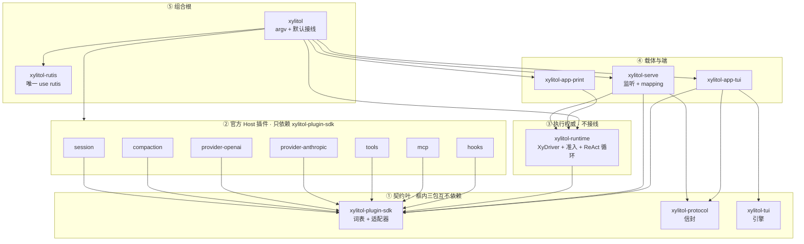

# xylitol 规划脊柱

规划真值，进 git 便于 diff。不升格为 `AGENTS.md` / spec。
进度只改本文件。稳定规则写进 `AGENTS.md`。行为合约写进 `llmanspec/`。
文风：`/home/l8ng/Projects/__straydragon__/STC-Simplified-Technical-Chinese`。

一事只在一节写全，其余用指针。沿革查 git。

<a id="now"></a>

## 现在

下一刀是 **[S2](#S2)**：会话 = instance。S1 完成。

S1d 收口：根 `src/*.rs` 只剩 [§2.2.1](#ROOTSRC) 五文件。占用 / Driver 在 `wiring` 内；迁进 `xylitol-serve` 要等 `XyInProcessDriver` 进 runtime，不挡 S2。

主线是 rutis 接入，顺序 **S1 → S2 → S3 → S4 → S5**，crate 图以 [§2](#TARGET) 为准。延后项见 [§5](#DEFER)，不插入主线。

装配适配层 `xylitol-rutis` 已在 workspace。组合根经它 `apply` 官方 Host 插件。结构说明：`.tmp/装配与rutis.md`（临时；随本文件一起撤）。

禁边闸：`scripts/check_crate_graph.py`。成员名单以根 `Cargo.toml` 为准。架构规则以 `src/AGENTS.md` 为准。包名真源是本文件 §2。

回退点 tag **`v0.0.0-pre.old`**（`004a2e4d`）。命令：`git switch -d v0.0.0-pre.old`。

“不用就不付钱”分三层，不要混。

| 层 | 规则 |
|---|---|
| 编译 | 依赖写在会用该库的 crate |
| 装配 | 没挂的插件不 start |
| 热路径 | 不在每 token / 每帧上计费 |

不为编译速度拆 crate。单包 default-on 的 Cargo feature 不省默认二进制。

读法：现在 → [§2](#TARGET) → [§3](#MAIN) → 动手。延后只在排主线之外时读 [§5](#DEFER)。

---

## 1. 约束

1. 行为不变的组织改动可跳过 llman-sdd 生命周期。live `.feature` 主语 / 路径过期时，直接改 feature，再跑 `llman-sdd validate`。
2. 产品可观察行为变化必须走完整 SDD：explore → propose → apply → verify → archive。
3. 任何批次合并前必须 `just qa`。触及真终端时再加 `just qa-e2e`。
4. 试验脚本只许 `lab_` 前缀。
5. 提交用 Conventional Commits。未要求则不自动 commit。
6. `AGENTS.md` 只收硬约束 / 稳定原则。不得把本文件进度抄进去。移除即改写，不留墓碑。
7. 同 crate 的不同 worktree **禁止**共用 `CARGO_TARGET_DIR`。
8. 改名一次性改调用点。不留兼容别名，不留 `#[deprecated]`。

| SDD | 何时 | 做什么 |
|---|---|---|
| skip-SDD | 纯组织 / 工具链 / 编译隔离，且产品行为不变 | 直接改代码 + `just qa` |
| validate-only | 组织演进导致 live `.feature` 过期 | 直接改 `.feature` + `llman-sdd validate` + `just qa` |
| must-SDD | 改了用户能看见或默认二进制含什么 | 完整 change 生命周期 |

发现“以为组织改动、实际改了行为”时立刻停，转 propose。

提交：工具链 `build:` / `chore:`；重写 `feat:` / `refactor:`；行为 `fix:`；SDD `chore(sdd):` / `archive(sdd):`。
不碰（除非该批次点名）：`docs/architecture/`、`_INTERVIEW/`、`delayed-changes/legacy/`。改行为才动 `llmanspec/`。

禁止创建：`xylitol-host`、`xylitol-client`、`xylitol-kernel`、`xylitol-assemble`、`xylitol-types`、`xylitol-official-plugin-react`、`xylitol-official-plugin-tui`、`xylitol-app-voice`、空 LSP/DAP crate、dylib 加载器、`crates/xylitol/`。

---

<a id="TARGET"></a>

## 2. 目标形态

新 crate 按契约重写。禁止 `pub use` 根 `src/` 模块凑编译。不留兼容 shim。

三层分名：**角色**（执行权威）/ **服务提供方**（`xylitol-runtime`）/ **载体**（`xylitol-serve`）。crate 名只表达其中一层。不要 `xylitol-host`、`xylitol-client`、`xylitol-server-host`。**组合根不是第四个角色名**，落在根包 `xylitol`。

`XyDriver` 是 runtime 侧应用协议。客户端只通过 attach 消费。S1 rutis 只装配 runtime 进程内的 Host 侧插件。`xylitol-app-tui` 不是 rutis fiber。

<a id="TERMS"></a>

### 2.0 用语

本节名称在后文只按这里的意思用。对照总表：`docs/architecture/术语表.md`。

**词表**（vocabulary，共享类型）是 Host 侧（插件 + runtime）都要 `use` 的那一组类型和适配器 trait，几乎不含业务实现。例子：`AgentMessage`、`XyEvent`、`XyError`、`XyModel`。词表 crate 是 `xylitol-plugin-sdk`。产品 TUI 可依赖 sdk 做 `XyEvent` 投影，不得依赖官方插件，不得依赖 runtime。不要再拆 `xylitol-types`。

**词表薄留**：只把类型形状放进 `xylitol-plugin-sdk`。HTTP、假实现、观测实现不放进去。

**产品信封**（envelope）是 client/server 四象限 RPC。crate 是 `xylitol-protocol`。只描述跨端形状。不认识适配器，不认识 `XyEvent`。与 `xylitol-plugin-sdk` 互不依赖。

**官方 Host 插件**是本仓库 Host 侧静态 crate，包名 `xylitol-official-plugin-*`。不是插件市场，不是 dylib。动态加载见 [S4](#S4)。

**适配器**（adapter）：`XyModel`、`XyTool`、`XySessionStore` 这类可替换实现。调用点 `xylitol_plugin_sdk::{XyModel, …}`。不要写 seam / port / 可替换口。sdk 内私有模块名仍是 `ports`，不改名为 `adapters`。

**执行权威**是 runtime 侧角色：会话循环、trust、准入、ReAct 循环。crate 是 `xylitol-runtime`。`xylitol-runtime` 不是组合根。

**载体**（carrier）是监听 + 编解码。本仓库实现是 `xylitol-serve`。

**组合根**是唯一把循环 + 工具 + 模型 + 会话接在一起的地方。落在仓库根包 `xylitol`（argv + 默认接线）。经装配适配层 `apply` 官方 Host 插件。`xylitol-runtime` 不接线。

**装配适配层**：`xylitol-rutis`。唯一允许 `use rutis`。

**客户端 / 端**（client / surface）是 `xylitol-app-*`。端认信封或 `XyDriver`。端不是 Host 插件。TUI 引擎 `xylitol-tui` 零引用产品。

**操作器**相对端而言：模型、会话、MCP、trust 在 Host 侧。端做键、画、TTY。

禁止 crate 名：`xylitol-types`；`xylitol-assemble`；`xylitol-kernel`；`xylitol-host`；`xylitol-official-plugin-react`；`xylitol-app-voice`。禁止用 `xylitol-protocol` 承接 sdk。禁止把信封 / 词表 / ReAct 循环做成可卸官方插件。

<a id="SETTLED"></a>

### 2.0b 定案

**P1 替换** 不同理由分开：厂商 HTTP ≠ 压缩策略 ≠ 会话落盘 ≠ 工具实现 ≠ ReAct 循环。OpenAI 兼容与 Anthropic 各一插件。DeepSeek overlay 留在 openai 插件。

**P2 开关** 没配置不 start。mcp / hooks 仍是官方插件 crate。`server` / `mcp` feature 可从二进制拿掉。未配置不得为“将来插件”堆抽象。

**P3 生命周期** 组合根经 `xylitol-rutis` `apply`。会话 = instance 见 [S2](#S2)。dylib 见 [S4](#S4)。禁止预埋空壳。

**P4 热路径** ReAct 循环在 `xylitol-runtime`。不做成官方插件。无第二实现。测端已有 `ScriptedDriver`。

**P5 稳定方向** `plugin-sdk` ∥ `protocol` ∥ `xylitol-tui`。runtime → sdk。runtime ↛ 插件、↛ 信封。插件之间不得 `use`。mapping 只在 serve。Print 只依赖 runtime。

**P6 依赖卫生** `async-openai` 只在 openai 插件。`rmcp` 只在 mcp 插件。`salvo` 只在 serve。fory 只在 protocol。Anthropic 构建不得编 `async-openai`。第三方与 `xylitol-*` 版本真源是根 `Cargo.toml` 的 `[workspace.dependencies]`；成员 `workspace = true`。`vendor/gherkin` 走 `[patch.crates-io]`。

用户数据单元：书签 → 事实日志 + 回合/步骤。书签 ≠ 主路径 ≠ 树干前缀。KV 只追加不改前缀。切主路径 = 追加高注意力事实。压缩追加切点，不重写旧行。组稿三槽：稳定系统提示 / 高注意力（最新主路径；压缩后仍要看见）/ 易变状态栏。改注入策略走 must-SDD。

```text
我 → 会话*（书签 + 主路径）
      ├── 事实日志（只追加）
      └── 回合* → 步骤*
```

所有权：session 插件写事实；compaction 插件写摘要条；runtime 跑回合、步骤、投影组稿；端只消费事件。

官方插件七个：session、compaction、provider-openai、provider-anthropic、tools、mcp、hooks。没有 react。内置默认挂：session / compaction / provider-* / tools。配置启用：mcp / hooks。

测循环用假适配器。测端用 `ScriptedDriver`。插件依赖声明适配器，由组合根注入。

主动交互：唤醒源走准入，不换内环。schedule 见 [D7](#D7)。

<a id="LEVELS"></a>

### 2.1 组件级别

crate 边界按替换、开关、生命周期来划，不按 `app / agent / infra` 分层来划。分层纪律留在每个 crate 内部。按契约重写实现，不把今日模块原样倒进目标 crate。

内核判据：别的插件都要依赖，并且不能自己被门控掉。

| 级别 | 放什么 | 例 |
|---|---|---|
| 内核 | 词表、适配器、错误、信封、trust、会话身份、ReAct 循环。不得知道压缩策略、具体厂商、TUI。不得接线 | `xylitol-plugin-sdk`、`xylitol-protocol`、`xylitol-runtime` |
| 内置插件 | 官方静态 `xylitol-official-plugin-*`。默认挂。进程内 `apply` 取一次 `Arc`，之后直连 | session、compaction、provider-*、tools |
| 配置启用插件 | 仍是官方插件 crate；没配置不 start | mcp、hooks |
| 装配 | 同一批插件，rutis 装配器 | `xylitol-rutis` |
| 客户端 | 独立 `xylitol-app-*` + 引擎 `xylitol-tui`。不是 Host 插件 | app-tui / app-print / xylitol-tui |

禁止为 LSP / DAP / gpui / 语音端预埋空壳。禁止客户端进 `xylitol-official-plugin-*`。

<a id="GRAPH"></a>

### 2.2 目录总图

```text
仓库根 xylitol/                 组合根 package（BusyBox bin + embed）。不要 crates/xylitol/
  src/                          终态只留 CLI + wiring + embed，见 [§2.2.1](#ROOTSRC)
  crates/
    xylitol-plugin-sdk/         词表 + 适配器 + 错误
    xylitol-protocol/           四象限信封 + fory-v3 + PROTOCOL_VERSION
    xylitol-runtime/            执行权威：XyDriver + trust + 会话槽 + ReAct 循环 + 唤醒准入
    xylitol-serve/              载体：监听 + XyEvent ↔ v3 Event mapping
    xylitol-tui/                TUI 引擎。零引用产品。不改名
    xylitol-app-tui/            产品 TUI 客户端
    xylitol-app-print/          Print 客户端
    xylitol-rutis/              装配适配层；唯一 use rutis
  plugins/                      仅 Host 侧。Cargo 依赖只出现在根包
    xylitol-official-plugin-*/
```

箭头 `A → B` = A 的 `Cargo.toml` 依赖 B。



规则：

1. 插件只依赖 `xylitol-plugin-sdk`。插件之间不得 `use`。依赖用适配器声明，由组合根注入。
2. ① 三包互不依赖。`protocol` 不认识适配器，也不认识 `XyEvent`。`plugin-sdk` 不认识信封。
3. `xylitol-runtime` 只依赖 `xylitol-plugin-sdk`。不得依赖信封，不得依赖任何 `xylitol-official-plugin-*`。
4. `xylitol-serve` 依赖 runtime + protocol。mapping 只在 serve。Print 只依赖 runtime。
5. `xylitol-app-tui` 依赖信封、`xylitol-tui`、plugin-sdk。不依赖 Host 插件，不依赖 runtime。
6. 根包是组合根：唯一列出默认官方插件的 `Cargo.toml`。新增官方插件只改根包接线，不改 runtime。根包依赖 `xylitol-rutis`，不得直接 `use rutis`。
7. 每个 crate 内部仍守 `app → agent|infra → protocol`；`agent` 不得依赖 `infra`。禁止按这三层各拆一 crate。

<a id="ROOTSRC"></a>

### 2.2.1 根 `src/` 终态

组合根留在仓库根 package。`cargo run` 仍在仓库根。不要再做一个 `crates/xylitol/`。

```text
src/
  main.rs      tokio + run()
  lib.rs       embed + 精选 Xy* 再导出
  cli.rs       clap：无子命令 / tui / print / serve / --list-models
  wiring.rs    apply 七个官方插件，注入 runtime；没配置不 start mcp/hooks
  embed.rs     库用户走同一套 wiring，不经 argv
```

`cli/`、`wiring/` 是对应 `.rs` 的子模块。现行 `wiring/` 仍含占用与 Driver；迁进 serve 等 `XyInProcessDriver` 进 runtime。

里面没有 TUI 画布、Print 渲染、HTTP 监听、ReAct、工具实现。那些在 `xylitol-app-*` / `xylitol-serve` / `xylitol-runtime` / `official-plugin-*`。不得把端实现嵌回 `src/app/tui`、`src/app/print`。

<a id="LLM"></a>

### 2.3 LLM 方言

两族方言各一官方插件：OpenAI 兼容、Anthropic Messages。DeepSeek overlay 留在 openai 插件。不要抽 `xylitol-llm` / `xylitol-types`。不要把 DTO 搬回主仓 `xylitol`。不要把 HTTP / 假实现 / 观测实现放进 `xylitol-plugin-sdk`。

准入：P1 两个方言；P6 Anthropic 构建不得编 `async-openai`。live-provider 路径解析在 `lab_responses_prompt_cache.rs`。

**词表薄留**（只把类型形状放进 `xylitol-plugin-sdk`，零 HTTP）：`AgentMessage::Llm` / `XyChunk`；产品 usage 形状；`HEURISTIC_BYTES_PER_TOKEN` + `heuristic_token_count`（禁止 tiktoken / RemoteCount）；`XyGenerateOptions` 字段与 `ObsSessionContext` 纯结构；`HeaderBag` 或直接 `serde_json::Map`；`tool_wire`；`Compat` 名字（`generic` / `deepseek` 配置词）。

**插件各自实现**：Responses / Completions / assembler / OpenCode attribution / DeepSeek overlay → openai 插件。Anthropic Messages → anthropic 插件。假模型直接 `impl XyModel`。工厂由根包接线时调用。

---

<a id="MAIN"></a>

## 3. 主线：rutis 接入

编译痛点在工具链，不在拆 crate。不为编译速度再拆 crate。

接入前读 [`/home/l8ng/Projects/__straydragon__/rutis/xylitol-x-rutis-temp`](/home/l8ng/Projects/__straydragon__/rutis/xylitol-x-rutis-temp)（阅读序：assessment → host-server → plugin-policy → rewrite → overhead → dependency）。工作树：上游 `3d0bc0d` / rutis 0.13.0。

0.13 事件是五分发（`emit` / `parallel` / `serial` / `waterfall` / `bail`）。不要按 0.11 写「跨进程只通知」。temp 里与本文件冲突的句子不要照抄：ReAct 不是官方插件；包名是 `xylitol-official-plugin-*`；组合根是仓库根包。

S1 失败则 rutis 接入可中止。契约叶与 `xylitol-app-*` 留下。

<a id="S1"></a>

### 3.1 S1 装配运行时

热路径延迟不劣化。这是整次重写的 go/no-go。

| 切片 | 状态 | 做什么 |
|---|---|---|
| S1a 适配层 + 装配合约 | 完成 | `xylitol-rutis`；`workspace-assembly` 锁定空 MCP/hooks、信封 fory-v3、ReAct 在执行权威 |
| S1b 组合根切装配器 | 完成 | 根包经 `apply` 挂同一批官方 Host 插件；空 hooks / mcp 不建 fiber |
| S1c listen 迁载体 | 完成 | 监听 / 注册 / Gateway 在 `xylitol-serve`；占用经 `OccupiedHost` 注入。根包 `[dependencies]` 无 `salvo` / `fory`。`FORBIDDEN_DEPS` 套到根包 |
| S1d 根 `src/` 五文件 | 完成 | 根 `src/*.rs` 仅 `main.rs` / `lib.rs` / `cli.rs` / `wiring.rs` / `embed.rs`。门面已删；BDD 改绑 runtime / 官方插件 / `xylitol-app-tui` / plugin-sdk。v3 mapping 在 `xylitol-serve`。占用 / Driver / 剩余 infra 收进 `src/wiring/`。迁占用进 serve 等 `XyInProcessDriver` 进 runtime（runtime ↛ 信封 / 插件），不挡 S2 |

<a id="S2"></a>

### 3.2 S2 会话 = instance

删 `RuntimeBaseline` 手工物化。`RuntimeBaseline` / `build_baseline` 在这一阶段删除。

<a id="S3"></a>

### 3.3 S3 配置启用改走总线 / loader

hooks 改走事件总线。MCP 启动改走 loader。freeze → generation。

<a id="S4"></a>

### 3.4 S4 多语言叶 + dylib

动态加载。官方 Host 插件在此之前保持静态 crate。

<a id="S5"></a>

### 3.5 S5 产品 TUI 作 rutis 客户端

端的订阅方式。S1–S4 期间产品 TUI 仍走信封，不是 rutis fiber。

---

<a id="SCOPE"></a>

## 4. 产品范围

核 = 必须在现行 crate 图里。瘦 = 代码留、feature-gate 或下沉。删用户可见面须改 `.feature`。未列入本节的方向见 [§5](#DEFER) 或 GitHub [#28](https://github.com/StrayDragon/xylitol/issues/28)。

**核 — 用户侧**：TUI 默认 attach 本机 Host；Print；embed `XyDriver`；slash；bang；`$skill`；会话树；滚动区 / 固定区；换模 / thinking；图像粘贴 / 读图；designing（`xylitol tui designing`，仅 debug 构建；合约 [c2930](llmanspec/changes/archive/2026-10-18-c2930-add-tui-preview/)）。

**核 — Host**：监听 + 四象限信封（HTTP 不得删）；`XyDriver` 会话槽 / 单写者 ReAct；内置工具；Trust；会话持久化 / 导出；压缩；OpenAI 兼容 + Anthropic；MCP（有配置才装配）；hooks；`edit` 内部 patch。

**核 — 观测**：`provider-trace.jsonl` + fastrace；`xylitol.log`（永不 stdout）；`just obs-*`；inspect 脚本；`otel` feature（default 开，配置默认 none，关 feature 真能关）。禁止再引入 `tracing` 双栈。

**瘦**：serve `stop` 只印 SIGTERM；`server` / `mcp` feature 可关（default 仍开）；`jsonschema` / `minijinja` / `schemars` 下沉到使用方；`cli = []` 不单独发明空开关。`incremental = false`。

---

<a id="DEFER"></a>

## 5. 延后

不插入 [§3](#MAIN)。做完 S1–S5 再从编号小的捡，或另开批次。**最低优先级最后处理。**

<a id="D1"></a>

### D1 环境变量 `XYLITOL_WIRE_V3` 改名

用户可设。改名是可观察行为，走 must-SDD。代码标识已是 `ENVELOPE_FORMAT_ENV`。值与 content-type、fbs `namespace xy.wire.v3` 不动。

<a id="D2"></a>

### D2 `AgentMessage` / `EnvMessage` / `AgentPart` 不加 `Xy`

`Xy*` 留给适配器与叶。`AgentMessage` 是会话日志组合，不是适配器。改成 `XyAgentMessage` 会把书签词表和库契约焊成一套品牌。`AgentPart` 若将来加前缀应叫 `XyPart`。

<a id="D3"></a>

### D3 其余 BDD `.feature` 按样板改写

**最低优先级，最后处理。** 样板：`llmanspec/specs/workspace-assembly/`。硬规则：`llmanspec/AGENTS.md` 语言节。

- `规则:` = Gherkin Rule = 需求句，不执行。`@req:` 挂块头。
- `场景:` = 可执行例。独立中文名，写这一例在测什么。不得英文 kebab，不得复制规则标题。
- 步骤里的黑话改标准词（如「面」→「端」）。共用步骤先 `rg` 调用点再分批改。
- 不得为改名改产品行为。同步 `tests/bdd/bindings_*.rs` 的 `name=`，再 `llman-sdd validate`。

<a id="D4"></a>

### D4 `xylitol-app-tui` 的 `[lib] test = false`

把仍点名根包树的单测改到产品路径，或只留 BDD `steps_app_tui_*`。

<a id="D5"></a>

### D5 `tests/bdd/steps_layer_probe.rs`

仍 `la_load("src/…")`。layer-architecture 不绑 crate 布局。确认无其它 scenario 引用后可删文件。

<a id="D6"></a>

### D6 未开放端与扩展

gpui、LSP、DAP、Sub-Agent、语音端 / 全双工 realtime、键位可视化、Inspect wasm / 框选。禁止为此预埋空壳 crate。认领走 GitHub [#28](https://github.com/StrayDragon/xylitol/issues/28)。

<a id="D7"></a>

### D7 schedule / cron 唤醒源

未来工具。不预埋 crate。唤醒源走准入，不换内环。

<a id="D8"></a>

### D8 观测后置

samply suite、Jaeger。`agent_demo*` / `host_loop` 留在 `xylitol-tui`。maka 对照留 `docs/research/`。

信封标识不改：`crates/xylitol-protocol/src/v3/`；fbs `namespace xy.wire.v3`；content-type `application/x-fory-v3`；`WIRE_FORMAT_FORY_V3`。改 namespace 等于删旧加新。

---

## 6. 来源

| 主题 | 路径 |
|---|---|
| 团队怎么做 | `.claude/skills/xylitol-dev/SKILL.md` |
| STC | `/home/l8ng/Projects/__straydragon__/STC-Simplified-Technical-Chinese` |
| 代码架构 | `src/AGENTS.md` |
| 产品主线 | `docs/architecture/产品分层总览.md` |
| 编译调优 | `~/.config/llman/skills/rust-build-tune/` |
| rutis 方向 | `/home/l8ng/Projects/__straydragon__/rutis/xylitol-x-rutis-temp/` |
| crate 图细则 | 同上 `skills/xylitol-rutis-rewrite/references/` |

---

<a id="FACTS"></a>

## 附录 A. 现行 workspace

成员：根包 + plugin-sdk / protocol / runtime / serve / app-tui / app-print / xylitol-tui / xylitol-rutis / 七个官方插件。`vendor/gherkin` 是 `[patch.crates-io]`。根 default = `cli, tui, otel, server, mcp`。

| 项 | 事实 |
|---|---|
| `cli = []` | 空 feature，不裁依赖 |
| `server` | optional；default 开；关 feature 真能关 |
| `mcp` | optional `rmcp`；default 开；运行时有配置才装配 |
| `otel` | optional OTLP；default 开；配置默认 none；关 feature 真能关 |
| `[workspace.dependencies]` | 版本真源。成员 `workspace = true` |

dev：`opt-level = 0`，依赖 `opt-level = 3`，`debug = "line-tables-only"`，`incremental = false`，`codegen-units = 16`。
release：`opt-level = "z"`，`lto = "thin"`，`strip = "symbols"`，`panic = "abort"`，`codegen-units = 1`。
`.cargo/config.toml`：Linux mold + `-Zshare-generics`（同一份 rustflags）。不用 Cranelift。
主 worktree 用仓库内 `target/`；额外 worktree 须 `eval "$(just cargo-wt-env)"`。

产品主线：对话循环、内置工具、会话持久化 / 导出、压缩、两家模型 API、Trust、图像附件。默认入口：产品 TUI attach 本机 Host（未在听失败）。后置：MCP。

---

## 附录 B. designing

入口：`xylitol tui designing`（仅 debug 构建）。场景槽 + 假 Host。designing preview = 把某场景注入同一 TUI 画布。合约：[c2930-add-tui-preview](llmanspec/changes/archive/2026-10-18-c2930-add-tui-preview/)。

框选 / `InspectFrame` / Inspect wasm 见 [D6](#D6)。不建 `designing/` 目录，本轮不装 wasm target。
