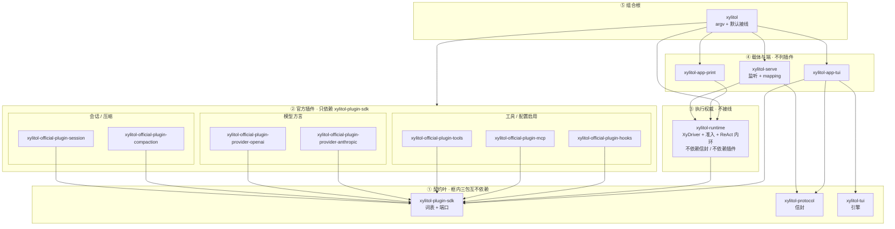

# xylitol 规划脊柱

本文件是规划真值，进 git 便于 diff。不升格为 `AGENTS.md` / spec。
进度只改本文件。稳定规则仍写进 `AGENTS.md`。行为合约仍写进 `llmanspec/`。
文风：`/home/l8ng/Projects/__straydragon__/STC-Simplified-Technical-Chinese`。

一事只在一节写全，其余章节用指针。沿革查 git。

<a id="now"></a>

## 现在

下一刀是 **[WS3](#S1) / S1**（rutis）。接入前必读 [§3.1](#S1) 的 `xylitol-x-rutis-temp`。本轮不引入 rutis。

目标 crate 图见 [§2](#TARGET)。禁边闸 `scripts/check_crate_graph.py`。成员名单以根 `Cargo.toml` 为准。架构规则以 `src/AGENTS.md` 为准。包名真源是本文件 §2。

根 `src/` 仍含 CLI、composition、Host listen、`agent` facade（BDD c2837）。终态五文件见 [§2.2.1](#ROOTSRC)，随 S1 再削。

与 S1 并行、可 skip-SDD 的卫生债：[§3.2.2](#NAMES) 与 [§3.2.3](#PORTS) 同一批。版本真源是根 `[workspace.dependencies]`，见 [§3.2.1](#WSDEP)。卫生债不挡 rutis。

回退点 tag **`v0.0.0-pre.old`**（`004a2e4d`）。命令：`git switch -d v0.0.0-pre.old`。

不为编译速度拆 crate。单包 default-on 的 Cargo feature 不省默认二进制。

“不用就不付钱”分三层，不要混。编译：依赖写在会用该库的 crate。装配：没挂的插件不 start。热路径：不在每 token / 每帧上计费。

读法：现在 → [§2.0b](#SETTLED) → [§2.2](#GRAPH) → [§3.1](#S1) → [§3.2](#HYGIENE)。

---

## 1. 约束

1. 行为不变的组织改动可跳过 llman-sdd 生命周期。live `.feature` 主语 / 路径过期时，直接改 feature，再跑 `llman-sdd validate`。
2. 产品可观察行为变化必须走完整 SDD：explore → propose → apply → verify → archive。
3. 任何批次合并前必须 `just qa`。触及真终端时再加 `just qa-e2e`。
4. 试验脚本只许 `lab_` 前缀。
5. 提交用 Conventional Commits。未要求则不自动 commit。
6. `AGENTS.md` 只收硬约束 / 稳定原则。不得把本文件进度抄进去。移除即改写，不留墓碑。
7. 同 crate 的不同 worktree **禁止**共用 `CARGO_TARGET_DIR`。
8. 改名一次性改调用点。不留兼容别名，不留 `#[deprecated]`。

| SDD | 何时 | 做什么 |
|---|---|---|
| skip-SDD | 纯组织 / 工具链 / 编译隔离，且产品行为不变 | 直接改代码 + `just qa` |
| validate-only | 组织演进导致 live `.feature` 过期 | 直接改 `.feature` + `llman-sdd validate` + `just qa` |
| must-SDD | 改了用户能看见或默认二进制含什么 | 完整 change 生命周期 |

发现“以为组织改动、实际改了行为”时立刻停，转 propose。

提交：工具链 `build:` / `chore:`；重写 `feat:` / `refactor:`；行为 `fix:`；SDD `chore(sdd):` / `archive(sdd):`。
不碰（除非该批次点名）：`docs/architecture/`、`_INTERVIEW/`、`delayed-changes/legacy/`。改行为才动 `llmanspec/`。

---

<a id="TARGET"></a>

## 2. 目标形态

新 crate 按契约重写。禁止 `pub use` 根 `src/` 模块凑编译。不留兼容 shim。

三层分名：**角色**（执行权威）/ **服务提供方**（`xylitol-runtime`）/ **载体**（`xylitol-serve`）。crate 名只表达其中一层。不要 `xylitol-host`、`xylitol-client`、`xylitol-server-host`。**组合根不是第四个角色名**，落在根包 `xylitol`，见 [§2.0](#TERMS)。

`XyDriver` 是 runtime 侧应用协议。客户端只通过 attach 消费。S1 rutis 只装配 runtime 进程内的 Host 侧插件。`xylitol-app-tui` 不是 rutis fiber。

<a id="TERMS"></a>

### 2.0 用语

本节名称在后文只按这里的意思用。对照总表：`docs/architecture/术语表.md`。

**词表**（vocabulary，共享类型）是 Host 侧（插件 + runtime）都要 `use` 的那一组类型和端口 trait，几乎不含业务实现。例子：`AgentMessage`、`XyEvent`、`XyError`、`XyModel`。词表 crate 是 `xylitol-plugin-sdk`（插件作者依赖这一包）。产品 TUI 可依赖 sdk 做 `XyEvent` 投影，不得依赖官方插件，不得依赖 runtime。不要再拆 `xylitol-types`。

**词表薄留**：只把类型形状放进 `xylitol-plugin-sdk`。HTTP、假实现、观测实现不放进去。

**产品信封**（envelope）是 client/server 四象限 RPC。crate 是 `xylitol-protocol`。只描述跨端形状。不认识端口，不认识 `XyEvent`。与 `xylitol-plugin-sdk` 互不依赖。

**官方插件**是本仓库 Host 侧静态 crate，包名 `xylitol-official-plugin-*`。不是插件市场，不是 dylib。S4 才谈动态加载。

**端口 / 可替换口**（replaceable seam）：`XyModel`、`XyTool`、`XySessionStore` 这类可替换接口。落在 `xylitol-plugin-sdk` 根。模块路径见 [§3.2.3](#PORTS)。

**执行权威**是 runtime 侧角色：会话循环、trust、准入、ReAct 内环。crate 是 `xylitol-runtime`。`xylitol-runtime` 不是组合根。

**服务提供方**是把已装配 runtime 挂到线上的那一侧。本仓库实现是 `xylitol-serve`。

**载体**（carrier）是监听 + 编解码。本仓库实现也是 `xylitol-serve`。

**组合根**是唯一把循环 + 工具 + 模型 + 会话接在一起的地方。落在仓库根包 `xylitol`（argv + 默认接线）。`xylitol-runtime` 不接线。S1 前手工装配。

**客户端 / 端**（client / surface）是 `xylitol-app-*`。端认信封或 `XyDriver`。端不是 Host 插件。TUI 引擎 `xylitol-tui` 零引用产品。

**操作器**相对端而言：模型、会话、MCP、trust 在 Host 侧。端做键、画、TTY。

禁止 crate 名：`xylitol-types`；`xylitol-assemble`；`xylitol-kernel`；`xylitol-host`；`xylitol-official-plugin-react`；`xylitol-app-voice`。禁止用 `xylitol-protocol` 承接 sdk。禁止 S0 把信封 / 词表 / 内环做成一切皆插件。

<a id="SETTLED"></a>

### 2.0b 拍板

**P1 替换** 不同理由分开：厂商 HTTP ≠ 压缩策略 ≠ 会话落盘 ≠ 工具实现 ≠ ReAct 内环。OpenAI 兼容与 Anthropic 各一插件。DeepSeek overlay 留在 openai 插件。

**P2 开关** 没配置不 start。mcp / hooks 仍是官方插件 crate。`server` / `mcp` feature 可从二进制拿掉。未配置不得为“将来插件”堆抽象。

**P3 生命周期** S1 才引 rutis。S1 前根包手工 `new` 插件并注入 runtime。S2 会话 = instance。S4 才谈 dylib。本轮禁止预埋空壳。

**P4 热路径** ReAct 内环在 `xylitol-runtime`。不做成官方插件。无第二实现。测端已有 `ScriptedDriver`。

**P5 稳定方向** `plugin-sdk` ∥ `protocol` ∥ `xylitol-tui`。runtime → sdk。runtime ↛ 插件、↛ 信封。插件之间不得 `use`。mapping 只在 serve。Print 只依赖 runtime。

**P6 依赖卫生** `async-openai` 只在 openai 插件。`rmcp` 只在 mcp 插件。`salvo` 只在 serve。fory 只在 protocol。Anthropic 构建不得编 `async-openai`。

用户数据单元：书签 → 事实日志 + 回合/步骤。书签 ≠ 主路径 ≠ 树干前缀。KV 只追加不改前缀。切主路径 = 追加高注意力事实。压缩追加切点，不重写旧行。组稿三槽：稳定系统提示 / 高注意力（最新主路径；压缩后仍要看见）/ 易变状态栏。改注入策略走 must-SDD。

```text
我 → 会话*（书签 + 主路径）
      ├── 事实日志（只追加）
      └── 回合* → 步骤*
```

所有权：session 插件写事实；compaction 插件写摘要条；runtime 跑回合、步骤、投影组稿；端只消费事件。

Cargo：`plugin-sdk` ∥ `protocol` ∥ `xylitol-tui`。runtime → sdk。插件 → sdk。serve → runtime + protocol。app-tui → protocol + tui + sdk。根包 → 插件 + runtime + 端 + 载体。图：[§2.2](#GRAPH)。

官方插件七个：session、compaction、provider-openai、provider-anthropic、tools、mcp、hooks。没有 react。

测循环用假端口。测端用 `ScriptedDriver`。插件依赖声明端口，由根包注入，兄弟 crate 不得 `use`。S1 的 `injects()` 同一句话。

主动交互：唤醒源走准入，不换内环。schedule 是未来工具，不预埋 crate。

<a id="LEVELS"></a>

### 2.1 组件级别

crate 边界按替换、开关、生命周期来划，不按 `app / agent / infra` 分层来划。分层纪律留在每个 crate 内部。按契约重写实现，不把今日模块原样倒进目标 crate。

内核判据：别的插件都要依赖，并且不能自己被门控掉。

| 级别 | 放什么 | 例 | 现状 |
|---|---|---|---|
| 内核 | 词表、端口、错误、信封、trust、会话身份、**turn 循环（ReAct）**。不得知道压缩策略、具体厂商、TUI。不得接线 | `xylitol-plugin-sdk`、`xylitol-protocol`、`xylitol-runtime` | 现行 |
| 内置插件 | 官方静态 `xylitol-official-plugin-*`。默认挂。进程内 `apply` 取一次 `Arc`，之后直连 | session、compaction、provider-*、tools | 现行 |
| 配置启用插件 | 仍是官方插件 crate；没配置不 start | mcp、hooks | 现行；未配置不连 |
| S1 装配 | 同一批插件，换 rutis 装配器 | `xylitol-rutis` | 未建 |
| 客户端 | 独立 `xylitol-app-*` + 引擎 `xylitol-tui`。不是 Host 插件 | app-tui / app-print / xylitol-tui | 现行；引擎不改名 |

禁止为 rutis / LSP / DAP / gpui / 语音端预埋空壳。禁止客户端进 `xylitol-official-plugin-*`。Cargo 边与禁名见 [§2.0b](#SETTLED)。

### 2.2 目录总图

```text
仓库根 xylitol/                 组合根 package（BusyBox bin + embed）。不要 crates/xylitol/
  src/                          终态只留 CLI + wiring + embed，见 [§2.2.1](#ROOTSRC)
  crates/
    xylitol-plugin-sdk/         词表 + 端口 + 错误（插件作者依赖这一包）
    xylitol-protocol/           四象限信封 + fory-v3 + PROTOCOL_VERSION
                                可含很薄的 attach client 半；过厚再拆 xylitol-attach
    xylitol-runtime/            执行权威：XyDriver + trust + 会话槽 + ReAct 内环 + 唤醒准入
                                进程内直调合法。不接线、不依赖插件、不依赖信封
    xylitol-serve/              载体：把已装配的 runtime 挂到 HTTP/WS
                                并做 XyEvent ↔ v3 Event mapping
    xylitol-tui/                TUI 引擎。零引用产品。不改名
    xylitol-app-tui/            产品 TUI 客户端（信封 + tui + sdk 投影）
    xylitol-app-print/          Print 客户端（只认 XyDriver）
    xylitol-rutis/              S1 才建；唯一 use rutis
  plugins/                      仅 Host 侧。Cargo 依赖只出现在根包
    xylitol-official-plugin-session/
    xylitol-official-plugin-compaction/
    xylitol-official-plugin-provider-openai/
    xylitol-official-plugin-provider-anthropic/
    xylitol-official-plugin-tools/
    xylitol-official-plugin-mcp/
    xylitol-official-plugin-hooks/
```

| 角色 | crate |
|---|---|
| TUI 引擎 | `xylitol-tui` |
| 产品 TUI | `xylitol-app-tui`（引擎 + protocol + sdk 投影） |
| Print | `xylitol-app-print`（同进程直调 runtime，不是插件，不编 fory） |
| 操作器 | `xylitol-runtime`（执行权威；不是组合根） |
| 监听 | `xylitol-serve`（产品 TUI 默认 attach 本机这一层） |
| 组合根 | 仓库根包 `xylitol`（argv + wiring + embed；唯一列出官方插件的 Cargo.toml） |

<a id="ROOTSRC"></a>

### 2.2.1 根 `src/` 终态

拍板：组合根留在仓库根 package。`cargo run` 仍在仓库根。不要再做一个 `crates/xylitol/`。

`src/` 终态只是 CLI 与 embed 入口：

```text
src/
  main.rs      tokio + run()
  lib.rs       embed + 精选 Xy* 再导出
  cli.rs       clap：无子命令 / tui / print / serve / --list-models
  wiring.rs    new 七个官方插件，注入 runtime；没配置不 start mcp/hooks
  embed.rs     库用户走同一套 wiring，不经 argv
```

里面没有 TUI 画布、Print 渲染、HTTP 监听、ReAct、工具实现。那些在 `xylitol-app-*` / `xylitol-serve` / `xylitol-runtime` / `official-plugin-*`。今日 `src/app/core` 里的 `XyDriver` / bang / export 也不属这层。不得把端实现嵌回 `src/app/tui`、`src/app/print`。

<a id="GRAPH"></a>

箭头 `A → B` = A 的 `Cargo.toml` 依赖 B（A 编译要等 B）。稳定的被依赖方画在上面。插件之间没有箭头。`xylitol-rutis` 本轮不画。根包对 ② 每个插件各有一条 Cargo 依赖，图上收成指向 ② 的一条边，避免和 ① 缠在一起。



对照 rust-build-tune / matklad（编译是副产品；拆分理由仍是 P1–P6）：

| 原则 | 本图 |
|---|---|
| 宽而浅，不要链 | ② 七个插件并行。不把 session→compaction 串成链。ReAct 在 runtime，不占插件位 |
| 词表稳、易变在上 | ① 少变；② 易变；⑤ 接线名单最易变 |
| 稳定不依赖易变 | sdk / protocol / tui 三包互不依赖。runtime ↛ 插件、↛ protocol |
| 一个叶子收口 | 只有根包同时依赖插件 + runtime + 端 + 载体。不另建 `xylitol-assemble` |
| 不为编译拆 | 不拆 `xylitol-types`。不把 tools 拆成每工具一包。不合并 session/compaction（变更理由不同）。不把 ReAct 拆成插件（无第二实现，测端已有 `ScriptedDriver`） |
| P6 依赖卫生 | `rmcp` 只在 mcp 插件；`async-openai` 只在 openai 插件；`salvo` 只在 serve；fory 只在 protocol（serve mapping 与 TUI attach 传递用）。print / runtime 不编 fory |
| 工具链先于拆 crate | mold / sccache / 每树独立 `CARGO_TARGET_DIR` / `-Zshare-generics` 已做 |
| 端口非泛型 | `dyn XyModel` + `async_trait`。crate 边界不放厚泛型壳 |
| 工件 m×n | 产品一个 BusyBox bin。集成测试多文件靠 share-generics，不靠再拆 crate |
| 甜区 | 约 15 个 crate。禁止为对称冲到 25 |

规则：

1. 插件只依赖 `xylitol-plugin-sdk`。插件之间不得 `use`。依赖用端口声明，由组合根注入。插件不依赖 `xylitol-protocol`。
2. 方言插件只依赖 [§2.3](#LLM) 标成“词表薄留”的类型。
3. ① 三包互不依赖。`protocol` 不认识端口，也不认识 `XyEvent`。`plugin-sdk` 不认识信封。
4. `xylitol-runtime` 只依赖 `xylitol-plugin-sdk`。不得依赖信封，不得依赖任何 `xylitol-official-plugin-*`。
5. `xylitol-serve` 依赖 runtime + protocol。mapping 只在 serve。Print 只依赖 runtime，不依赖 serve，不依赖 protocol。
6. `xylitol-app-tui` 依赖信封、`xylitol-tui`、plugin-sdk（`XyEvent` 投影）。不依赖 Host 插件，不依赖 runtime。
7. 根包是组合根：唯一列出默认官方插件的 `Cargo.toml`。新增官方插件只改根包接线，不改 runtime。
8. 每个 crate 内部仍守 `app → agent|infra → protocol`；`agent` 不得依赖 `infra`。禁止按这三层各拆一 crate。禁止 `xylitol-domain` / `xylitol-types` / `xylitol-assemble` / `xylitol-kernel`。禁止用 protocol 承接 plugin-sdk。
9. `vendor/gherkin` 保持上游包名加 path patch。

共享只允许：跨端协议形状、`.feature` 句子、固定区词汇、DESIGN 色板。Harness：引擎按键→状态在 `xylitol-tui`；产品场景 / 假 Host designing 在 `xylitol-app-tui`。

<a id="LLM"></a>

### 2.3 LLM 方言

两族方言各一官方插件：OpenAI 兼容、Anthropic Messages。DeepSeek overlay 留在 openai 插件。不要抽 `xylitol-llm` / `xylitol-llm-types` / `xylitol-types`。不要把 DTO 搬回主仓 `xylitol`。不要把 HTTP / 假实现 / 观测实现放进 `xylitol-plugin-sdk`。

准入：P1 两个方言；P6 Anthropic 构建不得编 `async-openai`。live-provider 路径解析在 `lab_responses_prompt_cache.rs`。

**词表薄留**（只把类型形状放进 `xylitol-plugin-sdk`，零 HTTP）：`AgentMessage::Llm` / `XyChunk`；产品 usage 形状；`HEURISTIC_BYTES_PER_TOKEN` + `heuristic_token_count`（禁止 tiktoken / RemoteCount；`estimate_context` 跟 compaction 插件）；`XyGenerateOptions` 字段与 `ObsSessionContext` 纯结构；`HeaderBag` 或直接 `serde_json::Map`；`tool_wire`（两插件不能互依）；`Compat` 名字（`generic` / `deepseek` 配置词）。

**插件各自实现**：Responses / Completions / assembler / OpenCode attribution / DeepSeek overlay → openai 插件。Anthropic Messages → anthropic 插件。`json_parse` 方言私有。`WirePolicy` 跟 openai 插件。`HttpHooks` 由 hooks 插件提供，方言消费 port。假模型直接 `impl XyModel`，不进内核。工厂由根包接线时调用。

方言直接 `impl XyModel`，错误直接 `XyError`。观测只带 generate 快照，不设全局槽。

不要：按文件再拆 assembler；DeepSeek 单独 crate；等 S1 再拆 HTTP；把 Fake / WirePolicy / trace / TLS 放进内核。方言内部仍带 `AiBridge*` 前缀的类型，改名见 [§3.2.2](#NAMES)。

### 2.4 现行名

| 含义 | 现行名 |
|---|---|
| 跨端协议 crate | `xylitol-protocol`。中文“跨端协议”。模块名 `wire` 与组合根 `wiring` 分清；文件名债见 [§3.2.2](#NAMES) |
| 词表 crate | `xylitol-plugin-sdk`。不要 `xylitol-types`，不要让 protocol 整包承接 |
| 官方 Host 插件前缀 | `xylitol-official-plugin-*`（不是内核） |
| 执行权威 / 提供方 / 载体 | 角色“执行权威”；提供方 HostServer；载体 carrier。`XyDriver`、`HostClient` 保留 |
| 模型契约 | 契约侧 `XyModel`；agent 侧用选择 / 装配 |
| 组合根 | 仓库根包 `xylitol`。`src/` 终态 = CLI + wiring + embed，见 [§2.2.1](#ROOTSRC)。不要缩成只剩 argv，也不要把接线塞进 runtime |
| feature 名 `server` | 可仍叫 `server`；不得改 attach 行为 |

不改：`xylitol-tui`、`XyDriver`、`XyEvent`、`XyModel`、`vendor/gherkin`。
`Xy*` = 库入口契约；`AgentMessage` / `XyLlmMessage` / `XyEvent` = plugin-sdk 词表；Command/Event = 信封载荷（`v3::*`）。新类型不得再发明第四套品牌。

---

<a id="BATCH"></a>

## 3. 批次

编译痛点在工具链，不在拆 crate。不为编译速度再拆 crate。

禁止创建：`xylitol-rutis`（S1 才建）、`xylitol-host`、`xylitol-client`、`xylitol-kernel`、`xylitol-assemble`、`xylitol-types`、`xylitol-official-plugin-react`、`xylitol-official-plugin-tui`、`xylitol-app-voice`、空 LSP/DAP crate、dylib 加载器、`crates/xylitol/`（组合根就是仓库根）。

<a id="S1"></a>
<a id="WS2"></a>

### 3.1 WS3 / S1（本轮不做接入，只记必读）

| 阶段 | 动作 |
|---|---|
| S1 | 引 rutis 只做组装运行时；热路径延迟不劣化。这是整次重写的 go/no-go |
| S2 | 会话 = instance；删 `RuntimePorts` 手工物化 |
| S3 | hooks→bus、MCP boot→loader、freeze→generation |
| S4 | 多语言叶 + dylib |
| S5 | TUI 作客户端事件订阅者 |

S1 失败则 rutis 接入可中止。契约叶与 `xylitol-app-*` 仍留下。

**S1 必读**：接入 rutis 必须先读 [`/home/l8ng/Projects/__straydragon__/rutis/xylitol-x-rutis-temp`](/home/l8ng/Projects/__straydragon__/rutis/xylitol-x-rutis-temp)（README 阅读序：assessment → host-server → plugin-policy → rewrite → overhead → dependency）。用该目录简化：IoC 从手工 `wiring.rs` 升到运行时、插件 `injects()`、实例/生命周期、开销红线、文件归位 `skills/xylitol-rutis-rewrite/references/crate-split-detail.md`。唯一 `use rutis` 落点是未来的 `xylitol-rutis`。

temp 里与现行拍板冲突的句子不要照抄：ReAct 不是官方插件（在 `xylitol-runtime`）；包名是 `xylitol-official-plugin-*` 不是 `xylitol-core-plugin-*`；组合根是仓库根包，不是 `xylitol-assemble` / `xylitol-kernel`。

随 S1 削的残差。卫生债见 [§3.2](#HYGIENE)。

- 根 `src/` 收到 [§2.2.1](#ROOTSRC) 五文件。Host listen 从 `src/app/server` 迁到 `xylitol-serve`。`scripts/check_crate_graph.py` 的 `TRANSITION_EXEMPT = {xylitol}` 随 listen 迁走后取消。
- `agent` facade（BDD c2837）随组合根变薄后改绑定或删。
- `crates/xylitol-app-tui` 的 `[lib] test = false`：把仍点名根包树的单测改到产品路径，或只留 BDD `steps_app_tui_*`。
- `tests/bdd/steps_layer_probe.rs` 仍 `la_load("src/…")`。layer-architecture 不绑 crate 布局。确认无其它 scenario 引用后可删文件。

<a id="HYGIENE"></a>

### 3.2 卫生债（skip-SDD，可与 S1 并行）

产品行为不变。改名一次性改调用点，见 §1.8。不跟 S1 捆。做完再 `just qa`。

<a id="WSDEP"></a>

#### 3.2.1 `[workspace.dependencies]` + `workspace = true`

第三方依赖与 path 上的 `xylitol-*` 以根 `Cargo.toml` 的 `[workspace.dependencies]` 为版本真源。成员只写 `workspace = true`，需要时覆盖 `features` / `optional` / `default-features`。features 仍按 crate 裁，遵守 P6。`vendor/gherkin` 仍走 `[patch.crates-io]`，不进 workspace 表。新依赖先入根表，再在使用方引用。

<a id="NAMES"></a>

#### 3.2.2 命名（与 [§3.2.3](#PORTS) 同一批）

内部编号 `c####` / `ath##` 保留。单独引用时带 ≤12 字语义尾。新代码不要再引入下表里的标识符。根 `src/` 与 `crates/` 仍有同名副本时，两边一起改。

**改（skip-SDD）**

| 现状 | 问题 | 目标 |
|---|---|---|
| `v7_layout.rs`；`plant_v7_*`；`then_header_v7_camelcase`；`test_c2826_v7_shell`。测试体里的 `v5_` / `v6_` 函数名 | 盘面代数进文件名 / 测试名 | `jsonl_layout` / `session_layout`。版本写进常量或断言消息 |
| `wire_v3_client.rs`（`crates/xylitol-app-tui` 与 `src/app/core/host_client` 两份）；`wire_v3_mod.rs`；`src/app/server/wire_v3.rs`；`with_wire_v3`；`negotiate_wire_v3`；`WIRE_V3_ENV` 代码标识 | `wire` 与组合根 `wiring` 撞词。代数焊进每个文件名 | 客户端模块 `envelope_client`。API 用 `PROTOCOL_VERSION`。env 名见下行 must-SDD |
| `crates/xylitol-protocol/src/v3/xy_wire_v3.fbs`；`scripts/gen_wire_v3.py`；`just codegen-wire`；`tests/bdd/steps_wire_v3.rs`；`bindings_wire_v3.rs` | 目录已是 `v3/`，文件名再带代数 | 见本小节「信封文件」：`v3/envelope.fbs`、`scripts/gen_envelope.py`、`just codegen-envelope`、`steps_envelope.rs`。**不改** fbs `namespace xy.wire.v3`、content-type、`WIRE_FORMAT_FORY_V3`。crate 根已有 `envelope.rs`（四象限外层），不要把 `pub mod v3` 改成 `pub mod envelope` |
| sdk `dto::AiBridgeMessage`（现 `pub use` 为 `LlmMessage`）；`AiBridgeError`；`AiBridgeGenerateOptions` 等历史别名；openai/anthropic `pub mod dto`；`reqwest_bridge.rs` | 已不用的包前缀。`LlmMessage` 是词表叶，过 `XyModel` 口，要 `Xy*` | 类型名 `XyLlmMessage`（serde 标签仍是 `role`，JSONL 不改）。错误走 `XyError`。方言私有 DTO 不带 `AiBridge`。`reqwest_headers` |
| `package-ai-bridge.feature`；`package-ai-bridge-accounting.feature`；`bindings_package_ai_bridge.rs`；`steps_bridge.rs` 的 `AiBridgeBdd`；`llmanspec/AGENTS.md` 的 `package-ai-bridge*` 前缀 | capability / BDD 仍按旧包名 | `provider-openai*`（与 live 路径一致）。validate-only |
| `xylitol::protocol::ports`（根 `src/protocol/mod.rs` 再导出 sdk）；BDD `tests/bdd` 走这条路径 | 信封 crate 不认识端口。路径撒谎 | `xylitol_plugin_sdk::{XyModel, …}`。见 [§3.2.3](#PORTS) |
| `RuntimePorts`；`runtime/ports.rs`（runtime crate 与根 `src/agent` 两份）；`build_ports` / `build_ports_with_store` | 与 sdk 模块、TCP 端口三重撞名。S2 才删物化，标识符现在就不要再扩散 | 同批改 `RuntimeBaseline` / `build_baseline`。S2 再删物化 |
| `crates/xylitol-app-tui` 的 `host-itest` cfg（`[lib] test = false`，feature 未声明） | 死开关 | 删 cfg 与 `Cargo.toml` 的 `check-cfg` |
| `src/infra/provider/adapter/` | 目录名还是第三层外壳 | 随根 `src/` 变薄删或并进方言插件。本批不要再往这里加类型 |

信封文件对照（`v3/` 目录不动）：

```text
crates/xylitol-protocol/src/v3/xy_wire_v3.fbs  →  v3/envelope.fbs
crates/xylitol-protocol/src/v3/generated.rs    留下（check-in 名已经对）
scripts/gen_wire_v3.py                         →  scripts/gen_envelope.py
  FBS 路径改 envelope.fbs
  foryc 输出 stem 变为 rust/envelope.rs，再写回 generated.rs
just codegen-wire                              →  just codegen-envelope
tests/bdd/steps_wire_v3.rs                     →  tests/bdd/steps_envelope.rs
tests/bdd/bindings_wire_v3.rs                  →  tests/bdd/bindings_envelope.rs
```

foryc 按 fbs 文件名出 `rust/<stem>.rs`。改文件名不必重跑 compiler：类型 ID 来自 `namespace xy.wire.v3` + table 名，不来自文件名。字节 conformance 锁不动。crate 根 `src/envelope.rs` 是四象限 `RpcMessage` / `PROTOCOL_VERSION`，与 `v3/envelope.fbs` 分工：外层版本号 vs 这一代二进制真源。

**改但 must-SDD**

| 现状 | 问题 | 目标 |
|---|---|---|
| 环境变量 `XYLITOL_WIRE_V3` | 用户可设。改名是可观察行为 | 本批只改代码标识。env 名另开 change |

**不改**

| 现状 | 原因 |
|---|---|
| `c####` / `ath##` | 内部编号，引用时带语义尾 |
| `crates/xylitol-protocol/src/v3/` 目录；fbs `namespace xy.wire.v3`；content-type `application/x-fory-v3`；`WIRE_FORMAT_FORY_V3` | 代数与跨端类型 ID。改 namespace 等于删旧加新 |
| `OpenAiResponsesAdapter` / `OpenAiCompletionsAdapter` / `AnthropicMessagesAdapter` / `McpToolAdapter` / `TuiInProcessAdapter` | 实现侧类型，名字对 |
| `app-tui-bridge` capability、`steps_app_tui_bridge.rs` | 产品 TUI 画布接线，不是 AiBridge。另议 |
| `xylitol-tui` 的 `syntect_bridge.rs` | 引擎内部，零引用产品 |
| `vendor/gherkin` | 上游包 |
| `TRANSITION_EXEMPT`、根 `src/` 五文件 | S1 残差，见 [§3.1](#S1) |
| `AgentMessage` / `EnvMessage` / `AgentPart` 是否加 `Xy` | **延后，不进本批。** 不宜加。`Xy*` 留给口与叶（`XyModel`、`XyLlmMessage`、`XyEvent`）。`AgentMessage` 是会话日志组合，不是可替换口。改成 `XyAgentMessage` 会把书签词表和库契约焊成一套品牌。`AgentPart` 若将来加前缀应叫 `XyPart`，也不进本批 |

<a id="PORTS"></a>

#### 3.2.3 `ports` 模块（与 [§3.2.2](#NAMES) 同一批）

**结论**：删 `xylitol-plugin-sdk` 的 `pub mod ports`。trait 已在 crate 根 `pub use`（`XyModel` / `XyTool` / `XySessionStore` 等）。调用点改到 `xylitol_plugin_sdk::XyModel`。不要把该模块改名为 `adapters`。

**原因**：该模块装的是可替换口 trait，不是实现。实现已经叫 `OpenAiResponsesAdapter`、`McpToolAdapter`、`TuiInProcessAdapter`。再把 trait 模块叫 `adapters`，检索对不上。`seams` 能对上术语表“缝”，但 crate 根已经再导出，再留一层模块名没有收益。

根包 `src/protocol/mod.rs` 的 `pub use … ports` 同批去掉。BDD 里的 `xylitol::protocol::ports::` 改到 sdk 根。`RuntimePorts` 见 [§3.2.2](#NAMES)。产品文“端口”第一次出现附“可替换口”。类型名 `Xy*` 不动。

---

<a id="SCOPE"></a>

## 4. 产品范围

核 = 必须在现行 crate 图里。瘦 = 代码留、feature-gate 或下沉。推迟 = 不进本轮。删用户可见面须改 `.feature`。

**核 — 用户侧**：TUI 默认 attach 本机 Host；Print；embed `XyDriver`；slash；bang；`$skill`；会话树；滚动区 / 固定区；换模 / thinking；图像粘贴 / 读图（解码器随 `plugin-tools`，不做单包 `image` feature）；designing（`xylitol tui designing`，仅 debug 构建；合约 [c2930](llmanspec/changes/archive/2026-10-18-c2930-add-tui-preview/)）。

**核 — Host**：监听 + 四象限信封（HTTP 不得删）；`XyDriver` 会话槽 / 单写者 ReAct；内置工具；Trust；会话持久化 / 导出；压缩；OpenAI 兼容 + Anthropic（薄词表 + 两个 provider 插件）；MCP（有配置才装配）；hooks；`edit` 内部 patch。

**核 — 观测**：`provider-trace.jsonl` + fastrace；`xylitol.log`（永不 stdout）；`just obs-*`；inspect 脚本；`otel` feature（default 开，配置默认 none，关 feature 真能关）。禁止再引入 `tracing` 双栈。

**瘦**：serve `stop` 只印 SIGTERM；`server` / `mcp` feature 可关（default 仍开）；`jsonschema` / `minijinja` / `schemars` 下沉到使用方；`cli = []` 不单独发明空开关；23 个集成测试二进制靠 `-Zshare-generics`，不删测试。`incremental = false`。

**推迟**：gpui、LSP、DAP、Sub-Agent、语音端 / 全双工 realtime、schedule/cron 唤醒源、键位可视化、Inspect wasm / 框选、samply suite、Jaeger、delayed-changes。`agent_demo*` / `host_loop` 留在 `xylitol-tui`。maka 对照留 `docs/research/`。

---

<a id="NO"></a>

## 5. 本轮不做

1. gpui / Web 控制台 / DAP / LSP / Sub-Agent / 语音端空壳 crate；`xylitol-official-plugin-lsp`、`xylitol-official-plugin-react`、`xylitol-official-plugin-schedule`、`xylitol-app-gpui`、`xylitol-app-voice`。
2. S1–S5 rutis。不为“一切皆插件”把信封 / 词表 / ReAct 内环提前 Cordis 化。
3. 按 layer 拆 crate；抽 `xylitol-domain` / `xylitol-types` / `xylitol-assemble` / `xylitol-kernel`；`xylitol-host` / `xylitol-client` / `xylitol-official-plugin-tui`。
4. 把发给模型的形状搬进主仓 `xylitol`；把方言 HTTP / 假实现 / 观测整包倒进 `xylitol-plugin-sdk`；用 `xylitol-protocol` 承接 plugin-sdk。把组合根或 mapping 塞进 runtime。runtime 依赖信封或官方插件。
5. 仅为编译速度拆 crate；全局 Cranelift；跨 worktree 共享 `CARGO_TARGET_DIR`。
6. 把 `AGENTS.md` 写成进度板；跳过 `just qa`；新 crate `pub use` 根 `src/`。
7. 单包 `image` Cargo feature。
8. default 去掉 `server` / `mcp` / `otel`。
9. CLI `xylitol resources`；`xylitol serve install`。
10. 把场景表当产品 slash。
11. 把 [§3.2](#HYGIENE) 的 rename 跟 S1 捆在一次提交里。

---

## 6. 来源

| 主题 | 路径 |
|---|---|
| 团队怎么做 | `.claude/skills/xylitol-dev/SKILL.md` |
| STC | `/home/l8ng/Projects/__straydragon__/STC-Simplified-Technical-Chinese` |
| 代码架构 | `src/AGENTS.md` |
| 产品主线 | `docs/architecture/产品分层总览.md` |
| spec 组织句 | 分层纪律与目标 crate 图在 `src/AGENTS.md`；规划对照本文件 §2 |
| 编译调优 | `~/.config/llman/skills/rust-build-tune/` |
| rutis 方向 | `/home/l8ng/Projects/__straydragon__/rutis/xylitol-x-rutis-temp/`（整份 temp；S1 必读，见 [§3.1](#S1)） |
| 拆分闸门 / crate 图 | 同上 `skills/xylitol-rutis-rewrite/references/`：`split-principles.md`（P1–P6）、`crate-graph.md`、`crate-naming.md`、`crate-split-detail.md`、`migration-stages.md` |

---

<a id="FACTS"></a>

## 附录 A. 现行 workspace

成员：根包 + `plugin-sdk` / `protocol` / `runtime` / `serve` / `app-tui` / `app-print` / `xylitol-tui` / 七个官方插件。`vendor/gherkin` 是 `[patch.crates-io]`。根 default = `cli, tui, otel, server, mcp`。

| 项 | 事实 |
|---|---|
| `cli = []` | 空 feature，不裁依赖 |
| `server` | optional；default 开；关 feature 真能关 |
| `mcp` | optional `rmcp`；default 开；运行时有配置才装配 |
| `otel` | optional OTLP；default 开；配置默认 none；关 feature 真能关 |
| `image` / `fory` / `jsonschema` / `minijinja` / `schemars` / `fastrace` | 非 optional |
| `salvo` / `tokio-tungstenite` / `xylitol-tui` | 随 feature 可选 |
| `[workspace.dependencies]` | 版本真源。成员 `workspace = true`。见 [§3.2.1](#WSDEP) |

dev：`opt-level = 0`，依赖 `opt-level = 3`，`debug = "line-tables-only"`，`incremental = false`，`codegen-units = 16`。
release：`opt-level = "z"`，`lto = "thin"`，`strip = "symbols"`，`panic = "abort"`，`codegen-units = 1`。
`.cargo/config.toml`：Linux mold + `-Zshare-generics`（同一份 rustflags）。不用 Cranelift（`aws-lc-rs` / `ring`）。
主 worktree 用仓库内 `target/`；额外 worktree 须 `eval "$(just cargo-wt-env)"`。

产品主线：对话循环、内置工具、会话持久化 / 导出、压缩、两家模型 API、Trust、图像附件。默认入口：产品 TUI attach 本机 Host（未在听失败）。后置：MCP。
`@req:r1532` 要求 server 应用面。未实现方向见 [#28](https://github.com/StrayDragon/xylitol/issues/28)。

---

## 附录 B. designing

入口：`xylitol tui designing`（仅 debug 构建）。场景槽 + 假 Host。designing preview = 把某场景注入同一 TUI 画布。合约：[c2930-add-tui-preview](llmanspec/changes/archive/2026-10-18-c2930-add-tui-preview/)。

框选 / `InspectFrame` / Inspect wasm 另开 change。不建 `designing/` 目录，本轮不装 wasm target。
