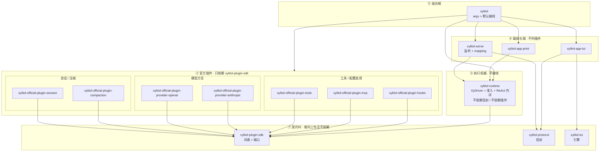

# xylitol 规划脊柱

本文件是规划真值，进 git 便于 diff。不升格为 `AGENTS.md` / spec。
进度只改本文件。稳定规则仍写进 `AGENTS.md`。行为合约仍写进 `llmanspec/`。
交流风格: ../STC-Simplified-Technical-Chinese

一事只在一节写全，他处用指针。沿革查 git。

<a id="now"></a>

## 现在

检查点 tag **`v0.0.0-pre.old`**（`004a2e4d`，W2.0 AGENTS SSOT，胖 `src/` 仍出产品）。回退：`git switch -d v0.0.0-pre.old`。

crate 图已拍板，见 [§2.0b](#SETTLED)。**[W2.0](#WS2)** 完成。走法：类型不双写、按 crate 切完就绿；先空壳 + 禁边门禁，再填叶。根 `src/` 终态 = CLI + wiring + embed，见 [§2.2.1](#ROOTSRC)。**[W2.0c](#WS2)** 完成（`just qa` 绿）。空壳在 `crates/` + `plugins/`；禁边闸 `scripts/check_crate_graph.py`。下一刀：**W2.1** 填 `xylitol-plugin-sdk`（类型不双写：填完主仓改 `use`，同批删旧模块）。搬旧模块前看 [§3.4](#GATES)。

读法：现在 → [§2.0b](#SETTLED) → [§2.2](#GRAPH) → [§3.2](#WS2) → [§3.4](#GATES)。

本轮不引入 rutis。不为编译速度拆 crate。单包 default-on 的 Cargo feature 不省默认二进制。

「不用就不付钱」分三层，不要混：编译（依赖写在会用它的 crate）→ 装配（没挂的插件不 start）→ 热路径（不在每 token / 每帧上）。

现行 workspace 成员以根 `Cargo.toml` 为准。架构规则以 `src/AGENTS.md` 的目标 crate 图为准。包名真源是本文件 §2。

---

## 1. 约束

1. 行为不变的组织改动可跳过 llman-sdd 生命周期。live `.feature` 主语 / 路径过期时，直接改 feature，再跑 `llman-sdd validate`。
2. 产品可观察行为变化必须走完整 SDD：explore → propose → apply → verify → archive。
3. 任何批次合并前必须 `just qa`。触及真终端时再加 `just qa-e2e`。
4. 试验脚本只许 `lab_` 前缀。
5. 提交用 Conventional Commits。未要求则不自动 commit。
6. `AGENTS.md` 只收硬约束 / 稳定原则。不得把本文件进度抄进去。移除即改写，不留墓碑。
7. 同 crate 的不同 worktree **禁止**共用 `CARGO_TARGET_DIR`。
8. 改名一次性改调用点。不留兼容别名，不留 `#[deprecated]`。

| SDD | 何时 | 做什么 |
|---|---|---|
| skip-SDD | 纯组织 / 工具链 / 编译隔离，且产品行为不变 | 直接改代码 + `just qa` |
| validate-only | 组织演进导致 live `.feature` 过期 | 直接改 `.feature` + `llman-sdd validate` + `just qa` |
| must-SDD | 改了用户能看见或默认二进制含什么 | 完整 change 生命周期 |

发现「以为组织改动、实际改了行为」时立刻停，转 propose。

提交：工具链 `build:` / `chore:`；重写 `feat:` / `refactor:`；行为 `fix:`；SDD `chore(sdd):` / `archive(sdd):`。
不碰（除非该批次点名）：`docs/architecture/`、`_INTERVIEW/`、`delayed-changes/legacy/`。改行为才动 `llmanspec/`。

---

<a id="TARGET"></a>

## 2. 目标形态

新 crate 按契约重写，禁止 `pub use` 旧 `src/` 模块凑编译。旧 `src/` 继续出产品二进制，对照 [§4](#SCOPE) 后再删对应旧模块。不留兼容 shim。

三层分名：**角色**（执行权威）/ **服务提供方**（`xylitol-runtime`）/ **载体**（`xylitol-serve`）。crate 名只表达其中一层。不要 `xylitol-host`、`xylitol-client`、`xylitol-server-host`。**组合根不是第四个角色名**，落在根包 `xylitol`，见 [§2.0](#TERMS)。

`XyDriver` 是 runtime 侧应用协议。客户端只通过 attach 消费。S1 rutis 只装配 runtime 进程内的 Host 侧插件。`xylitol-app-tui` 不是 rutis fiber。

<a id="TERMS"></a>

### 2.0 用语

本节名称在后文只按这里的意思用。对照总表：`docs/architecture/术语表.md`。

**词表**（vocabulary，共享类型）是 Host 侧（插件 + runtime）都要 `use` 的那一组类型和端口 trait，几乎不含业务实现。例子：`AgentMessage`、`XyEvent`、`XyError`、`XyModel`。词表 crate 是 `xylitol-plugin-sdk`（插件作者依赖这一包）。产品 TUI 不 use 这包。不要再拆 `xylitol-types`。

说明：词表不是“全部和模型有关的代码”。发 HTTP、拼请求体、读 SSE、假模型、写 `provider-trace.jsonl`，都不算词表。词表也不是文档开头那份术语对照表。

**词表薄留**：重写时只把类型形状放进 `xylitol-plugin-sdk`。HTTP、假实现、观测实现放进插件，见 [§2.3](#LLM)。

**端口**（port）：可替换的接口。业务只认 `XyModel` / `XyTool` / `XySessionStore` 这些 trait，不认某个厂商 SDK。

**信封**（RPC envelope）：client 与 Host 之间的四象限 RPC 帧（fory-v3）。信封不是发给模型的 JSON，也不是 `AgentMessage`。信封 crate 是 `xylitol-protocol`。线上形状是 `v3::Command` / `v3::Event`。不要用 protocol 承接 plugin-sdk。

**组合根**（composition root）：唯一把「循环 + 工具 + 模型 + 会话」接在一起的地方。S0 落在根包 `xylitol`（argv + 默认接线）。循环本体在 `xylitol-runtime`；根包只把端口实现注入进去。`xylitol-runtime` 不接线、不依赖任何官方插件 crate、不依赖信封。插件之间不得互相 `use`；需要别人时由组合根注入。

**mapping**：`XyEvent` ↔ `v3::Event` 是跨进程的活，落在载体 `xylitol-serve`。不进 protocol（信封不认识 `XyEvent`），不进 plugin-sdk，不进 runtime（Print 同进程直调，不得为此编 fory）。

**官方插件**：本仓库 Host 侧静态 crate，包名 `xylitol-official-plugin-*`。不是插件市场，不是 dylib。

**内置插件**：官方插件且默认挂上，可以换实现。产品里的「内置工具」（read / write / bash 等）属于 `xylitol-official-plugin-tools`，不是内核。

**配置启用插件**：仍是官方插件 crate。没有配置时组合根不调用 start。例子：MCP、hooks。

**内环**：按步骤分类的 ReAct（问模型 → 工具批 → 再问）。在 `xylitol-runtime`，不是插件。

**唤醒源**：谁有权开一个回合。用户 `Prompt`、steer、follow-up 已有；schedule / 监视 / 语音切句都打进同一道准入。

**主路径**：会话 header 上绑定的工作目录（cwd）。不是树干前缀。

**回合**：一次准入开跑到 `AgentEnd`（今日一条 `XyDriver::run` 流）。

**步骤**：回合里的一拍：一次 generate + 可选工具批（今日事件名 `TurnStart` / `TurnEnd`）。

<a id="SETTLED"></a>

### 2.0b 拍板链路

请求（默认产品 TUI attach）：

```text
我 → xylitol-app-tui → xylitol-protocol → xylitol-serve（mapping）
   → xylitol-runtime（准入 + 内环 + 组稿）
   → 端口：session / model / tools / compaction
```

Print：`我 → xylitol-app-print → xylitol-runtime`（不编 fory）。根包 `xylitol` 只在进程启动接线。

数据：

```text
我 → 会话*（书签 + 主路径）
      ├── 事实日志（只追加）
      └── 回合* → 步骤*
```

书签 ≠ 主路径 ≠ 树干前缀。KV 只追加不改前缀。切主路径 = 追加高注意力事实。压缩追加切点，不重写旧行。组稿三槽：稳定系统提示 / 高注意力（最新主路径；压缩后仍要看见）/ 易变状态栏。改注入策略走 must-SDD。

所有权：session 插件写事实；compaction 插件写摘要条；runtime 跑回合、步骤、投影组稿；端只消费事件。

Cargo：`plugin-sdk` ∥ `protocol` ∥ `xylitol-tui`。runtime → sdk。插件 → sdk。serve → runtime + protocol。app-tui → protocol + tui。根包 → 插件 + runtime + 端 + 载体。图：[§2.2](#GRAPH)。

官方插件七个：session、compaction、provider-openai、provider-anthropic、tools、mcp、hooks。没有 react。

测循环用假端口。测端用 `ScriptedDriver`。插件依赖声明端口，由根包注入，兄弟 crate 不得 `use`。S1 的 `injects()` 同一句话。

主动交互：唤醒源走准入，不换内环。schedule 是未来工具，不预埋 crate。

已否：`xylitol-types`；protocol 承接 sdk；`xylitol-assemble` / `xylitol-kernel` / `xylitol-host`；`xylitol-official-plugin-react`；S0 一切皆插件（信封/词表/内环 Cordis 化）；`xylitol-app-voice`。

<a id="LEVELS"></a>

### 2.1 组件级别

crate 边界按替换、开关、生命周期来划，不按 `app / agent / infra` 分层来划。分层纪律留在每个 crate 内部。按契约重写实现，不把今日模块原样倒进目标 crate。

内核判据：别的插件都要依赖，并且不能自己被门控掉。

| 级别 | 放什么 | 例 | 本轮 |
|---|---|---|---|
| 内核 | 词表、端口、错误、信封、trust、会话身份、**turn 循环（ReAct）**。不得知道压缩策略、具体厂商、TUI。不得接线 | `xylitol-plugin-sdk`、`xylitol-protocol`、`xylitol-runtime` | S0 建 |
| 内置插件 | 官方静态 `xylitol-official-plugin-*`。默认挂。进程内 `apply` 取一次 `Arc`，之后直连 | session、compaction、provider-*、tools | S0 建并重写 |
| 配置启用插件 | 仍是官方插件 crate；没配置不 start | mcp、hooks | S0 建；未配置不连 |
| S1 装配 | 同一批插件，换 rutis 装配器 | `xylitol-rutis` | 不引入 |
| 客户端 | 独立 `xylitol-app-*` + 引擎 `xylitol-tui`。不是 Host 插件 | app-tui / app-print / xylitol-tui | S0 重写 app；引擎不改名 |

禁止为 rutis / LSP / DAP / gpui / 语音端预埋空壳。禁止客户端进 `xylitol-official-plugin-*`。链路与已否见 [§2.0b](#SETTLED)。

### 2.2 目录总图

```text
仓库根 xylitol/                 组合根 package（BusyBox bin + embed）。不要 crates/xylitol/
  src/                          终态只留 CLI + wiring + embed，见 [§2.2.1](#ROOTSRC)
  crates/
    xylitol-plugin-sdk/         词表 + 端口 + 错误（插件作者依赖这一包）
    xylitol-protocol/           四象限信封 + fory-v3 + PROTOCOL_VERSION
                                可含很薄的 attach client 半；过厚再拆 xylitol-attach
    xylitol-runtime/            执行权威：XyDriver + trust + 会话槽 + ReAct 内环 + 唤醒准入
                                进程内直调合法。不接线、不依赖插件、不依赖信封
    xylitol-serve/              载体：把已装配的 runtime 挂到 HTTP/WS
                                并做 XyEvent ↔ v3 Event mapping
    xylitol-tui/                TUI 引擎。零引用产品。不改名
    xylitol-app-tui/            产品 TUI 客户端（只认信封）
    xylitol-app-print/          Print 客户端（只认 XyDriver）
    xylitol-rutis/              S1 才建；唯一 use rutis
  plugins/                      仅 Host 侧。Cargo 依赖只出现在根包
    xylitol-official-plugin-session/
    xylitol-official-plugin-compaction/
    xylitol-official-plugin-provider-openai/
    xylitol-official-plugin-provider-anthropic/
    xylitol-official-plugin-tools/
    xylitol-official-plugin-mcp/
    xylitol-official-plugin-hooks/
```

| 角色 | crate |
|---|---|
| TUI 引擎 | `xylitol-tui` |
| 产品 TUI | `xylitol-app-tui`（引擎 + protocol/attach） |
| Print | `xylitol-app-print`（同进程直调 runtime，不是插件，不编 fory） |
| 操作器 | `xylitol-runtime`（执行权威；不是组合根） |
| 监听 | `xylitol-serve`（产品 TUI 默认 attach 本机这一层） |
| 组合根 | 仓库根包 `xylitol`（argv + wiring + embed；唯一列出官方插件的 Cargo.toml） |

<a id="ROOTSRC"></a>

### 2.2.1 根 `src/` 终态

拍板：组合根留在仓库根 package。`cargo run` 仍在仓库根。不要再做一个 `crates/xylitol/`。

`src/` 终态只是 CLI 与 embed 入口，不是现在这棵胖树：

```text
src/
  main.rs      tokio + run()
  lib.rs       embed + 精选 Xy* 再导出
  cli.rs       clap：无子命令 / tui / print / serve / --list-models
  wiring.rs    new 七个官方插件，注入 runtime；没配置不 start mcp/hooks
  embed.rs     库用户走同一套 wiring，不经 argv
```

里面没有 TUI 画布、Print 渲染、HTTP 监听、ReAct、工具实现。那些在 `xylitol-app-*` / `xylitol-serve` / `xylitol-runtime` / `official-plugin-*`。今日 `src/app/core` 里的 `XyDriver` / bang / export 也不属这层。

过渡：旧 `src/` 继续出产品二进制。W2.5 收口后按模块删，不留 shim。不得把端实现嵌回 `src/app/tui`、`src/app/print`。

<a id="GRAPH"></a>

箭头 `A → B` = A 的 `Cargo.toml` 依赖 B（A 编译要等 B）。稳定的被依赖方画在上面。插件之间没有箭头。`xylitol-rutis` 本轮不画。根包对 ② 每个插件各有一条 Cargo 依赖，图上收成指向 ② 的一条边，避免和 ① 缠在一起。



对照 rust-build-tune / matklad（编译是副产品；拆分理由仍是 P1–P6）：

| 原则 | 本图 |
|---|---|
| 宽而浅，不要链 | ② 七个插件并行。不把 session→compaction 串成链。ReAct 在 runtime，不占插件位 |
| 词表稳、易变在上 | ① 少变；② 易变；⑤ 接线名单最易变 |
| 稳定不依赖易变 | sdk / protocol / tui 三包互不依赖。runtime ↛ 插件、↛ protocol |
| 一个叶子收口 | 只有根包同时依赖插件 + runtime + 端 + 载体。不另建 `xylitol-assemble` |
| 不为编译拆 | 不拆 `xylitol-types`。不把 tools 拆成每工具一包。不合并 session/compaction（变更理由不同）。不把 ReAct 拆成插件（无第二实现，测端已有 `ScriptedDriver`） |
| P6 依赖卫生 | `rmcp` 只在 mcp 插件；`async-openai` 只在 openai 插件；`salvo` 只在 serve；fory 只在 protocol（serve mapping 与 TUI attach 传递用）。print / runtime 不编 fory |
| 工具链先于拆 crate | mold / sccache / 每树独立 `CARGO_TARGET_DIR` / `-Zshare-generics` 已做 |
| 端口非泛型 | `dyn XyModel` + `async_trait`。crate 边界不放厚泛型壳 |
| 工件 m×n | 产品一个 BusyBox bin。集成测试多文件靠 share-generics，不靠再拆 crate |
| 甜区 | 约 15 个 crate。禁止为对称冲到 25 |

规则：

1. 插件只依赖 `xylitol-plugin-sdk`。插件之间不得 `use`。依赖用端口声明，由组合根注入。插件不依赖 `xylitol-protocol`。
2. 方言插件只依赖 [§2.3](#LLM) 标成「词表薄留」的类型。
3. ① 三包互不依赖。`protocol` 不认识端口，也不认识 `XyEvent`。`plugin-sdk` 不认识信封。
4. `xylitol-runtime` 只依赖 `xylitol-plugin-sdk`。不得依赖信封，不得依赖任何 `xylitol-official-plugin-*`。
5. `xylitol-serve` 依赖 runtime + protocol。mapping 只在 serve。Print 只依赖 runtime，不依赖 serve，不依赖 protocol。
6. `xylitol-app-tui` 依赖信封和 `xylitol-tui`。不依赖 Host 插件，不依赖 plugin-sdk，不依赖 runtime。
7. 根包是组合根：唯一列出默认官方插件的 `Cargo.toml`。新增官方插件只改根包接线，不改 runtime。
8. 每个 crate 内部仍守 `app → agent|infra → protocol`；`agent` 不得依赖 `infra`。禁止按这三层各拆一 crate。禁止 `xylitol-domain` / `xylitol-types` / `xylitol-assemble` / `xylitol-kernel`。禁止用 protocol 承接 plugin-sdk。
9. `vendor/gherkin` 保持上游包名加 path patch。

| 轨 | 做什么 | 编译 |
|---|---|---|
| 旧 | 仓库根 `src/` 出产品 `xylitol`（过渡胖树） | 照旧，直到该批删对应旧模块 |
| 新 | 目标 crate 按信封与 `.feature` 重写；根 `src/` 收成 [§2.2.1](#ROOTSRC) | `cargo build -p …` |

共享只允许：跨端协议形状、`.feature` 句子、固定区词汇、DESIGN 色板。Harness：引擎按键→状态在 `xylitol-tui`；产品场景 / 假 Host designing 在 `xylitol-app-tui`。

<a id="LLM"></a>

### 2.3 `xylitol-ai-bridge` 去留

包把词表、HTTP、观测、第三层 `AiBridgeLlmAdapter` 捆在一起。重写按 [§2.1](#LEVELS) 定级别。不要抽 `xylitol-llm` / `xylitol-llm-types` / `xylitol-types`。不要把 DTO 搬回主仓 `xylitol`。不要把非 HTTP 整包倒进 `xylitol-plugin-sdk`。

准入：P1 两个方言；P6 Anthropic 构建不得编 `async-openai`。live-provider 路径解析在 `lab_responses_prompt_cache.rs`。

**词表薄留**（只把类型形状放进 `xylitol-plugin-sdk`，零 HTTP）

| 块 | 约行 | 收什么 |
|---|---|---|
| `dto/message.rs` + `dto/chunk.rs` | 544 | `AgentMessage::Llm` / `XyChunk` |
| `usage` 类型 | ⊂359 | 产品 usage 形状 |
| `accounting` 常量+函数 | ⊂189 | `HEURISTIC_BYTES_PER_TOKEN` + `heuristic_token_count`。禁止 tiktoken / RemoteCount。`estimate_context` 跟 compaction 插件 |
| `thinking` 选项 / 快照结构 | ⊂480 | `XyGenerateOptions` 字段；`ObsSessionContext` 纯结构 |
| `HeaderBag` | ⊂46 | 或直接 `serde_json::Map` |
| `tool_wire` | 115 | 两插件不能互依 |
| `Compat` 名字 | — | `generic` / `deepseek` 配置词 |

**插件重写**（按契约重写，不 `pub use` 旧模块）

| 块 | 约行 | 去向 |
|---|---|---|
| OpenAI Responses / Completions / assembler / hooks mw | ~3510 | `plugin-provider-openai` |
| DeepSeek overlay | 71 | 同上。不要单独 crate |
| OpenCode attribution | 197 | 同上 |
| Anthropic Messages | 1194 | `plugin-provider-anthropic` |
| `reqwest_bridge` | 59 | 同上，私有 |
| `json_parse` | 50 | 方言私有 util（可各留副本） |
| `from_openai` / `from_anthropic` | ⊂359 | 跟方言 |
| `apply_thinking_*` | ⊂480 | 跟方言 |
| `WirePolicy` 整包 | 206 | 跟 openai 插件（`Compat` 名字在 plugin-sdk） |
| `HttpHooks` + run_* | ⊂46 | hooks 插件提供，方言消费 port |
| `fake` | 571 | 测支持：直接 `impl XyModel`。不进内核 |
| `factory` | 56 | 根包接线时调各插件工厂 |
| `trace` | 775 | 方言 / 观测。不进内核 |

**重写不迁**

| 块 | 约行 | 新路径 |
|---|---|---|
| `AiBridgeLlmAdapter` + `AdapterXyModel` | ⊂20 + 主仓壳 | 方言直接 `impl XyModel` |
| `AiBridgeError` + `infra/provider/map.rs` | 32 + 主仓 | 方言直接 `XyError` |
| `obs_session` TLS / 进程槽 | 372 | 只带 generate 快照，不设全局槽 |

不要：按文件再拆 assembler；DeepSeek 单独 crate；等 S1 再拆 HTTP；把 Fake / WirePolicy / trace / TLS 放进内核。

### 2.4 改名

S0 搬 crate 时顺手改。不单独全树 rename。

| 现状 | 目标 |
|---|---|
| `protocol/wire`、`app/server/wire_v3`、`host_client/wire_v3_client` | crate `xylitol-protocol`；中文「跨端协议」。`wire` 与组合根 `wiring` 分清 |
| 规划名「词表 crate `xylitol-core`」 | `xylitol-plugin-sdk`。不要 `xylitol-types`，不要让 protocol 整包承接 |
| 规划名前缀 `xylitol-core-plugin-*` | `xylitol-official-plugin-*`（官方 Host 插件，不是内核） |
| `HostState` / 角色 host / `HostClient` | 角色「执行权威」；提供方 HostServer；载体 carrier。`XyDriver`、`HostClient` 保留 |
| `protocol/model*` 与 agent 侧 `model` | 契约侧对齐 `XyModel`；agent 侧用选择 / 装配 |
| 根包含全部 lib | 仓库根包 = 组合根。`src/` 终态 = CLI + wiring + embed，见 [§2.2.1](#ROOTSRC)。不要缩成只剩 argv，也不要把接线塞进 runtime |
| `crates/xylitol-ai-bridge` | 删包；去留见 [§2.3](#LLM) |
| feature 名 `server` | 可仍叫 `server`；不得改 attach 行为 |

不改：`xylitol-tui`、`XyDriver`、`XyEvent`、`XyModel`、`vendor/gherkin`。
`Xy*` = 库入口契约；`AgentMessage` / `XyEvent` = plugin-sdk 词表；Command/Event = 信封载荷（`v3::*`）。新类型不得再发明第四套品牌。

---

<a id="BATCH"></a>

## 3. 批次

编译痛点在工具链，不在拆 crate。

<a id="W113"></a>
<a id="PRE"></a>

### 3.1 W1.13 — STC 改写现行单 crate 描述

**已完成**（随后 W2.0 已把 [§2](#TARGET) 写入 AGENTS）。下文是当时范围，不要再执行。

SDD：skip-SDD（AGENTS / 产品文）+ validate-only（`.feature` + 步骤绑定）。

**写**

1. `src/AGENTS.md`、根 `AGENTS.md` 分层摘要：STC **for instruction writing**（必须 / 不得 / 宜 / 不宜 / 可 / 不必 / 能 / 不能）。现行事实仍是单 crate 逻辑分层。
2. 组织级产品文：`docs/architecture/产品分层总览.md`、`库与多客户端.md`、`扩展与开闭.md`、`docs/architecture/AGENTS.md`。STC **for document**。主语写名称，不用第一人称复数。
3. `llmanspec/specs/layer-architecture/layer-architecture.feature` 与绑定步骤：情态词用 `llmanspec/AGENTS.md` 的必须 / 不得 / 宜。purpose 仍写单 crate。多 crate 句子留给 W2.0b。
4. 已错事实：r1530 default 须含 `mcp`（`Cargo.toml` 已是 `cli,tui,otel,server,mcp`）；r1529 删不存在的 ACP / `infra-acp`，可选 flag 写成现用名，不虚构「域前缀」。
5. 改 Gherkin 步骤文本时，同步改 `tests/bdd` 精确绑定。文档探针（`steps_layer_probe.rs`）只改中文，本批不删扫描闸。

**不写**

其余 `docs/architecture/` 能力细则；全量 `.feature` compact；crate 图（W2.0）；`layer-architecture` 改成多 crate（W2.0b）。

规则：`/home/l8ng/Projects/__straydragon__/STC-Simplified-Technical-Chinese`。AGENTS 走 instruction；产品文走 document；spec / BDD 走 llman 情态词表。检查：`node …/tools/cli.mjs check <文件> --profile <场景> --anti-echo`。

<a id="WS2"></a>

### 3.2 WS2 契约叶 + 按 crate 切完

验收：边界就位 + `just qa` 全绿。编译变快只是副产品。回退：检查点 `v0.0.0-pre.old`，或 git revert 该批。

类型不双写：新 crate 就是 SSOT，主仓马上 `use`，旧模块同批删。不要一份类型留在 `src/protocol` 又抄进 plugin-sdk。产品 BDD 保持绿；先红的是禁边门禁，不是用户故事。

| 批 | 做什么 | 准入 | SDD |
|---|---|---|---|
| W2.0 | `src/AGENTS.md` 与根 `AGENTS.md` 换成 [§2](#TARGET)；细则 [§6](#W20) | 否则代理按旧规则回滚 | skip-SDD |
| W2.0b | 若产品场景步骤文本随 crate 路径改名，再改 `layer-architecture.feature`（现已不钉模块布局） | 行为测步骤过期 | validate-only |
| W2.0c | 目标 crate 空壳进 workspace + `scripts/check_crate_graph.py`（禁边）进 `just qa`。根包仍出产品。 | 已种树 | skip-SDD |
| W2.1 | 填 `xylitol-plugin-sdk` | P5 | skip-SDD + validate-only |
| W2.2 | `xylitol-protocol`；顺手改 `wire` 撞车名 | P5 | 同上 |
| W2.2b | 按 [§2.3](#LLM) 重写两个 provider 插件；plugin-sdk 只收词表薄留；删 `xylitol-ai-bridge` | P1 / P6 | 同上 |
| W2.3 | `xylitol-official-plugin-session` / `-compaction` / `-tools` / `-mcp` / `-hooks` / `-provider-*` | P1 / P2 / P6 | skip-SDD |
| W2.4 | 重写 `xylitol-runtime`（含 ReAct；无插件依赖、无信封依赖）+ `xylitol-serve`（mapping + 监听） | P2 / P4 / P5 | skip-SDD；行为差 must-SDD |
| W2.5 | 重写 `xylitol-app-tui` + `xylitol-app-print`；根包接线 | P1 / P2 | 同上；TUI 加 `just qa-e2e` |
| W2.6 | 每批后 `just qa` | 门禁 | 强制 |

不创建：`xylitol-rutis`、`xylitol-host`、`xylitol-client`、`xylitol-kernel`、`xylitol-assemble`、`xylitol-types`、`xylitol-official-plugin-react`、`xylitol-official-plugin-tui`、`xylitol-app-voice`、空 LSP/DAP crate、dylib 加载器、`crates/xylitol/`（组合根就是仓库根）。

### 3.3 WS3（本轮不做）

| 阶段 | 动作 |
|---|---|
| S1 | 引 rutis 只做组装运行时；热路径延迟不劣化。这是整次重写的 go/no-go |
| S2 | 会话 = instance；删 `RuntimePorts` 手工物化 |
| S3 | hooks→bus、MCP boot→loader、freeze→generation |
| S4 | 多语言叶 + dylib |
| S5 | TUI 作客户端事件订阅者 |

S1 失败则 rutis 接入可中止。契约叶与 `xylitol-app-*` 仍留下。

<a id="GATES"></a>

### 3.4 重写闸（搬 `src/` 旧模块前）

W2.1 可以先**加** `xylitol-plugin-sdk`，主仓继续出二进制。闸在「从 `src/` **删**旧模块」的收口。优先把扫描改成产品可观察测，不要把路径闸抄进新 crate。

**不挡 W2.1 建包。** 挡对应批的删模块。

| 何时红 | 闸 | 处理 |
|---|---|---|
| W2.2b 删 `xylitol-ai-bridge` | `package-ai-bridge.feature` 规定仓库必须有该成员包；`infra-provider.feature` 钉 `AdapterXyModel` + 实现归属 ai-bridge；`domain-compaction.feature` 点名 ai-bridge accounting；`test-fake-provider.feature` 经 `AdapterXyModel` 装配 | 同批 validate-only：改成方言插件 / `impl XyModel`，删包名硬约束 |
| W2.2 / 抽信封 | `tests/bdd/steps_wire_v3.rs` 读 `src/protocol/wire/v3/*.fbs` | 路径改到 `crates/xylitol-protocol` |
| W2.3 / 工具与 session | `tests/bdd/steps_tools.rs` 读 `src/protocol/tools.rs`；`steps_task_model.rs` 读 `src/infra/provider/adapter/mod.rs` | 改绑定或改成行为测 |
| W2.4 | `agent-runtime.feature`「经 app/core 助手」；`tests/bdd/steps_server.rs` `source_contains("src/app/server/…")`、`src/app/core/driver` | 步骤改产品行为；路径随 serve/runtime |
| W2.5 | `just qa-check-complexity` 钉 `src/app/tui/{host,layout,effects,bridge}`；`scripts/check_tui_tokens.py` 与 `steps_app_tui_host.rs` 读 `src/app/tui/DESIGN.md` / `AGENTS.md` | 路径改到 `crates/xylitol-app-tui` |
| 随手改 | `llmanspec/AGENTS.md` capability 前缀仍按 `app-*` / `agent-*` / `infra-*` 层 + `src/app/tui` + `package-ai-bridge*` | 不挡编译；新 spec 不要再按层取前缀 |
| 已撤但仍占编译 | `tests/bdd/steps_layer_probe.rs` 大量 `la_load("src/…")`，layer-architecture 已不绑 | 确认无其它 scenario 引用后可删文件，不作为布局真源 |

`src/app/tui/AGENTS.md`、根 `AGENTS.md` 里的产品端路径是**现行代码**指针，随 W2.5 改写，现在不要提前改成不存在的 crate 路径。

---

<a id="SCOPE"></a>

## 4. S0 带走

核 = 必须进第一批 crate 图。瘦 = 代码留、feature-gate 或下沉。推迟 = 不进本轮。删用户可见面须改 `.feature`。

**核 — 用户侧**：TUI 默认 attach 本机 Host；Print；embed `XyDriver`；slash；bang；`$skill`；会话树；滚动区 / 固定区；换模 / thinking；图像粘贴 / 读图（解码器随 `plugin-tools`，不做单包 `image` feature）；designing（`xylitol tui designing`，仅 debug 构建；合约 [c2930](llmanspec/changes/archive/2026-10-18-c2930-add-tui-preview/)）。

**核 — Host**：监听 + 四象限信封（HTTP 不得删）；`XyDriver` 会话槽 / 单写者 ReAct；内置工具；Trust；会话持久化 / 导出；压缩；OpenAI 兼容 + Anthropic（薄词表 + 两个 provider 插件）；MCP（有配置才装配）；hooks；`edit` 内部 patch。

**核 — 观测**：`provider-trace.jsonl` + fastrace；`xylitol.log`（永不 stdout）；`just obs-*`；inspect 脚本；`otel` feature（default 开，配置默认 none，关 feature 真能关）。禁止再引入 `tracing` 双栈。

**瘦**：serve `stop` 只印 SIGTERM；`server` / `mcp` feature 可关（default 仍开）；`jsonschema` / `minijinja` / `schemars` 下沉到使用方；`cli = []` 不单独发明空开关；23 个集成测试二进制靠 `-Zshare-generics`，不删测试。`incremental = false`。

**推迟**：gpui、LSP、DAP、Sub-Agent、语音端 / 全双工 realtime、schedule/cron 唤醒源、键位可视化、Inspect wasm / 框选、samply suite、Jaeger、delayed-changes。`agent_demo*` / `host_loop` 留在 `xylitol-tui`。maka 对照留 `docs/research/`。

---

<a id="NO"></a>

## 5. 本轮不做

1. gpui / Web 控制台 / DAP / LSP / Sub-Agent / 语音端空壳 crate；`xylitol-official-plugin-lsp`、`xylitol-official-plugin-react`、`xylitol-official-plugin-schedule`、`xylitol-app-gpui`、`xylitol-app-voice`。
2. S1–S5 rutis。不为「一切皆插件」把信封 / 词表 / ReAct 内环提前 Cordis 化。
3. 按 layer 拆 crate；抽 `xylitol-domain` / `xylitol-types` / `xylitol-assemble` / `xylitol-kernel`；`xylitol-host` / `xylitol-client` / `xylitol-official-plugin-tui`。
4. 把发给模型的形状搬进主仓 `xylitol`；把 `xylitol-ai-bridge` 非 HTTP 整包倒进 `xylitol-plugin-sdk`；用 `xylitol-protocol` 承接 plugin-sdk。把组合根或 mapping 塞进 runtime。runtime 依赖信封或官方插件。
5. 仅为编译速度拆 crate；全局 Cranelift；跨 worktree 共享 `CARGO_TARGET_DIR`。
6. 把 `AGENTS.md` 写成进度板；跳过 `just qa`；新 crate `pub use` 旧 `src/`。
7. 单包 `image` Cargo feature。
8. default 去掉 `server` / `mcp` / `otel`。
9. CLI `xylitol resources`；`xylitol serve install`。
10. 把场景表当产品 slash。

---

<a id="W20"></a>

## 6. W2.0 改 AGENTS 时写什么

**已完成**（写入 `src/AGENTS.md` 与根 `AGENTS.md`）。改写只换稳定规则，不写进度，不留墓碑。不要和 W2.1 混提交。

1. 「单 crate 逻辑分层（不为分层拆 crate）」→ [§2](#TARGET)。Host 侧 crate 边界 = 插件替换 / 开关 / 生命周期。客户端是 `xylitol-app-*`。禁止按层各一 crate。禁止 `xylitol-domain`。
2. `protocol/{wire, ports, model, session}` 同一顶栏 → 信封进 `xylitol-protocol`，ports / 词表进 `xylitol-plugin-sdk`，session 实现进官方插件。① 三包互不依赖。mapping 在 serve。信封 ↛ ports 升为跨 crate 规则。
3. 组合根落点从 `app/core` → 根包 `xylitol`（接线）。`xylitol-runtime` 做执行权威 + 准入 + ReAct 内环。S1 前仍是手工装配。
4. 根 `AGENTS.md` 与 `src/AGENTS.md` 同步。`crates/` 角色表换成 [§2](#TARGET)。
5. `layer-architecture.feature` 只留产品可观察场景，不在 spec 里写 crate 图。步骤文本若随路径改名，W2.0b 再改。
6. 开箱 vs 配置后置拆成两句：监听主线且 feature 真可关；MCP 配置后置且 compile 也可关。
7. `RunId` 不得进 `XyEvent` / 信封。
8. `xylitol-official-plugin-*` 是官方静态 Host 侧 crate，不是插件市场，不是 dylib。
9. 用户数据单元与唤醒源见 [§2.0b](#SETTLED)。插件依赖声明端口。ReAct 不是官方插件。

不改的硬规则：Trust 门禁项目本地资源；工具开箱 allow-all；MCP 有配置才装配；产品 TUI 默认 attach 本机监听；监听 ≠ 操作器定义；改名不留别名；`just qa`；worktree 独立 `CARGO_TARGET_DIR`。

---

## 7. 来源

| 主题 | 路径 |
|---|---|
| 团队怎么做 | `.claude/skills/xylitol-dev/SKILL.md` |
| STC | `/home/l8ng/Projects/__straydragon__/STC-Simplified-Technical-Chinese` |
| 代码架构 | `src/AGENTS.md` |
| 产品主线 | `docs/architecture/产品分层总览.md` |
| spec 组织句 | 已撤。分层纪律与目标 crate 图在 `src/AGENTS.md`；规划对照本文件 §2 |
| 编译调优 | `~/.config/llman/skills/rust-build-tune/` |
| rutis 方向 | `/home/l8ng/Projects/__straydragon__/rutis/xylitol-x-rutis-temp/skills/xylitol-rutis-rewrite/` |
| 拆分闸门 / crate 图 / 迁移 | 同上 `references/split-principles.md`（P1–P6）、`crate-graph.md`、`crate-naming.md`、`crate-split-detail.md`、`migration-stages.md` |

---

<a id="FACTS"></a>

## 附录 A. 现状盘点

盘点日期：2026-10-17。Workspace：`xylitol` + `xylitol-tui` + `xylitol-ai-bridge`。`vendor/gherkin` 是 `[patch.crates-io]`。`cargo metadata` resolve 节点约 594 个。

| 区域 | 约行 |
|---|---|
| `src/` | Code ~10.0 万 / 总行 ~11.8 万（356 文件） |
| `src/app` | Code ~5.4 万（`app/tui` ~3.6 万） |
| `src/agent` / `src/infra` | 各总行 ~2.1 万 |
| `src/protocol` | 总行 ~1.3 万 |
| `crates/xylitol-tui` | Code ~2.4 万 |
| `crates/xylitol-ai-bridge` | Code ~0.8 万 |
| `tests/` | Code ~3.8 万 |

根 default = `cli, tui, otel, server, mcp`。

| 项 | 事实 |
|---|---|
| `cli = []` | 空 feature，不裁依赖 |
| `server` | optional；default 开；关 feature 真能关 |
| `mcp` | optional `rmcp`；default 开；运行时有配置才装配 |
| `otel` | optional OTLP；default 开；配置默认 none；关 feature 真能关 |
| `image` / `fory` / `jsonschema` / `minijinja` / `schemars` / `fastrace` | 非 optional |
| `salvo` / `tokio-tungstenite` / `xylitol-tui` | 随 feature 可选 |

dev：`opt-level = 0`，依赖 `opt-level = 3`，`debug = "line-tables-only"`，`incremental = false`，`codegen-units = 16`。
release：`opt-level = "z"`，`lto = "thin"`，`strip = "symbols"`，`panic = "abort"`，`codegen-units = 1`。
`.cargo/config.toml`：Linux mold + `-Zshare-generics`（同一份 rustflags）。不用 Cranelift（`aws-lc-rs` / `ring`）。
主 worktree 用仓库内 `target/`；额外 worktree 须 `eval "$(just cargo-wt-env)"`。

产品主线：对话循环、内置工具、会话持久化 / 导出、压缩、两家模型 API、Trust、图像附件。默认入口：产品 TUI attach 本机 Host（未在听失败）。后置：MCP。
`@req:r1532` 要求 server 应用面。未实现方向见 [#28](https://github.com/StrayDragon/xylitol/issues/28)。

现行 workspace：根包 + `xylitol-tui` + `xylitol-ai-bridge` + W2.0c 空壳（sdk / protocol / runtime / serve / app-* / 七个 official-plugin）。产品仍从胖 `src/` 出。架构规则：`src/AGENTS.md`。下一刀 [W2.1](#WS2)。

---

## 附录 B. designing

入口：`xylitol tui designing`（仅 debug 构建）。场景槽 + 假 Host。designing preview = 把某场景注入同一 TUI 画布。合约：[c2930-add-tui-preview](llmanspec/changes/archive/2026-10-18-c2930-add-tui-preview/)。

框选 / `InspectFrame` / Inspect wasm 另开 change。不建 `designing/` 目录，本轮不装 wasm target。
