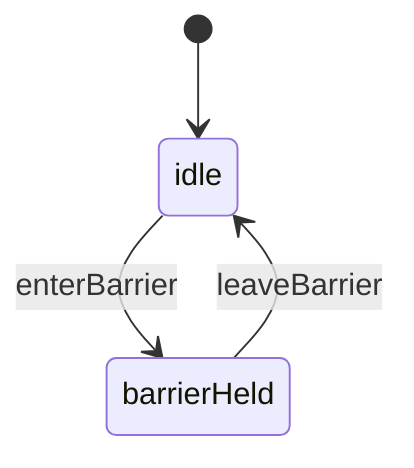

# agent-todo

> 待办清单 SSOT：latest-wins 持久、三态、多 in_progress、只读投影

子包：`agent-domain`　代码：`agent-domain/agent-todo.ts`

## 状态图

## 状态清单

- `idle`
- `barrierHeld`

## spec 锚点

- `llmanspec/specs/agent-todo/agent-todo.feature#@req:r1118`
- `llmanspec/specs/agent-todo/agent-todo.feature#@req:r1123`
- `llmanspec/specs/agent-todo/agent-todo.feature#@req:r1126`
- `llmanspec/specs/agent-todo/agent-todo.feature#@req:r1127`
- `llmanspec/specs/agent-todo/agent-todo.feature#@req:r1128`
- `llmanspec/specs/agent-todo/agent-todo.feature#@req:r1842`
- `llmanspec/specs/agent-todo/agent-todo.feature#@req:r1119`

## 实现落点

- `plugins/xylitol-official-plugin-todo/、crates/xylitol-runtime/src/agent/prompt/status_bar.rs。`
