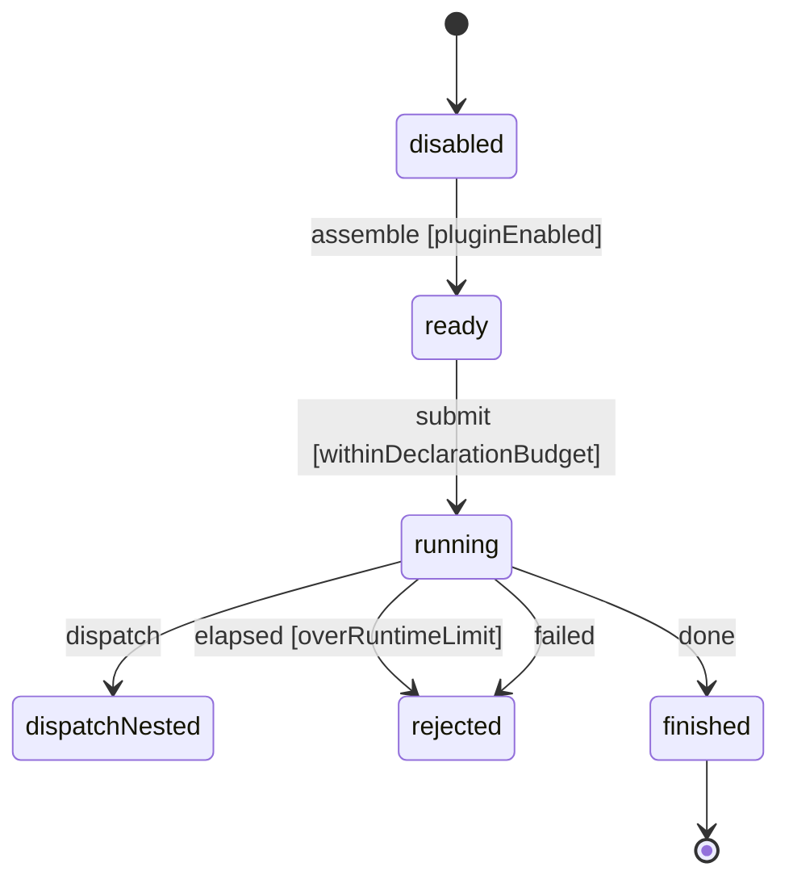

# codemode-runtime

> run_code 执行：暴露交集、声明预算、沙箱限额、嵌套 dispatch

子包：`agent-domain`　代码：`agent-domain/codemode-runtime.ts`

## 状态图

## 状态清单

- `disabled`
- `ready`
- `running`
- `dispatchNested`
- `finished`
- `rejected`

## spec 锚点

- `llmanspec/specs/agent-codemode/agent-codemode.feature#@req:r3250`
- `llmanspec/specs/agent-codemode/agent-codemode.feature#@req:r3251`
- `llmanspec/specs/agent-codemode/agent-codemode.feature#@req:r3252`
- `llmanspec/specs/agent-codemode/agent-codemode.feature#@req:r3253`
- `llmanspec/specs/agent-codemode/agent-codemode.feature#@req:r3254`
- `llmanspec/specs/agent-codemode/agent-codemode.feature#@req:r3255`
- `llmanspec/specs/agent-codemode/agent-codemode.feature#@req:r3347`
- `llmanspec/specs/domain-security/domain-security.feature#@req:r3258`

## 实现落点

- `plugins/xylitol-official-plugin-codemode/。`
