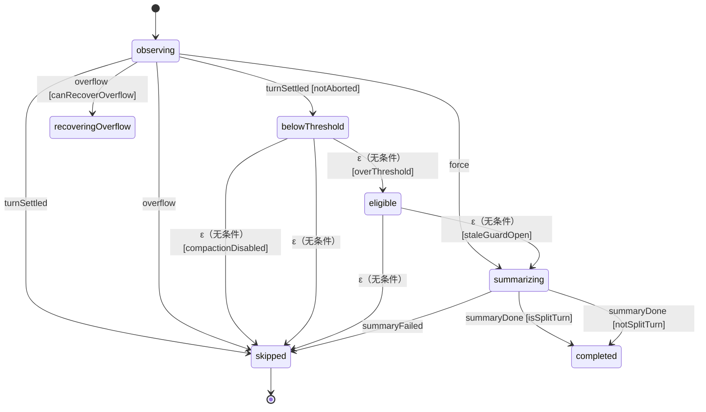

# compaction

> 上下文压缩触发与摘要：阈值、force、overflow、防抖、双摘要

子包：`agent-domain`　代码：`agent-domain/compaction.ts`

## 状态图

## 状态清单

- `observing`
- `belowThreshold`
- `eligible`
- `summarizing`
- `recoveringOverflow`
- `completed`
- `skipped`

## spec 锚点

- `llmanspec/specs/domain-compaction/domain-compaction.feature#@req:r1406`
- `llmanspec/specs/domain-compaction/domain-compaction.feature#@req:r1403`
- `llmanspec/specs/domain-compaction/domain-compaction.feature#@req:r1408`
- `llmanspec/specs/domain-compaction/domain-compaction.feature#@req:r1404`
- `llmanspec/specs/domain-compaction/domain-compaction.feature#@req:r1405`
- `llmanspec/specs/domain-compaction/domain-compaction.feature#@req:r1413`
- `llmanspec/specs/domain-compaction/domain-compaction.feature#@req:r1417`

## 实现落点

- `crates/xylitol-runtime/src/agent/compaction.rs、crates/xylitol-plugin-sdk/src/compaction_settings.rs。`
