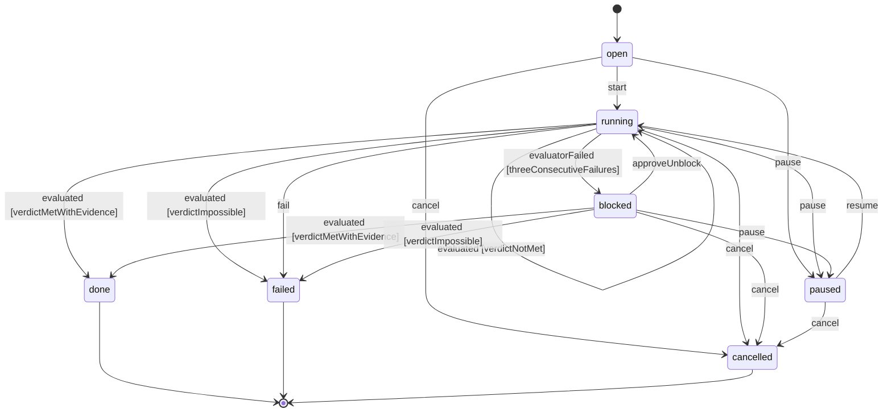

# goal-lifecycle

> 会话级目标：合法转移表、evaluator 判定、逐 turn 续跑

子包：`agent-domain`　代码：`agent-domain/goal-lifecycle.ts`

## 状态图

## 状态清单

- `open`
- `running`
- `blocked`
- `paused`
- `done`
- `failed`
- `cancelled`

## spec 锚点

- `llmanspec/specs/agent-goal/agent-goal.feature#@req:r3318`
- `llmanspec/specs/agent-goal/agent-goal.feature#@req:r3299`
- `llmanspec/specs/agent-goal/agent-goal.feature#@req:r3300`
- `llmanspec/specs/agent-goal/agent-goal.feature#@req:r3301`
- `llmanspec/specs/agent-goal/agent-goal.feature#@req:r3302`

## 实现落点

- `crates/xylitol-runtime/src/agent/automation.rs、crates/xylitol-runtime/src/agent/runtime/react/step_end.rs。`
