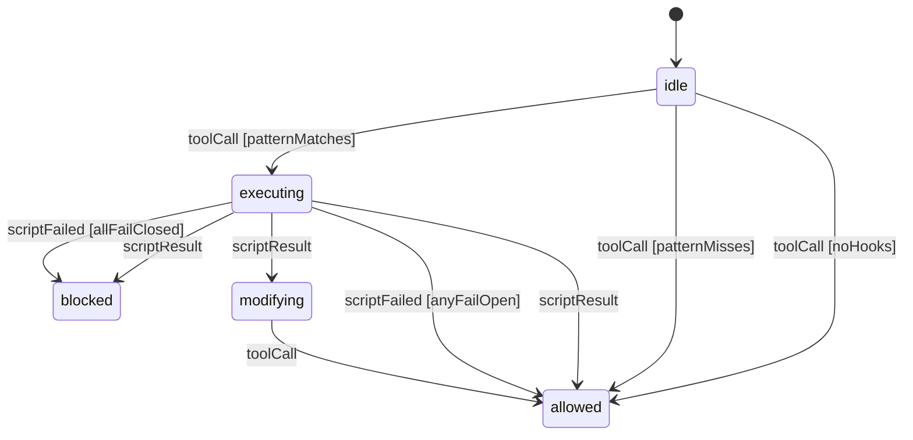

# hook-dispatch

> hook 匹配与脚本动作：allow/block/modify、失败 fail-closed

子包：`agent-domain`　代码：`agent-domain/hook-dispatch.ts`

## 状态图

## 状态清单

- `idle`
- `executing`
- `modifying`
- `blocked`
- `allowed`

## spec 锚点

- `llmanspec/specs/agent-hooks/agent-hooks.feature#@req:r1`
- `llmanspec/specs/agent-hooks/agent-hooks.feature#@req:r3`
- `llmanspec/specs/agent-hooks/agent-hooks.feature#@req:r1008`
- `llmanspec/specs/agent-hooks/agent-hooks.feature#@req:r1009`
- `llmanspec/specs/agent-hooks/agent-hooks.feature#@req:r1010`
- `llmanspec/specs/agent-hooks/agent-hooks.feature#@req:r1014`

## 实现落点

- `crates/xylitol-runtime/src/agent/runtime/hooks.rs、plugins/xylitol-official-plugin-hooks/。`
