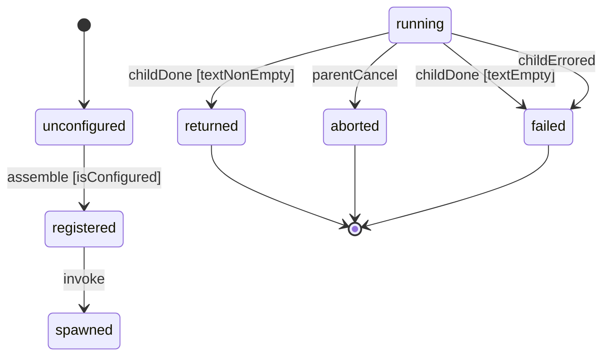

# readonly-subagent

> 只读子代理：零装配、隔离 runtime、只读工具集、父级取消传播

子包：`agent-domain`　代码：`agent-domain/readonly-subagent.ts`

## 状态图

## 状态清单

- `unconfigured`
- `registered`
- `spawned`
- `running`
- `returned`
- `aborted`
- `failed`

## spec 锚点

- `llmanspec/specs/agent-subagent/agent-subagent.feature#@req:r2999`
- `llmanspec/specs/agent-subagent/agent-subagent.feature#@req:r3000`
- `llmanspec/specs/agent-tools/agent-tools.feature#@req:r32`
- `llmanspec/specs/agent-runtime/agent-runtime.feature#@req:r1030`

## 实现落点

- `crates/xylitol-kernel/src/subagent.rs。`
