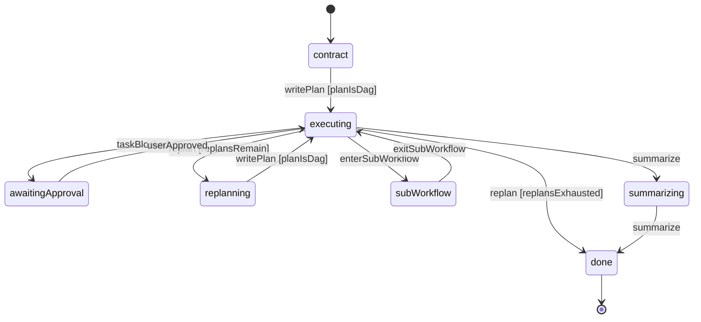

# workflow-engine

> 任务图执行：七阶段容器、任务转移表、批准一次消费

子包：`agent-domain`　代码：`agent-domain/workflow-engine.ts`

## 状态图

## 状态清单

- `contract`
- `executing`
- `awaitingApproval`
- `replanning`
- `subWorkflow`
- `summarizing`
- `done`

## spec 锚点

- `llmanspec/specs/agent-workflow/agent-workflow.feature#@req:r2946`
- `llmanspec/specs/agent-workflow/agent-workflow.feature#@req:r2966`
- `llmanspec/specs/agent-workflow/agent-workflow.feature#@req:r2969`

## 实现落点

- `plugins/xylitol-official-plugin-workflow/。`
