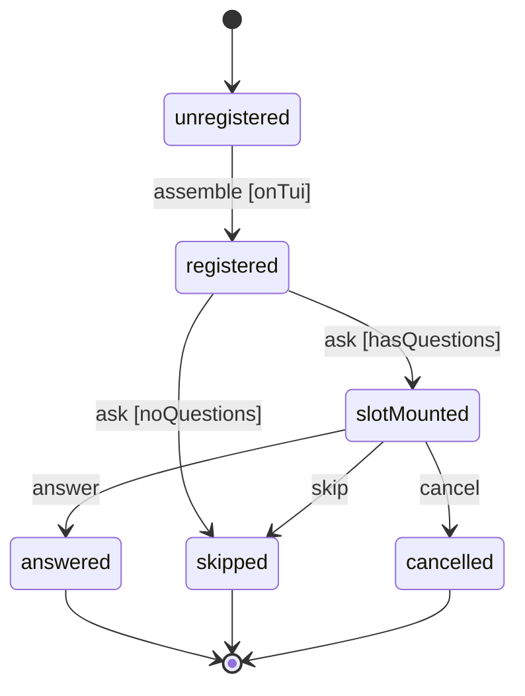

# ask-tool

> TUI 问卷：仅 TUI 装配、槽挂载、跳过成功、载荷回写

子包：`app-surface`　代码：`app-surface/ask-tool.ts`

## 状态图

## 状态清单

- `unregistered`
- `registered`
- `slotMounted`
- `answered`
- `skipped`
- `cancelled`

## spec 锚点

- `llmanspec/specs/app-tui-ask/app-tui-ask.feature#@req:r1167`
- `llmanspec/specs/app-tui-ask/app-tui-ask.feature#@req:r1168`
- `llmanspec/specs/app-tui-ask/app-tui-ask.feature#@req:r1169`
- `llmanspec/specs/app-tui-ask/app-tui-ask.feature#@req:r1170`
- `llmanspec/specs/app-tui-ask/app-tui-ask.feature#@req:r1171`
- `llmanspec/specs/app-tui-ask/app-tui-ask.feature#@req:r1172`
- `llmanspec/specs/app-tui-ask/app-tui-ask.feature#@req:r3327`
- `llmanspec/specs/app-tui-ask/app-tui-ask.feature#@req:r3339`

## 实现落点

- `crates/xylitol-app-tui/src/`
