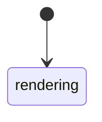

# footer-composition

> footer 单行字段序：used 来源标注、占用比、cache 三态、截断

子包：`app-surface`　代码：`app-surface/footer-composition.ts`

## 状态图

## 状态清单

- `rendering`

## spec 锚点

- `llmanspec/specs/app-tui-fixed-zone/app-tui-fixed-zone.feature#@req:r1224`
- `llmanspec/specs/app-tui-fixed-zone/app-tui-fixed-zone.feature#@req:r1214`
- `llmanspec/specs/app-tui-fixed-zone/app-tui-fixed-zone.feature#@req:r1226`
- `llmanspec/specs/app-tui-fixed-zone/app-tui-fixed-zone.feature#@req:r1219`
- `llmanspec/specs/app-tui-fixed-zone/app-tui-fixed-zone.feature#@req:r1216`
- `llmanspec/specs/app-tui-fixed-zone/app-tui-fixed-zone.feature#@req:r1229`

## 实现落点

- `crates/xylitol-app-tui/src/`
