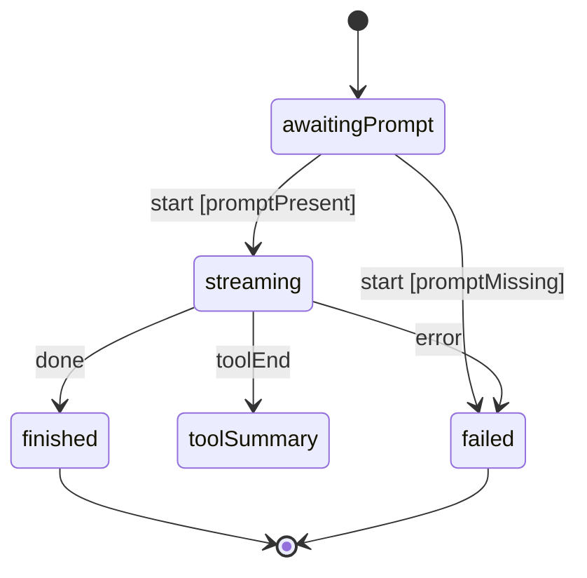

# print-rendering

> 非交互输出：stdout 流式、reasoning 走 stderr、去重、非零退出

子包：`app-surface`　代码：`app-surface/print-rendering.ts`

## 状态图

## 状态清单

- `awaitingPrompt`
- `streaming`
- `toolSummary`
- `finished`
- `failed`

## spec 锚点

- `llmanspec/specs/cli-print/cli-print.feature#@req:r34`
- `llmanspec/specs/cli-print/cli-print.feature#@req:r43`
- `llmanspec/specs/cli-print/cli-print.feature#@req:r49`
- `llmanspec/specs/cli-print/cli-print.feature#@req:r52`
- `llmanspec/specs/cli-print/cli-print.feature#@req:r55`
- `llmanspec/specs/cli-print/cli-print.feature#@req:r3325`
- `llmanspec/specs/cli-entry/cli-entry.feature#@req:r1382`

## 实现落点

- `crates/xylitol-app-print/。`
