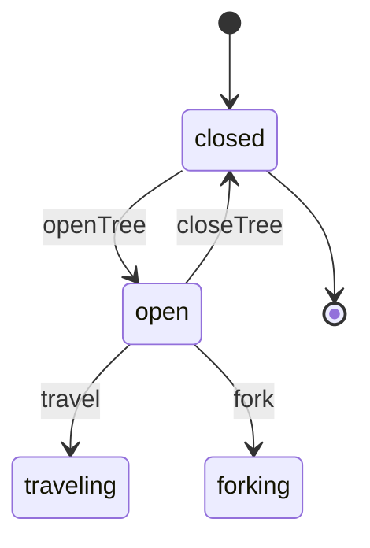

# session-tree-slot

> 会话树槽：打开、travel、过滤、折叠、fork、标签持久

子包：`app-surface`　代码：`app-surface/session-tree-slot.ts`

## 状态图

## 状态清单

- `closed`
- `open`
- `traveling`
- `forking`

## spec 锚点

- `llmanspec/specs/app-tui-session-tree/app-tui-session-tree.feature#@req:r1325`
- `llmanspec/specs/app-tui-session-tree/app-tui-session-tree.feature#@req:r1332`
- `llmanspec/specs/app-tui-session-tree/app-tui-session-tree.feature#@req:r1336`
- `llmanspec/specs/app-tui-session-tree/app-tui-session-tree.feature#@req:r1337`
- `llmanspec/specs/app-tui-session-tree/app-tui-session-tree.feature#@req:r1338`
- `llmanspec/specs/app-tui-session-tree/app-tui-session-tree.feature#@req:r1326`
- `llmanspec/specs/app-tui-session-tree/app-tui-session-tree.feature#@req:r1328`
- `llmanspec/specs/app-tui-session-tree/app-tui-session-tree.feature#@req:r1330`

## 实现落点

- `crates/xylitol-app-tui/src/`
