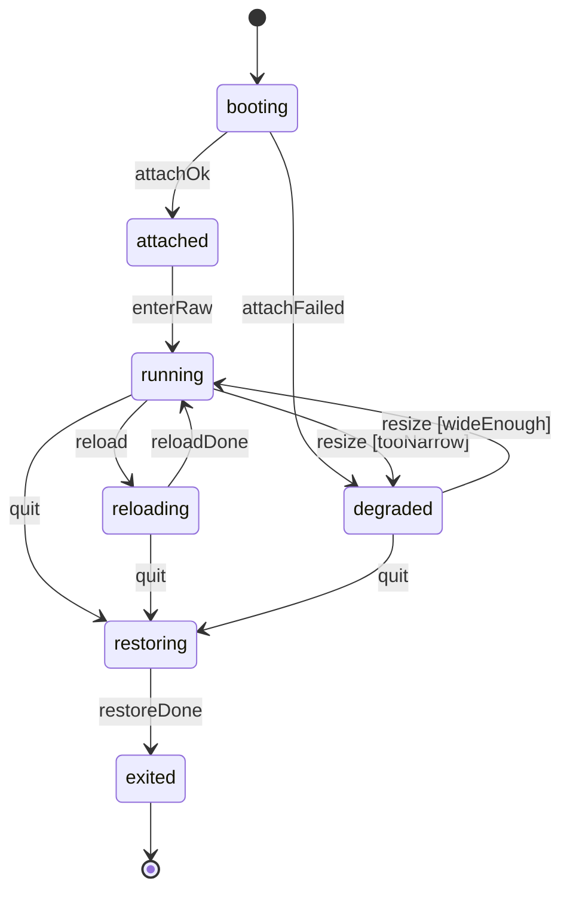

# tui-host-lifecycle

> TUI 宿主：attach、raw 终端、尺寸降级、重载、退出恢复

子包：`app-surface`　代码：`app-surface/tui-host-lifecycle.ts`

## 状态图

## 状态清单

- `booting`
- `attached`
- `running`
- `reloading`
- `degraded`
- `restoring`
- `exited`

## spec 锚点

- `llmanspec/specs/app-tui-host/app-tui-host.feature#@req:r1240`
- `llmanspec/specs/app-tui-host/app-tui-host.feature#@req:r1248`
- `llmanspec/specs/app-tui-host/app-tui-host.feature#@req:r1270`
- `llmanspec/specs/app-tui-host/app-tui-host.feature#@req:r1279`
- `llmanspec/specs/app-tui-host/app-tui-host.feature#@req:r1249`
- `llmanspec/specs/app-tui-host/app-tui-host.feature#@req:r1257`
- `llmanspec/specs/app-tui-host/app-tui-host.feature#@req:r1253`

## 实现落点

- `crates/xylitol-app-tui/src/`
