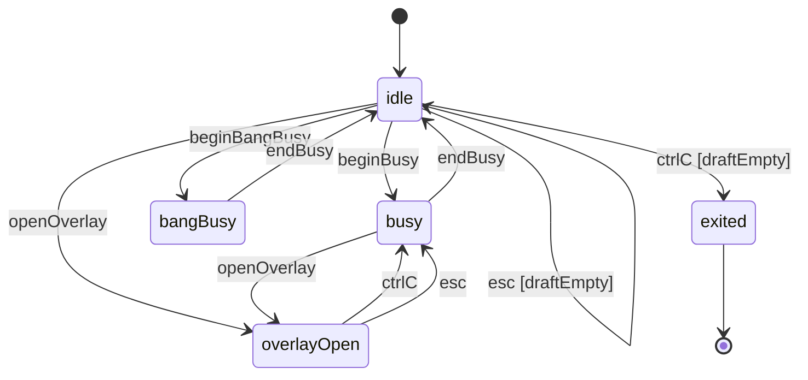

# tui-input-routing

> 键位语义：Esc/Ctrl+C 取消与退出、steer/follow-up、双 Esc 会话树

子包：`app-surface`　代码：`app-surface/tui-input-routing.ts`

## 状态图

## 状态清单

- `idle`
- `busy`
- `bangBusy`
- `overlayOpen`
- `exited`

## spec 锚点

- `llmanspec/specs/app-tui-input/app-tui-input.feature#@req:r1294`
- `llmanspec/specs/app-tui-input/app-tui-input.feature#@req:r1305`
- `llmanspec/specs/app-tui-input/app-tui-input.feature#@req:r1321`
- `llmanspec/specs/app-tui-input/app-tui-input.feature#@req:r1283`
- `llmanspec/specs/app-tui-input/app-tui-input.feature#@req:r1293`

## 实现落点

- `crates/xylitol-app-tui/src/`
