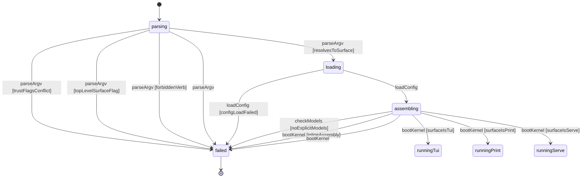

# boot-assembly

> 启动装配：argv → profile → Kernel::boot、表面与 ops 区分、no-silent-fallback

子包：`config-meta`　代码：`config-meta/boot-assembly.ts`

## 状态图

## 状态清单

- `parsing`
- `loading`
- `assembling`
- `runningTui`
- `runningPrint`
- `runningServe`
- `failed`

## spec 锚点

- `llmanspec/specs/cli-entry/cli-entry.feature#@req:r1381`
- `llmanspec/specs/cli-entry/cli-entry.feature#@req:r1385`
- `llmanspec/specs/cli-entry/cli-entry.feature#@req:r1379`
- `llmanspec/specs/cli-entry/cli-entry.feature#@req:r1386`
- `llmanspec/specs/cli-entry/cli-entry.feature#@req:r1389`
- `llmanspec/specs/cli-entry/cli-entry.feature#@req:r1392`
- `llmanspec/specs/cli-entry/cli-entry.feature#@req:r1394`
- `llmanspec/specs/cli-entry/cli-entry.feature#@req:r1388`
- `llmanspec/specs/cli-entry/cli-entry.feature#@req:r3352`
- `llmanspec/specs/cli-entry/cli-entry.feature#@req:r67`
- `llmanspec/specs/cli-entry/cli-entry.feature#@req:r69`
- `llmanspec/specs/cli-entry/cli-entry.feature#@req:r70`

## 实现落点

- `src/cli.rs`
