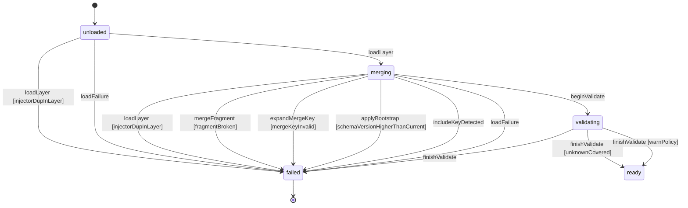

# config-load-merge

> 配置分层加载与深合并：三层链、conf.d 片段、两阶段未知键校验、fail-closed

子包：`config-meta`　代码：`config-meta/config-load-merge.ts`

## 状态图

## 状态清单

- `unloaded`
- `merging`
- `validating`
- `ready`
- `failed`

## spec 锚点

- `llmanspec/specs/runtime-config/runtime-config.feature#@req:r1731`
- `llmanspec/specs/runtime-config/runtime-config.feature#@req:r1732`
- `llmanspec/specs/runtime-config/runtime-config.feature#@req:r3076`
- `llmanspec/specs/runtime-config/runtime-config.feature#@req:r3072`
- `llmanspec/specs/runtime-config/runtime-config.feature#@req:r3070`
- `llmanspec/specs/runtime-config/runtime-config.feature#@req:r3071`
- `llmanspec/specs/runtime-config/runtime-config.feature#@req:r3069`
- `llmanspec/specs/runtime-config/runtime-config.feature#@req:r3311`
- `llmanspec/specs/runtime-config/runtime-config.feature#@req:r1723`
- `llmanspec/specs/runtime-config/runtime-config.feature#@req:r1740`
- `llmanspec/specs/cli-entry/cli-entry.feature#@req:r1386`
- `llmanspec/specs/user-experience/user-experience.feature#@req:r3075`

## 实现落点

- `crates/xylitol-kernel/src/bootstrap.rs`
