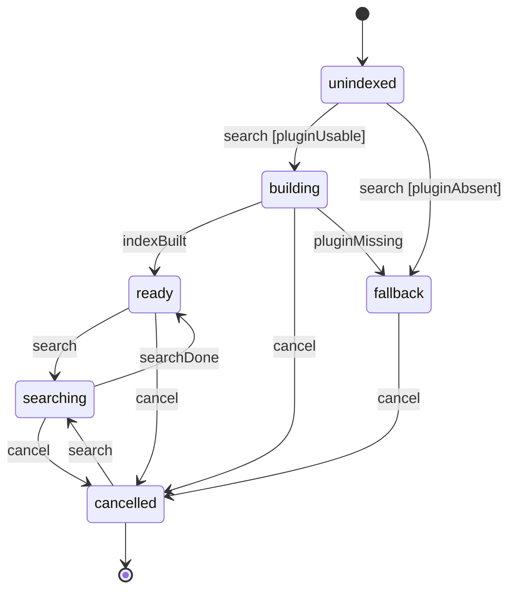

# fff-index-lifecycle

> fff 检索：惰性建索引、回落内置、全模式可取消

子包：`config-meta`　代码：`config-meta/fff-index-lifecycle.ts`

## 状态图

## 状态清单

- `unindexed`
- `building`
- `ready`
- `searching`
- `fallback`
- `cancelled`

## spec 锚点

- `llmanspec/specs/infra-fff-search/infra-fff-search.feature#@req:r2979`
- `llmanspec/specs/infra-fff-search/infra-fff-search.feature#@req:r2980`
- `llmanspec/specs/infra-fff-search/infra-fff-search.feature#@req:r2981`
- `llmanspec/specs/infra-fff-search/infra-fff-search.feature#@req:r3350`
- `llmanspec/specs/agent-tools/agent-tools.feature#@req:r1158`

## 实现落点

- `plugins/xylitol-official-plugin-tools-fff/。`
