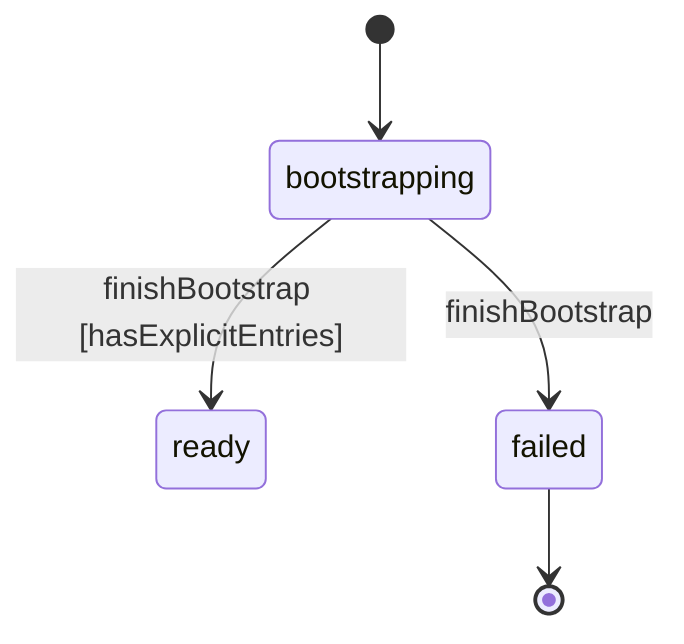

# model-resolution

> 模型解析与回退：显式条目注册、档位 clamp、任务级回退、reload 重建

子包：`config-meta`　代码：`config-meta/model-resolution.ts`

## 状态图

## 状态清单

- `bootstrapping`
- `ready`
- `failed`

## spec 锚点

- `llmanspec/specs/runtime-model-registry/runtime-model-registry.feature#@req:r1742`
- `llmanspec/specs/runtime-model-registry/runtime-model-registry.feature#@req:r1751`
- `llmanspec/specs/runtime-model-registry/runtime-model-registry.feature#@req:r1752`
- `llmanspec/specs/runtime-model-registry/runtime-model-registry.feature#@req:r1753`
- `llmanspec/specs/runtime-model-registry/runtime-model-registry.feature#@req:r1755`
- `llmanspec/specs/runtime-model-registry/runtime-model-registry.feature#@req:r1743`
- `llmanspec/specs/runtime-model-registry/runtime-model-registry.feature#@req:r1744`
- `llmanspec/specs/runtime-model-registry/runtime-model-registry.feature#@req:r1745`
- `llmanspec/specs/runtime-model-registry/runtime-model-registry.feature#@req:r1749`
- `llmanspec/specs/runtime-model-registry/runtime-model-registry.feature#@req:r1750`
- `llmanspec/specs/runtime-model-registry/runtime-model-registry.feature#@req:r3030`

## 实现落点

- `crates/xylitol-runtime/src/agent/model/registry.rs`
