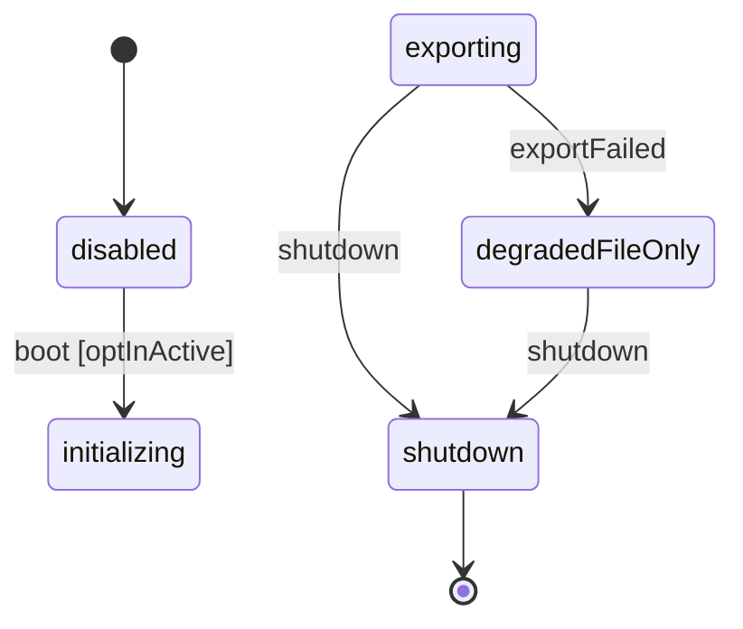

# otel-export

> OTEL 出口：默认不收集、opt-in、失败不阻塞、与文件管线 fanout

子包：`config-meta`　代码：`config-meta/otel-export.ts`

## 状态图

## 状态清单

- `disabled`
- `initializing`
- `exporting`
- `degradedFileOnly`
- `shutdown`

## spec 锚点

- `llmanspec/specs/infra-otel/infra-otel.feature#@req:r1466`
- `llmanspec/specs/infra-otel/infra-otel.feature#@req:r1477`
- `llmanspec/specs/infra-otel/infra-otel.feature#@req:r1486`
- `llmanspec/specs/infra-otel/infra-otel.feature#@req:r1487`
- `llmanspec/specs/infra-otel/infra-otel.feature#@req:r1488`
- `llmanspec/specs/infra-otel/infra-otel.feature#@req:r1489`
- `llmanspec/specs/infra-otel/infra-otel.feature#@req:r1468`
- `llmanspec/specs/infra-otel/infra-otel.feature#@req:r1478`

## 实现落点

- `plugins/xylitol-official-plugin-obs/。`
