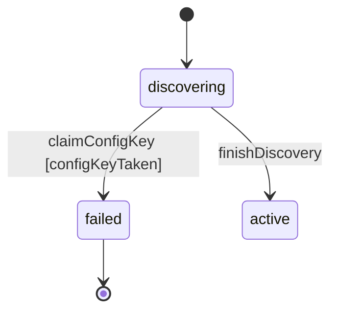

# plugin-assembly

> 外进程插件装配与启停：批准持久化、config 停用最高优先、mcp 声明与命令委派

子包：`config-meta`　代码：`config-meta/plugin-assembly.ts`

## 状态图

## 状态清单

- `discovering`
- `active`
- `failed`

## spec 锚点

- `llmanspec/specs/infra-plugin/infra-plugin.feature#@req:r2990`
- `llmanspec/specs/infra-plugin/infra-plugin.feature#@req:r3377`
- `llmanspec/specs/infra-plugin/infra-plugin.feature#@req:r3027`
- `llmanspec/specs/infra-plugin/infra-plugin.feature#@req:r3074`
- `llmanspec/specs/infra-plugin/infra-plugin.feature#@req:r3317`
- `llmanspec/specs/workspace-assembly/workspace-assembly.feature#@req:r2911`
- `llmanspec/specs/workspace-assembly/workspace-assembly.feature#@req:r2912`
- `llmanspec/specs/workspace-assembly/workspace-assembly.feature#@req:r2916`
- `llmanspec/specs/cli-plugin-command/cli-plugin-command.feature#@req:r3358`
- `llmanspec/specs/cli-plugin-command/cli-plugin-command.feature#@req:r3360`
- `llmanspec/specs/cli-plugin-command/cli-plugin-command.feature#@req:r3361`

## 实现落点

- `crates/xylitol-kernel/src/external_plugin.rs`
