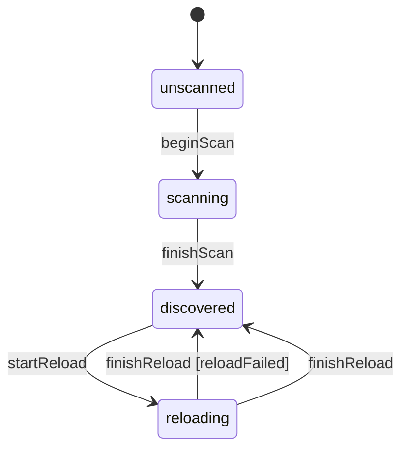

# resource-discovery

> 统一资源发现与热重载：skills/themes/context、Trust 门禁、reload 报告

子包：`config-meta`　代码：`config-meta/resource-discovery.ts`

## 状态图

## 状态清单

- `unscanned`
- `scanning`
- `discovered`
- `reloading`

## spec 锚点

- `llmanspec/specs/runtime-resource-discovery/runtime-resource-discovery.feature#@req:r1759`
- `llmanspec/specs/runtime-resource-discovery/runtime-resource-discovery.feature#@req:r1760`
- `llmanspec/specs/runtime-resource-discovery/runtime-resource-discovery.feature#@req:r1761`
- `llmanspec/specs/runtime-resource-discovery/runtime-resource-discovery.feature#@req:r1762`
- `llmanspec/specs/runtime-resource-discovery/runtime-resource-discovery.feature#@req:r1767`
- `llmanspec/specs/runtime-resource-discovery/runtime-resource-discovery.feature#@req:r1768`

## 实现落点

- `crates/xylitol-runtime/src/resource/loader.rs`
