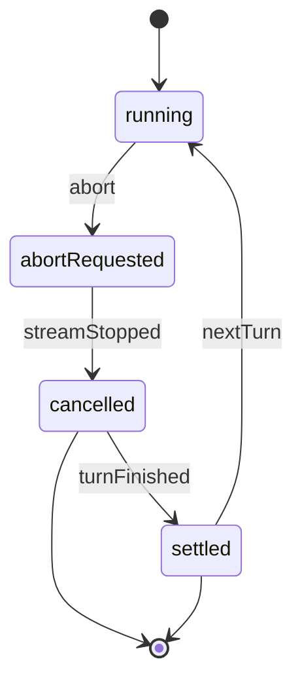

# abort

> 中止语义：取消流、清 steer、留 follow_up、跳过 LLM 结算

子包：`core-runtime`　代码：`core-runtime/abort.ts`

## 状态图

## 状态清单

- `running`
- `abortRequested`
- `cancelled`
- `settled`

## spec 锚点

- `llmanspec/specs/agent-runtime/agent-runtime.feature#@req:r1028`
- `llmanspec/specs/agent-runtime/agent-runtime.feature#@req:r1029`
- `llmanspec/specs/agent-runtime/agent-runtime.feature#@req:r1030`
- `llmanspec/specs/agent-runtime/agent-runtime.feature#@req:r1043`
- `llmanspec/specs/server-core/server-core.feature#@req:r1775`

## 实现落点

- `crates/xylitol-runtime/src/agent/runtime/state.rs`
