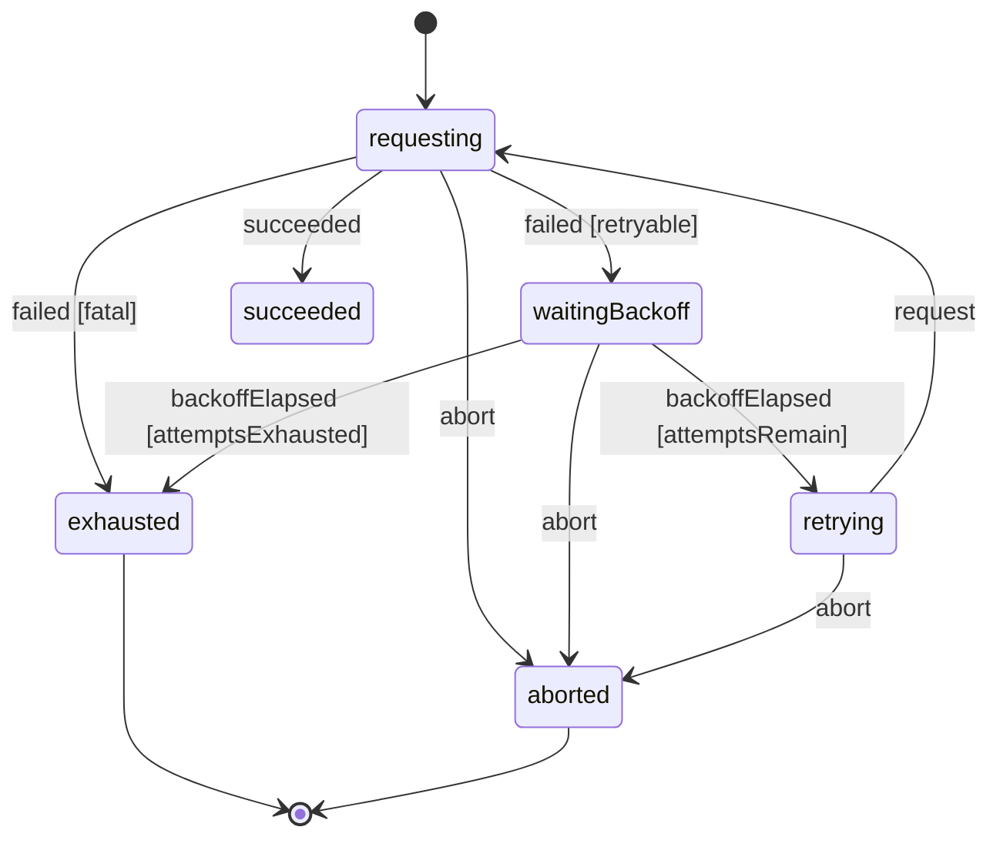

# auto-retry

> provider 失败重试：退避、状态事件、耗尽与中止

子包：`core-runtime`　代码：`core-runtime/auto-retry.ts`

## 状态图

## 状态清单

- `requesting`
- `waitingBackoff`
- `retrying`
- `succeeded`
- `exhausted`
- `aborted`

## spec 锚点

- `llmanspec/specs/agent-runtime/agent-runtime.feature#@req:r3304`
- `llmanspec/specs/app-tui-bridge/app-tui-bridge.feature#@req:r1184`
- `llmanspec/specs/app-tui-fixed-zone/app-tui-fixed-zone.feature#@req:r1239`
- `llmanspec/specs/agent-runtime/agent-runtime.feature#@req:r1031`

## 实现落点

- `crates/xylitol-runtime/src/agent/runtime/retry.rs。`
