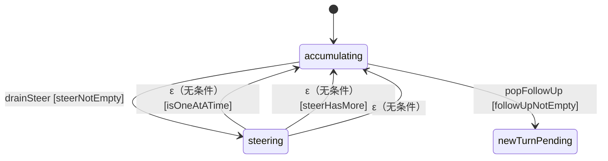

# pending-queues

> steer 与 follow_up 双队列：入队、drain、逐项撤销、逐条成 turn

子包：`core-runtime`　代码：`core-runtime/pending-queues.ts`

## 状态图

## 状态清单

- `accumulating`
- `steering`
- `newTurnPending`

## spec 锚点

- `llmanspec/specs/agent-runtime/agent-runtime.feature#@req:r1059`
- `llmanspec/specs/agent-runtime/agent-runtime.feature#@req:r3374`
- `llmanspec/specs/agent-runtime/agent-runtime.feature#@req:r1060`
- `llmanspec/specs/agent-runtime/agent-runtime.feature#@req:r1028`
- `llmanspec/specs/agent-runtime/agent-runtime.feature#@req:r3322`

## 实现落点

- `crates/xylitol-runtime/src/agent/capabilities/queue.rs`
