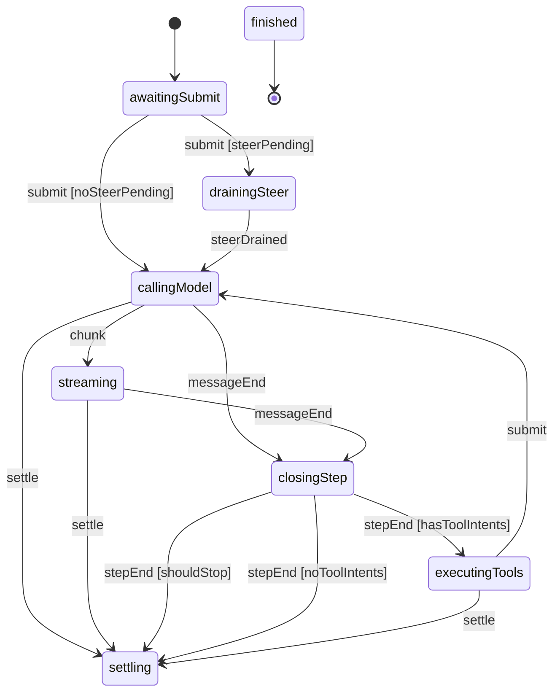

# react-loop

> ReAct 内环：模型调用、流式意图、工具批续跑、停步收尾

子包：`core-runtime`　代码：`core-runtime/react-loop.ts`

## 状态图

## 状态清单

- `awaitingSubmit`
- `drainingSteer`
- `callingModel`
- `streaming`
- `closingStep`
- `executingTools`
- `settling`
- `finished`

## spec 锚点

- `llmanspec/specs/agent-runtime/agent-runtime.feature#@req:r1027`
- `llmanspec/specs/agent-runtime/agent-runtime.feature#@req:r1038`
- `llmanspec/specs/agent-runtime/agent-runtime.feature#@req:r1047`
- `llmanspec/specs/agent-runtime/agent-runtime.feature#@req:r1041`
- `llmanspec/specs/agent-runtime/agent-runtime.feature#@req:r1045`
- `llmanspec/specs/agent-runtime/agent-runtime.feature#@req:r1059`

## 实现落点

- `crates/xylitol-runtime/src/agent/runtime/react/`
