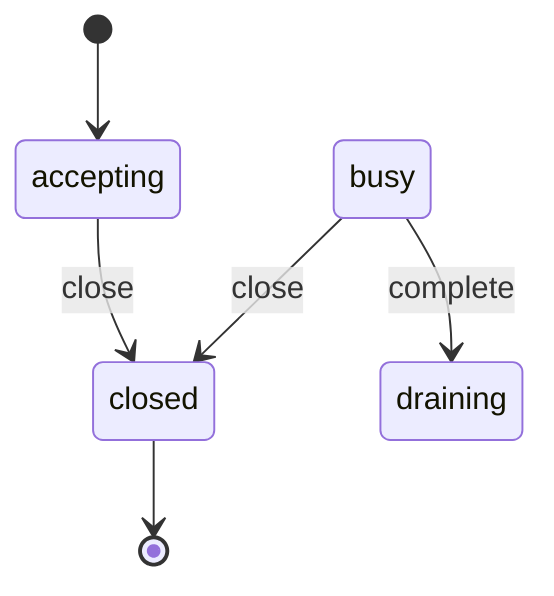

# session-mailbox

> 有界命令信箱单写者：排队、背压、逐条消费

子包：`core-runtime`　代码：`core-runtime/session-mailbox.ts`

## 状态图

## 状态清单

- `accepting`
- `busy`
- `draining`
- `closed`

## spec 锚点

- `llmanspec/specs/agent-runtime/agent-runtime.feature#@req:r3375`
- `llmanspec/specs/agent-runtime/agent-runtime.feature#@req:r3322`
- `llmanspec/specs/layer-architecture/layer-architecture.feature#@req:r1514`

## 实现落点

- `crates/xylitol-runtime/src/driver/in_process/actor.rs`
