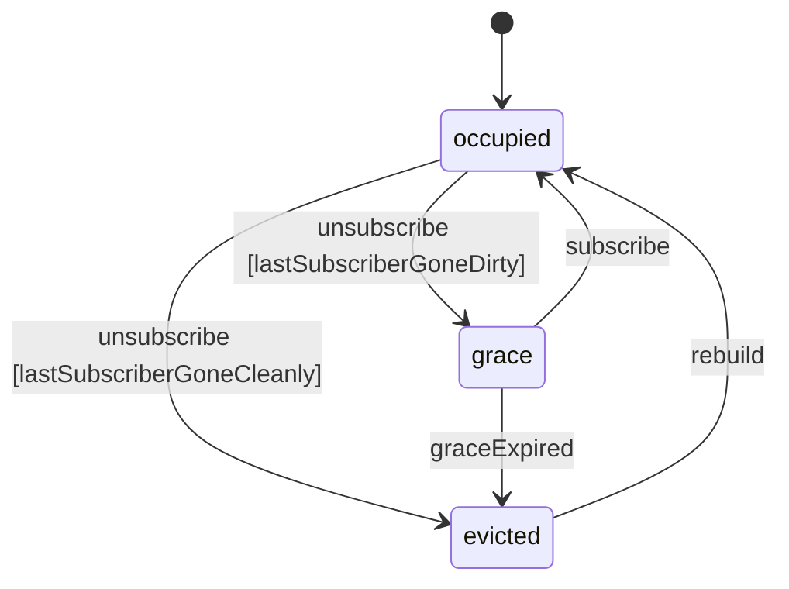

# session-slot-lifecycle

> 会话槽的占用、宽限与驱逐，含序号水位续接

子包：`core-runtime`　代码：`core-runtime/session-slot.ts`

## 状态图

## 状态清单

- `occupied`
- `grace`
- `evicted`
- `expectContext`
- `expectContext`
- `expectContext`
- `expectContext`
- `expectContext`

## spec 锚点

- `llmanspec/specs/server-core/server-core.feature#@req:r1793`
- `llmanspec/specs/server-core/server-core.feature#@req:r1798`
- `llmanspec/specs/layer-architecture/layer-architecture.feature#@req:r1514`
- `llmanspec/specs/server-core/server-core.feature#@req:r1792`

## 实现落点

- `crates/xylitol-serve/src/occupancy/host.rs、crates/xylitol-serve/src/occupancy/mod.rs。`
