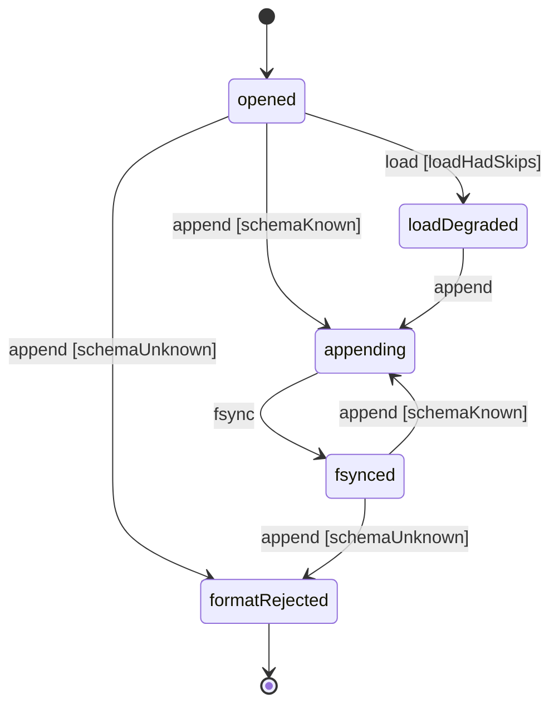

# session-store-append

> 会话 JSONL 追加存储：串行写、fsync、跳过告警、CWD 回退

子包：`core-runtime`　代码：`core-runtime/session-store-append.ts`

## 状态图

## 状态清单

- `opened`
- `appending`
- `fsynced`
- `loadDegraded`
- `formatRejected`

## spec 锚点

- `llmanspec/specs/agent-session-store/agent-session-store.feature#@req:r1090`
- `llmanspec/specs/agent-session-store/agent-session-store.feature#@req:r1093`
- `llmanspec/specs/agent-session-store/agent-session-store.feature#@req:r1104`
- `llmanspec/specs/agent-session-store/agent-session-store.feature#@req:r1095`
- `llmanspec/specs/agent-session-store/agent-session-store.feature#@req:r1098`
- `llmanspec/specs/agent-session-store/agent-session-store.feature#@req:r1094`
- `llmanspec/specs/agent-session-store/agent-session-store.feature#@req:r1109`
- `llmanspec/specs/agent-session-store/agent-session-store.feature#@req:r1900`

## 实现落点

- `crates/xylitol-runtime/src/driver/in_process/session.rs。`
