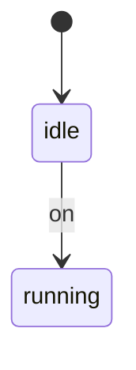

# tool-batch

> 工具批调度：barrier 串行、parallel 并行、源序回写

子包：`core-runtime`　代码：`core-runtime/tool-batch.ts`

## 状态图

## 状态清单

- `idle`
- `running`
- `flushed`

## spec 锚点

- `llmanspec/specs/agent-runtime/agent-runtime.feature#@req:r1045`
- `llmanspec/specs/agent-runtime/agent-runtime.feature#@req:r1046`
- `llmanspec/specs/agent-runtime/agent-runtime.feature#@req:r1047`
- `llmanspec/specs/agent-runtime/agent-runtime.feature#@req:r1058`
- `llmanspec/specs/infra-mcp/infra-mcp.feature#@req:r1451`
- `llmanspec/specs/agent-todo/agent-todo.feature#@req:r1127`

## 实现落点

- `crates/xylitol-runtime/src/agent/runtime/tool_batch.rs、crates/xylitol-runtime/src/agent/runtime/tool_exec.rs。`
