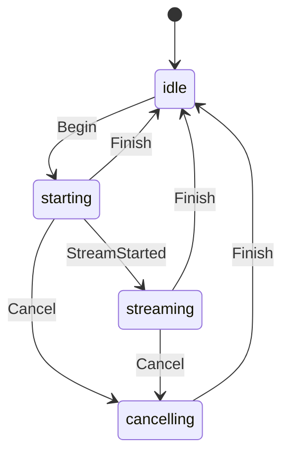

# turn-coordinator

> 单 turn 相位机：空闲→起始→流式→收尾，含忙拒绝与取消

子包：`core-runtime`　代码：`core-runtime/turn-coordinator.ts`

## 状态图

## 状态清单

- `idle`
- `starting`
- `streaming`
- `cancelling`

## spec 锚点

- `llmanspec/specs/agent-runtime/agent-runtime.feature#@req:r3322`
- `llmanspec/specs/agent-runtime/agent-runtime.feature#@req:r3375`
- `llmanspec/specs/agent-runtime/agent-runtime.feature#@req:r1028`
- `llmanspec/specs/agent-runtime/agent-runtime.feature#@req:r1030`
- `llmanspec/specs/layer-architecture/layer-architecture.feature#@req:r1514`

## 实现落点

- `crates/xylitol-runtime/src/agent/runtime/state.rs`
