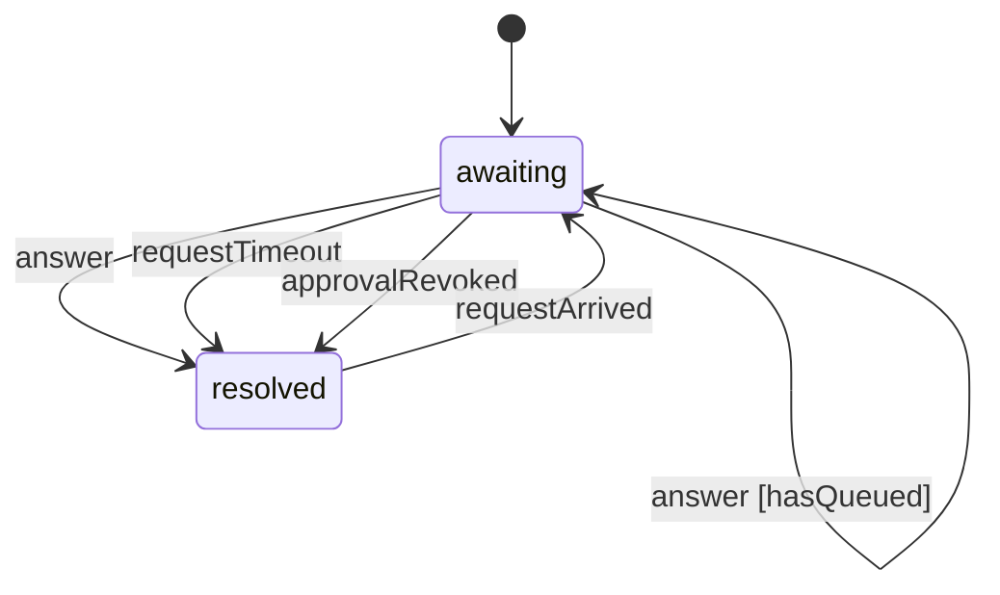

# approval-request

> 远端审批/问卷：首答生效、人类限定、槽占用排队与队满即时拒绝

子包：`protocol-transport`　代码：`protocol-transport/approval-request.ts`

## 状态图

## 状态清单

- `awaiting`
- `resolved`

## spec 锚点

- `llmanspec/specs/protocol-app/protocol-app.feature#@req:r1706`
- `llmanspec/specs/app-tui-ask/app-tui-ask.feature#@req:r3327`
- `llmanspec/specs/domain-security/domain-security.feature#@req:r3219`

## 实现落点

- `crates/xylitol-serve/src/occupancy/host.rs`
