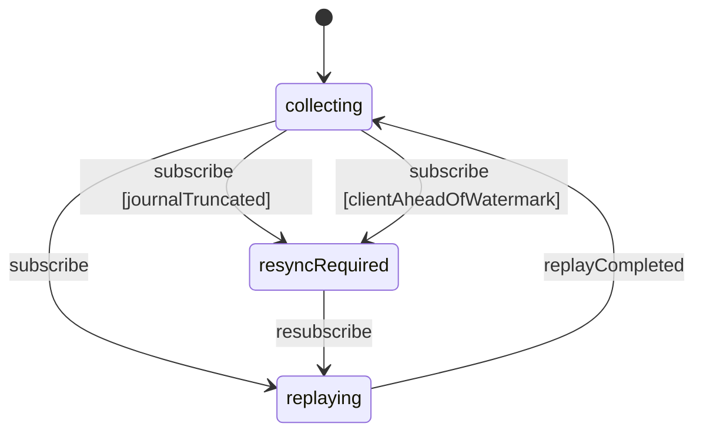

# journal-replay

> 会话 journal 重放：序号水位、partial 补齐、截断 resync、seq 不变量

子包：`protocol-transport`　代码：`protocol-transport/journal-replay.ts`

## 状态图

## 状态清单

- `collecting`
- `replaying`
- `resyncRequired`

## spec 锚点

- `llmanspec/specs/server-core/server-core.feature#@req:r1798`
- `llmanspec/specs/server-core/server-core.feature#@req:r1806`
- `llmanspec/specs/agent-session-store/agent-session-store.feature#@req:r1090`
- `llmanspec/specs/agent-session-store/agent-session-store.feature#@req:r1900`
- `llmanspec/specs/agent-session-store/agent-session-store.feature#@req:r1103`

## 实现落点

- `crates/xylitol-serve/src/occupancy/ws.rs`
