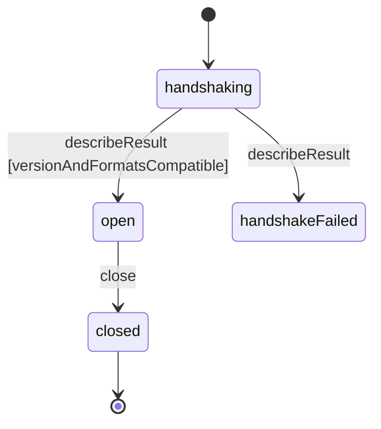

# jsonrpc-envelope

> JSON-RPC 2.0 文本信封：握手协商、方法名寻址、标准码与业务码拒绝

子包：`protocol-transport`　代码：`protocol-transport/jsonrpc-envelope.ts`

## 状态图

## 状态清单

- `handshaking`
- `open`
- `handshakeFailed`
- `closed`

## spec 锚点

- `llmanspec/specs/protocol-app/protocol-app.feature#@req:r2917`
- `llmanspec/specs/protocol-app/protocol-app.feature#@req:r2918`
- `llmanspec/specs/protocol-app/protocol-app.feature#@req:r2919`
- `llmanspec/specs/protocol-app/protocol-app.feature#@req:r1704`
- `llmanspec/specs/protocol-app/protocol-app.feature#@req:r1705`
- `llmanspec/specs/protocol-app/protocol-app.feature#@req:r1706`

## 实现落点

- `crates/xylitol-protocol/src/message.rs、crates/xylitol-protocol/src/codec.rs、`
