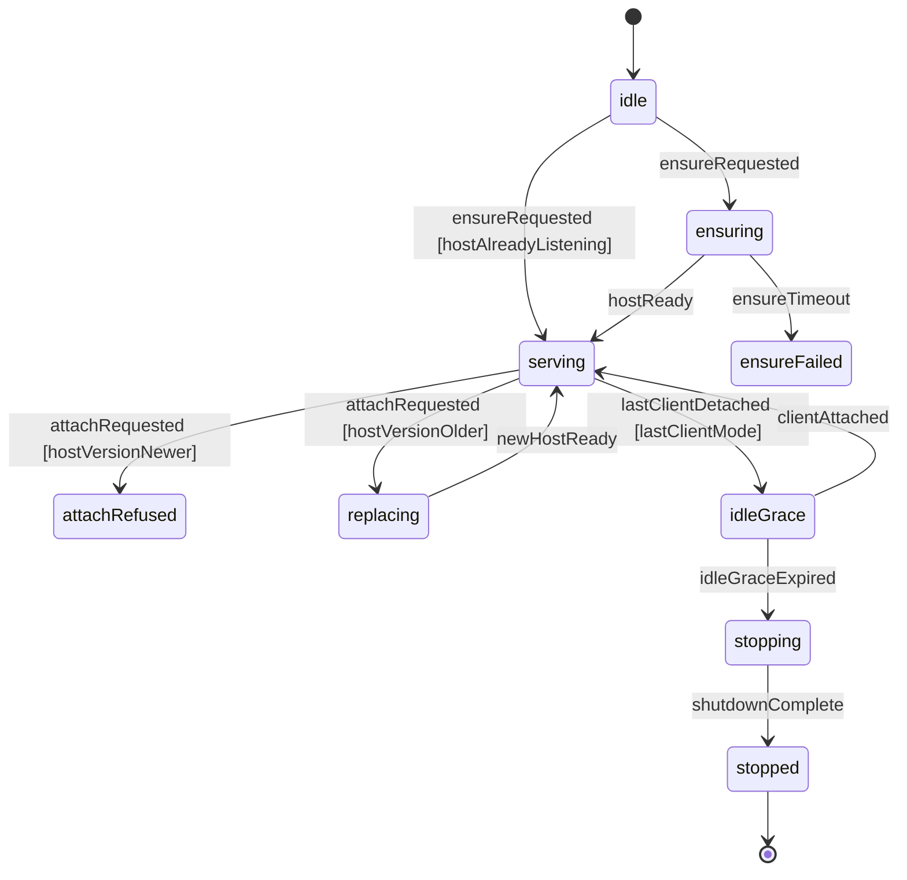

# serve-lifecycle

> Serve 进程生命周期：persistent/last-client、空闲宽限、ensure-host 版本决策

子包：`protocol-transport`　代码：`protocol-transport/serve-lifecycle.ts`

## 状态图

## 状态清单

- `idle`
- `ensuring`
- `serving`
- `idleGrace`
- `replacing`
- `stopping`
- `attachRefused`
- `ensureFailed`
- `stopped`

## spec 锚点

- `llmanspec/specs/server-core/server-core.feature#@req:r1794`
- `llmanspec/specs/server-core/server-core.feature#@req:r1796`
- `llmanspec/specs/cli-entry/cli-entry.feature#@req:r1391`
- `llmanspec/specs/cli-entry/cli-entry.feature#@req:r3261`

## 实现落点

- `crates/xylitol-serve/src/lifecycle.rs`
