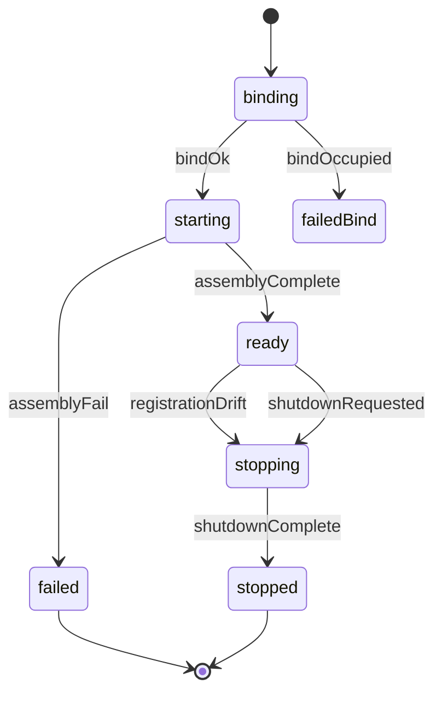

# serve-readiness

> Serve 启动就绪窗口：starting/ready/stopping/failed、绑定占用禁重试、注册文件自检

子包：`protocol-transport`　代码：`protocol-transport/serve-readiness.ts`

## 状态图

## 状态清单

- `binding`
- `starting`
- `ready`
- `stopping`
- `failed`
- `failedBind`
- `stopped`

## spec 锚点

- `llmanspec/specs/server-core/server-core.feature#@req:r1786`
- `llmanspec/specs/server-core/server-core.feature#@req:r1787`
- `llmanspec/specs/server-core/server-core.feature#@req:r1797`
- `llmanspec/specs/server-core/server-core.feature#@req:r1780`
- `llmanspec/specs/server-core/server-core.feature#@req:r1801`
- `llmanspec/specs/cli-entry/cli-entry.feature#@req:r1393`

## 实现落点

- `crates/xylitol-serve/src/listen.rs、crates/xylitol-serve/src/registration.rs。`
