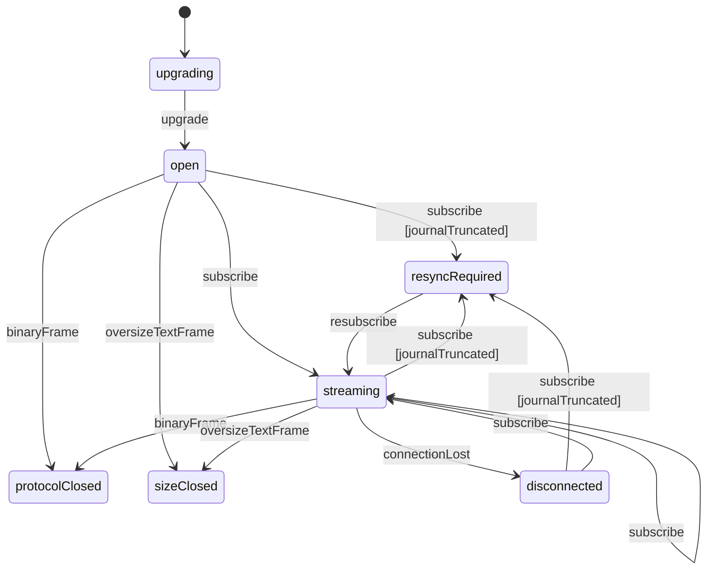

# ws-session-channel

> WS /rpc 通道：升级、纯 JSON-RPC 文本、订阅跨回合存活、重连 resync

子包：`protocol-transport`　代码：`protocol-transport/ws-session-channel.ts`

## 状态图

## 状态清单

- `upgrading`
- `open`
- `streaming`
- `disconnected`
- `resyncRequired`
- `protocolClosed`
- `sizeClosed`

## spec 锚点

- `llmanspec/specs/protocol-app/protocol-app.feature#@req:r1709`
- `llmanspec/specs/protocol-app/protocol-app.feature#@req:r1697`
- `llmanspec/specs/protocol-app/protocol-app.feature#@req:r1721`
- `llmanspec/specs/server-core/server-core.feature#@req:r1804`
- `llmanspec/specs/server-core/server-core.feature#@req:r1805`
- `llmanspec/specs/server-core/server-core.feature#@req:r1792`
- `llmanspec/specs/server-core/server-core.feature#@req:r1798`

## 实现落点

- `crates/xylitol-serve/src/occupancy/ws.rs、crates/xylitol-serve/src/occupancy/envelope.rs、`
