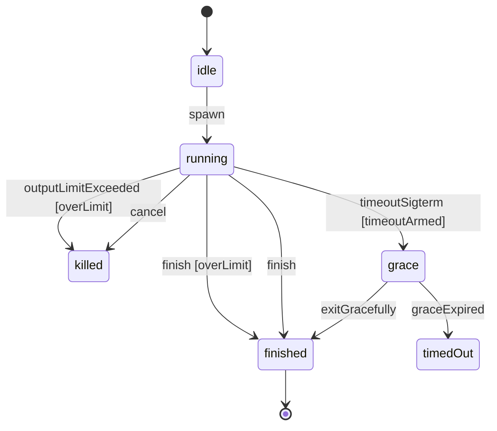

# bash-execution

> bash 子进程执行：流式输出、取消杀树、超时升级、截断溢出与显式结局

子包：`security-infra`　代码：`security-infra/bash-execution.ts`

## 状态图

## 状态清单

- `idle`
- `running`
- `grace`
- `finished`
- `killed`
- `timedOut`

## spec 锚点

- `llmanspec/specs/infra-bash/infra-bash.feature#@req:r1429`
- `llmanspec/specs/infra-bash/infra-bash.feature#@req:r1430`
- `llmanspec/specs/infra-bash/infra-bash.feature#@req:r1431`
- `llmanspec/specs/infra-bash/infra-bash.feature#@req:r1428`
- `llmanspec/specs/infra-bash/infra-bash.feature#@req:r1435`
- `llmanspec/specs/infra-bash/infra-bash.feature#@req:r3351`
- `llmanspec/specs/agent-tools/agent-tools.feature#@req:r1160`

## 实现落点

- `plugins/xylitol-official-plugin-tools/src/tools/bash.rs、`
