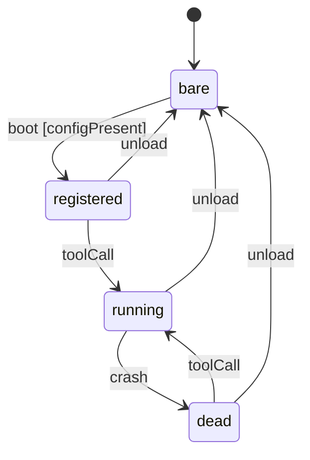

# lsp-dap-tool-registration

> LSP/DAP 工具装配：零配置零装配、首调用启动、相位显式、崩溃后重建一次

子包：`security-infra`　代码：`security-infra/lsp-dap-tool-registration.ts`

## 状态图

## 状态清单

- `bare`
- `registered`
- `running`
- `dead`

## spec 锚点

- `llmanspec/specs/infra-lsp/infra-lsp.feature#@req:r2993`
- `llmanspec/specs/infra-lsp/infra-lsp.feature#@req:r2994`
- `llmanspec/specs/infra-lsp/infra-lsp.feature#@req:r3348`
- `llmanspec/specs/infra-dap/infra-dap.feature#@req:r2996`
- `llmanspec/specs/infra-dap/infra-dap.feature#@req:r2997`
- `llmanspec/specs/infra-dap/infra-dap.feature#@req:r3349`

## 实现落点

- `plugins/xylitol-official-plugin-lsp/src/lib.rs、`
