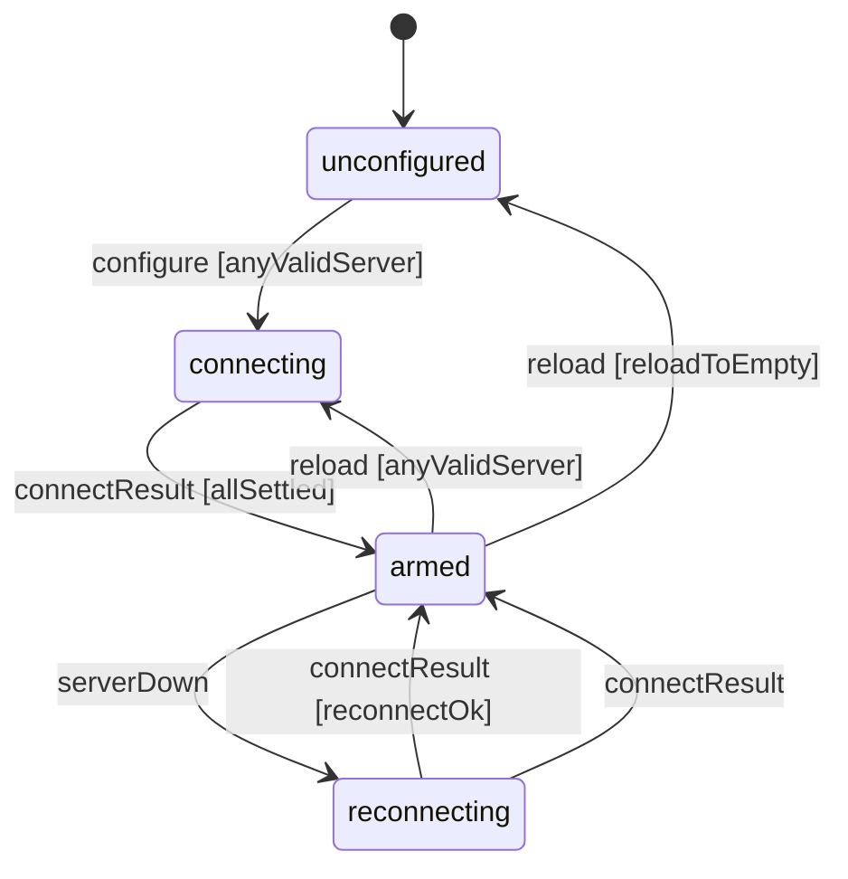

# mcp-server-lifecycle

> MCP 服务器装配与连接：零配置零装配、失败诊断、重载、last-known 快照、resume 释放

子包：`security-infra`　代码：`security-infra/mcp-server-lifecycle.ts`

## 状态图

## 状态清单

- `unconfigured`
- `connecting`
- `armed`
- `reconnecting`

## spec 锚点

- `llmanspec/specs/infra-mcp/infra-mcp.feature#@req:r1445`
- `llmanspec/specs/infra-mcp/infra-mcp.feature#@req:r1447`
- `llmanspec/specs/infra-mcp/infra-mcp.feature#@req:r1448`
- `llmanspec/specs/infra-mcp/infra-mcp.feature#@req:r1449`
- `llmanspec/specs/infra-mcp/infra-mcp.feature#@req:r1450`
- `llmanspec/specs/infra-mcp/infra-mcp.feature#@req:r3228`
- `llmanspec/specs/infra-mcp/infra-mcp.feature#@req:r3229`
- `llmanspec/specs/infra-mcp/infra-mcp.feature#@req:r3234`

## 实现落点

- `plugins/xylitol-official-plugin-mcp/src/hub.rs、`
