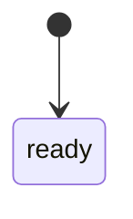

# permission-gate

> 工具分发前 permission 裁决：路径、网络域、MCP 允许列表、进程工作区，默认拒绝未列出

子包：`security-infra`　代码：`security-infra/permission-gate.ts`

## 状态图

## 状态清单

- `ready`
- `allowed`
- `blocked`

## spec 锚点

- `llmanspec/specs/domain-security/domain-security.feature#@req:r64`
- `llmanspec/specs/domain-security/domain-security.feature#@req:r65`
- `llmanspec/specs/domain-security/domain-security.feature#@req:r66`
- `llmanspec/specs/domain-security/domain-security.feature#@req:r44`
- `llmanspec/specs/domain-security/domain-security.feature#@req:r50`
- `llmanspec/specs/domain-security/domain-security.feature#@req:r53`
- `llmanspec/specs/domain-security/domain-security.feature#@req:r1423`
- `llmanspec/specs/domain-security/domain-security.feature#@req:r1424`
- `llmanspec/specs/domain-security/domain-security.feature#@req:r3258`

## 实现落点

- `crates/xylitol-runtime/src/permission/policy.rs`
