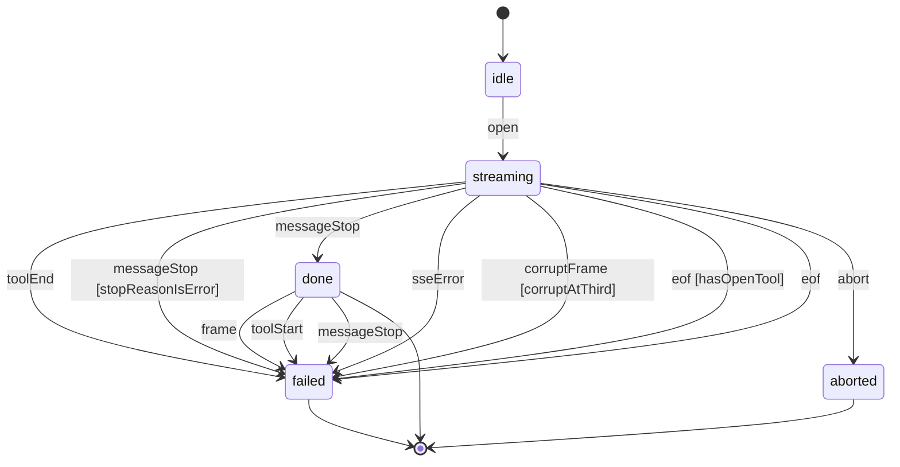

# provider-stream-terminal

> Provider SSE 流终态约束：Done 唯一、坏帧守卫、结构化错误、abort finalize、stop_reason 映射

子包：`security-infra`　代码：`security-infra/provider-stream-terminal.ts`

## 状态图

## 状态清单

- `idle`
- `streaming`
- `done`
- `failed`
- `aborted`

## spec 锚点

- `llmanspec/specs/infra-provider/infra-provider.feature#@req:r3308`
- `llmanspec/specs/infra-provider/infra-provider.feature#@req:r3012`
- `llmanspec/specs/infra-provider/infra-provider.feature#@req:r3013`
- `llmanspec/specs/infra-provider/infra-provider.feature#@req:r3022`
- `llmanspec/specs/infra-provider/infra-provider.feature#@req:r3354`
- `llmanspec/specs/infra-otel/infra-otel.feature#@req:r1474`

## 实现落点

- `plugins/xylitol-official-plugin-provider-anthropic/src/provider/`
