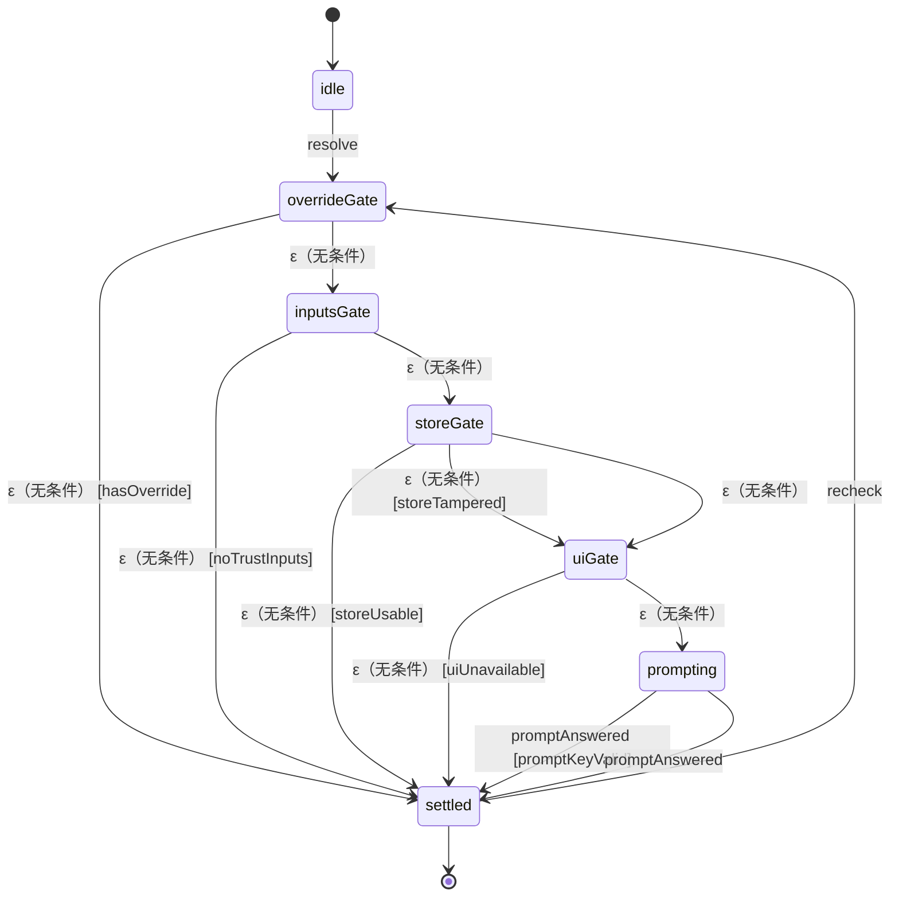

# trust-resolution

> 项目信任按固定优先级解析：覆盖、无输入、store、UI 提示、回退拒绝

子包：`security-infra`　代码：`security-infra/trust-resolution.ts`

## 状态图

## 状态清单

- `idle`
- `overrideGate`
- `inputsGate`
- `storeGate`
- `uiGate`
- `prompting`
- `settled`

## spec 锚点

- `llmanspec/specs/domain-security/domain-security.feature#@req:r73`
- `llmanspec/specs/domain-security/domain-security.feature#@req:r72`
- `llmanspec/specs/domain-security/domain-security.feature#@req:r71`
- `llmanspec/specs/domain-security/domain-security.feature#@req:r74`
- `llmanspec/specs/domain-security/domain-security.feature#@req:r75`
- `llmanspec/specs/domain-security/domain-security.feature#@req:r3216`
- `llmanspec/specs/domain-security/domain-security.feature#@req:r3218`
- `llmanspec/specs/domain-security/domain-security.feature#@req:r3219`
- `llmanspec/specs/domain-security/domain-security.feature#@req:r3220`
- `llmanspec/specs/app-tui-trust/app-tui-trust.feature#@req:r3307`
- `llmanspec/specs/app-tui-trust/app-tui-trust.feature#@req:r3223`

## 实现落点

- `crates/xylitol-runtime/src/trust/resolve.rs`
